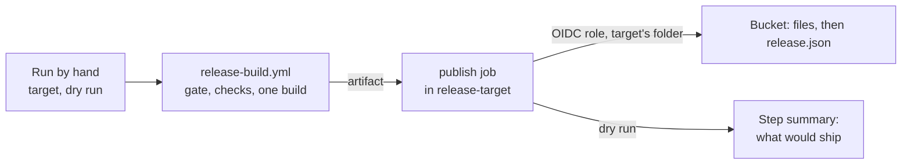

# Workflows: the checks and a release by hand

A repository's two workflows, as one fixture holds them: the checks every pull request runs, and a
release by hand that builds once and publishes to a bucket. Every file below is the fixture's own:

- The workflows pass actionlint (its wasm build, 2.0.6), and every `run:` block passes ShellCheck
  0.11. The wasm build predates the `vars` context and the `macos-15` runner, so its messages about
  those two are set apart as stale; it reported nothing else.
- The release scripts pass their 11 tests: stub servers stand in for the published manifest, and
  fake `aws` and `gcloud` commands record what the publish runs. A dry run against a manifest that
  answers 500 crashed on an unset variable before its test was added.
- Every action's pin was checked against its latest release on GitHub.
- The workflows were not run on GitHub: they need a repository with these environments.

The cloud access the publish job uses is `ci-cloud-oidc`'s; its references hold the AWS roles and
the Google Cloud setup.



## 1. The checks

```yaml
name: Checks

# Every pull request and every push to main: install from the lockfile, typecheck, test, and build.
# Required by main's branch rule, so nothing merges that fails here.
on:
  pull_request:
  push:
    branches: [main]

permissions: {}

concurrency:
  group: checks-${{ github.event.pull_request.number || github.ref }}
  # a newer push replaces a pull request's run; a push to main always runs to the end
  cancel-in-progress: ${{ github.event_name == 'pull_request' }}

jobs:
  checks:
    runs-on: ubuntu-latest
    timeout-minutes: 15
    permissions:
      contents: read
    steps:
      # event data is input: it reaches the shell through env, quoted, never through ${{ }}
      - name: Check the pull request's title
        if: github.event_name == 'pull_request'
        env:
          TITLE: ${{ github.event.pull_request.title }}
        run: |
          if [[ ! "$TITLE" =~ ^[a-z0-9-]+:\ .+ ]]; then
            echo "::error::Start the title with its area, as in 'web: Add the sign-in page'"
            exit 1
          fi
      - uses: actions/checkout@3d3c42e5aac5ba805825da76410c181273ba90b1 # v7.0.1
        with:
          persist-credentials: false
      - uses: pnpm/action-setup@73e46992e05b19abd31f2f3c20e0e7370d762115 # v6.1.1
      - uses: actions/setup-node@949feb2413d6458794dcd2491c4babbbce0c15c1 # v7.1.0
        with:
          node-version: "24"
          cache: pnpm
      - name: Install from the lockfile
        run: pnpm install --frozen-lockfile
      - name: Typecheck
        run: pnpm typecheck
      - name: Test
        run: pnpm test
      - name: Build
        run: pnpm build
```

- **The title check reads the title from `env:`**, quoted. Written as
  `[[ "${{ github.event.pull_request.title }}" =~ … ]]`, a title holding `"; curl … #` would run.
- **The concurrency group** cancels a pull request's run when it gets a new push, and lets every
  push to `main` run to the end.
- **The job asks for `contents: read` only**, and the checkout keeps no token, so the install's
  scripts cannot push or comment.

## 2. A release by hand

The build is a reusable workflow, so each release workflow (this one to S3, `ci-cloud-oidc`'s to
Cloud Storage) builds the same way and publishes the bytes its checks passed.

```yaml
name: Release build

# Called by each release workflow: checks the version against what the target has published, runs
# the checks, builds once, and keeps the build as this run's artifact, so the bytes a publish job
# ships are the bytes these steps checked. Holds no secret and no cloud access.
on:
  workflow_call:
    inputs:
      target:
        type: string
        required: true
      dry_run:
        type: boolean
        required: true
      first_release:
        type: boolean
        required: true
    outputs:
      version:
        description: The version this run releases
        value: ${{ jobs.build.outputs.version }}

permissions: {}

jobs:
  build:
    runs-on: ubuntu-latest
    timeout-minutes: 20
    permissions:
      contents: read
    outputs:
      version: ${{ steps.gate.outputs.version }}
    steps:
      - uses: actions/checkout@3d3c42e5aac5ba805825da76410c181273ba90b1 # v7.0.1
        with:
          persist-credentials: false
      # first, before the install: a refused run costs seconds
      - name: Check the target and the version
        id: gate
        env:
          TARGET: ${{ inputs.target }}
          DRY_RUN: ${{ inputs.dry_run }}
          FIRST_RELEASE: ${{ inputs.first_release }}
          RELEASES_URL: ${{ vars.RELEASES_URL }}
          RELEASE_BRANCH: ${{ vars.RELEASE_BRANCH }}
        run: scripts/release/check-version.sh
      - uses: pnpm/action-setup@73e46992e05b19abd31f2f3c20e0e7370d762115 # v6.1.1
      # no cache: what ships is built from the lockfile's packages, never from a restored store
      - uses: actions/setup-node@949feb2413d6458794dcd2491c4babbbce0c15c1 # v7.1.0
        with:
          node-version: "24"
      - name: Install from the lockfile
        run: pnpm install --frozen-lockfile
      - name: Typecheck and test
        run: pnpm typecheck && pnpm test
      - name: Build
        run: pnpm build
      # the manifest names the version and the commit; it is published last
      - name: Write the manifest
        env:
          VERSION: ${{ steps.gate.outputs.version }}
        run: printf '{"version":"%s","commit":"%s"}\n' "$VERSION" "$GITHUB_SHA" > dist/release.json
      - uses: actions/upload-artifact@cf430e030ddbb5b0abf93d22962f4752f3646cd9 # v7.0.2
        with:
          name: release-build
          path: dist/
          if-no-files-found: error
          retention-days: 7
```

````yaml
name: Release

# Run by hand with a target: builds once, then publishes the build to the target's folder in the
# release bucket on S3, the manifest last. Each target's environment holds its role and decides
# which branches reach it: dev protected branches, prod the release branch. A dry run, the default,
# does all of it but publish, and reports what a real run would refuse instead of stopping.
on:
  workflow_dispatch:
    inputs:
      target:
        description: Where to publish
        type: choice
        options: [dev, prod]
        default: dev
      dry_run:
        description: "Dry run: build and sign in, publish nothing"
        type: boolean
        default: true
      first_release:
        description: "The target's first release: read a 403 from its manifest as nothing published"
        type: boolean
        default: false

# One run per target at a time: a second waits, then finds its version published and stops.
concurrency:
  group: release-${{ inputs.target }}
  cancel-in-progress: false

permissions: {}

jobs:
  build:
    permissions:
      contents: read
    uses: ./.github/workflows/release-build.yml
    with:
      target: ${{ inputs.target }}
      dry_run: ${{ inputs.dry_run }}
      first_release: ${{ inputs.first_release }}

  publish:
    needs: build
    runs-on: ubuntu-latest
    timeout-minutes: 15
    # RELEASE_AWS_ROLE_ARN and RELEASE_S3_FOLDER: the target's role, which trusts only this
    # environment and writes only RELEASE_S3_FOLDER
    environment: release-${{ inputs.target }}
    permissions:
      contents: read
      id-token: write # the token the role is assumed with
    steps:
      # the environment's variables, which the build cannot see, before anything else
      - name: Check the environment's variables
        env:
          ROLE_ARN: ${{ vars.RELEASE_AWS_ROLE_ARN }}
          REGION: ${{ vars.RELEASE_AWS_REGION }}
          FOLDER: ${{ vars.RELEASE_S3_FOLDER }}
        run: |
          need() { test -n "$1" || { echo "::error::set the variable $2 in this environment"; exit 1; }; }
          need "$ROLE_ARN" RELEASE_AWS_ROLE_ARN
          need "$REGION" RELEASE_AWS_REGION
          need "$FOLDER" RELEASE_S3_FOLDER
      - uses: actions/checkout@3d3c42e5aac5ba805825da76410c181273ba90b1 # v7.0.1
        with:
          persist-credentials: false
          sparse-checkout: scripts/release
      - uses: actions/download-artifact@9000827ccba6bdab643e8b6fd33ac0654aef8333 # v8.0.2
        with:
          name: release-build
          path: dist
      # credentials for an hour and no stored key; a dry run signs in too, which proves the role's
      # trust before a real run needs it
      - uses: aws-actions/configure-aws-credentials@e1253824e5c10ff9df46874f81ed3ec929e19cfd # v6.3.0
        with:
          role-to-assume: ${{ vars.RELEASE_AWS_ROLE_ARN }}
          aws-region: ${{ vars.RELEASE_AWS_REGION }}
      - name: Dry run (nothing published)
        if: inputs.dry_run
        env:
          FOLDER: ${{ vars.RELEASE_S3_FOLDER }}
          VERSION: ${{ needs.build.outputs.version }}
        run: |
          {
            echo "### Dry run: nothing published"
            echo "would publish $VERSION to \`$FOLDER\`:"
            echo '```'
            find dist -type f | sort
            echo '```'
          } >> "$GITHUB_STEP_SUMMARY"
      - name: Publish
        if: ${{ !inputs.dry_run }}
        env:
          FOLDER: ${{ vars.RELEASE_S3_FOLDER }}
          VERSION: ${{ needs.build.outputs.version }}
        run: |
          scripts/release/publish-s3.sh dist "$FOLDER"
          echo "::notice::published $VERSION to $FOLDER"
````

- **The gate runs before the install**, so a refused run costs seconds, and a dry run reports a
  refusal as a warning and goes on. `first_release`, false by default, is the one way a 403 from the
  manifest passes: a first release says so, and a bucket whose reads broke stops the run.
- **The release build restores no cache**: it installs from the registry, since a cache the default
  branch's other workflows can write would reach what ships. `checks.yml` caches; it ships nothing.
- **The publish job names its environment**, which gives it the target's variables and, through its
  subject, the target's role. It installs and builds nothing, so no package's code runs where the
  OIDC token can be asked for. The build job names no environment and holds no cloud access.
- **The checkout in the publish job is sparse**: it needs only the publish script.
- **Variables the publish job reads** live in each target's environment:

| Where                 | Name                                         | Holds                                       |
| --------------------- | -------------------------------------------- | ------------------------------------------- |
| Repository variables  | `RELEASES_URL`                               | The public folder of the targets, no slash  |
| Repository variables  | `RELEASE_BRANCH`                             | The branch prod releases from               |
| Environment variables | `RELEASE_AWS_ROLE_ARN`, `RELEASE_AWS_REGION` | The target's role (`ci-cloud-oidc`)         |
| Environment variables | `RELEASE_S3_FOLDER`                          | `s3://<bucket>/<folder>`, the role's folder |

- **Each environment's deployment branch rule** admits protected branches to `release-dev` and the
  release branch alone to `release-prod`, with a required reviewer.

## 3. The release scripts

The gate is a script, not inline YAML, so its every case runs under test.

```bash
#!/usr/bin/env bash
# Checks a release before anything is built: the target, its branch, and that package.json's version
# is newer than the one the target has published. A dry run reports what a real run would refuse
# instead of stopping. Writes `version` to $GITHUB_OUTPUT.
#
# Reads TARGET (dev or prod), DRY_RUN and FIRST_RELEASE (true or false), RELEASES_URL (the public
# folder of the targets, no trailing slash), RELEASE_BRANCH (the branch prod releases from),
# GITHUB_REF, GITHUB_OUTPUT, and RUNNER_TEMP.
set -euo pipefail

fail() {
  echo "::error::$1"
  exit 1
}

# what a real run refuses, a dry run only reports
refuse() {
  if [ "$DRY_RUN" = true ]; then
    echo "::warning::a real run stops here: $1"
  else
    fail "$1"
  fi
}

case "$TARGET" in
  dev | prod) ;;
  *) fail "the target must be dev or prod, not $TARGET" ;;
esac

test -n "$RELEASES_URL" || fail "set the repository variable RELEASES_URL"
test -n "$RELEASE_BRANCH" || fail "set the repository variable RELEASE_BRANCH"
case "$RELEASES_URL" in */) fail "write RELEASES_URL without the trailing slash" ;; esac

if [ "$TARGET" = prod ] && [ "$GITHUB_REF" != "refs/heads/$RELEASE_BRANCH" ]; then
  refuse "prod releases from $RELEASE_BRANCH, not ${GITHUB_REF#refs/heads/}"
fi

# MAJOR.MINOR.PATCH only: sort -V orders those as semver does, but not pre-releases
semver='^[0-9]+\.[0-9]+\.[0-9]+$'
version=$(node -p 'require("./package.json").version')
[[ $version =~ $semver ]] || fail "the version must be MAJOR.MINOR.PATCH, not $version"

# a manifest that cannot be read stops the run, so a network error never lets an old version out
manifest="$RUNNER_TEMP/release.json"
published=
status=$(curl -s -o "$manifest" -w '%{http_code}' "$RELEASES_URL/$TARGET/release.json" || true)
case "$status" in
  404) ;;
  # a bucket that may not be listed answers 403 for a missing key, but so does one whose reads broke,
  # which would let any version out: only a first release, said so, reads 403 as nothing published
  403)
    if [ "${FIRST_RELEASE:-false}" != true ]; then
      refuse "the $TARGET manifest answered HTTP 403: if $TARGET has never been released, run with first_release"
    fi
    ;;
  200)
    published=$(node -p 'JSON.parse(require("fs").readFileSync(0, "utf8")).version' < "$manifest" 2> /dev/null || true)
    [[ $published =~ $semver ]] || refuse "cannot read the version in the $TARGET manifest"
    ;;
  *) refuse "cannot check the version: the $TARGET manifest answered HTTP $status" ;;
esac

newest=$(printf '%s\n%s\n' "$version" "$published" | sort -V | tail -n 1)
if [ -n "$published" ] && { [ "$version" = "$published" ] || [ "$newest" != "$version" ]; }; then
  refuse "$TARGET already has $published: raise the version in package.json (it says $version)"
fi

echo "::notice::$TARGET $version (published: ${published:-nothing})"
echo "version=$version" >> "$GITHUB_OUTPUT"
```

```bash
#!/usr/bin/env bash
# Publishes a build folder to its target's folder on S3: every file but the manifest first, then the
# manifest, never cached, so a reader never sees a manifest that names a file not there yet.
# Usage: publish-s3.sh <build-folder> <s3://bucket/prefix/target>
set -euo pipefail

build_path=$1
folder=$2

test -f "$build_path/release.json" || {
  echo "::error::$build_path has no release.json"
  exit 1
}

aws s3 cp "$build_path" "$folder" --recursive --exclude release.json --only-show-errors
aws s3 cp "$build_path/release.json" "$folder/release.json" --cache-control no-store --only-show-errors
```

```ts
import assert from "node:assert/strict";
import { spawn } from "node:child_process";
import fs from "node:fs";
import http from "node:http";
import type { AddressInfo } from "node:net";
import os from "node:os";
import path from "node:path";
import { after, before, describe, it } from "node:test";
import { fileURLToPath } from "node:url";

const SCRIPTS_PATH = fileURLToPath(new URL("../scripts/release", import.meta.url));

type Run = { exitCode: number | null; output: string; githubOutput: string };

/** Runs a script with its own temporary folder as the working folder and RUNNER_TEMP. */
function runScript(
  script: string,
  argList: readonly string[],
  env: Readonly<Record<string, string>>,
  workPath: string
): Promise<Run> {
  const githubOutputPath = path.join(workPath, "github-output");

  fs.writeFileSync(githubOutputPath, "");

  return new Promise(resolve => {
    const child = spawn("bash", [path.join(SCRIPTS_PATH, script), ...argList], {
      cwd: workPath,
      env: { ...process.env, ...env, GITHUB_OUTPUT: githubOutputPath, RUNNER_TEMP: workPath }
    });
    let output = "";

    child.stdout.on("data", chunk => (output += chunk));
    child.stderr.on("data", chunk => (output += chunk));
    child.on("exit", exitCode => {
      resolve({ exitCode, output, githubOutput: fs.readFileSync(githubOutputPath, "utf8") });
    });
  });
}

const makeWorkPath = (): string => fs.mkdtempSync(path.join(os.tmpdir(), "release-script-"));

describe("check-version.sh", () => {
  // /<case>/<target>/release.json answers as its case says
  const manifestMap: Readonly<Record<string, [number, string]>> = {
    older: [200, '{"version":"1.3.9"}'],
    same: [200, '{"version":"1.4.0"}'],
    newer: [200, '{"version":"1.5.0"}'],
    unlisted: [403, ""],
    missing: [404, ""],
    down: [500, ""],
    garbled: [200, "<html>"]
  };
  const server = http.createServer((request, response) => {
    const [status, body] = manifestMap[request.url?.split("/")[1] ?? ""] ?? [404, ""];

    response.writeHead(status);
    response.end(body);
  });
  let origin = "";

  before(async () => {
    await new Promise<void>(resolve => server.listen(0, "127.0.0.1", resolve));

    origin = `http://127.0.0.1:${(server.address() as AddressInfo).port}`;
  });

  after(() => server.close());

  const check = (feed: string, change: Readonly<Record<string, string>> = {}): Promise<Run> => {
    const workPath = makeWorkPath();

    fs.writeFileSync(path.join(workPath, "package.json"), '{"version":"1.4.0"}');

    return runScript(
      "check-version.sh",
      [],
      {
        TARGET: "dev",
        DRY_RUN: "false",
        RELEASES_URL: `${origin}/${feed}`,
        RELEASE_BRANCH: "release",
        GITHUB_REF: "refs/heads/main",
        ...change
      },
      workPath
    );
  };

  it("passes a version newer than the published one, and outputs it", async () => {
    const run = await check("older");

    assert.equal(run.exitCode, 0);
    assert.equal(run.githubOutput, "version=1.4.0\n");
  });

  it("reads a 404 as nothing published", async () => {
    assert.equal((await check("missing")).exitCode, 0);
  });

  it("reads a 403 as nothing published only in a first release", async () => {
    assert.match((await check("unlisted")).output, /answered HTTP 403: .* run with first_release/);
    assert.equal((await check("unlisted", { FIRST_RELEASE: "true" })).exitCode, 0);
  });

  it("refuses the published version and an older one", async () => {
    assert.match((await check("same")).output, /dev already has 1\.4\.0/);
    assert.equal((await check("newer")).exitCode, 1);
  });

  it("stops when the manifest cannot be read", async () => {
    assert.match((await check("down")).output, /answered HTTP 500/);
    assert.match((await check("garbled")).output, /cannot read the version/);
  });

  it("refuses prod off the release branch, and allows it on it", async () => {
    assert.match((await check("older", { TARGET: "prod" })).output, /prod releases from release/);
    assert.equal(
      (await check("older", { TARGET: "prod", GITHUB_REF: "refs/heads/release" })).exitCode,
      0
    );
  });

  it("only reports a refusal in a dry run, an unreadable manifest included", async () => {
    for (const feed of ["same", "down", "unlisted"]) {
      const run = await check(feed, { DRY_RUN: "true" });

      assert.equal(run.exitCode, 0, run.output);
      assert.match(run.output, /::warning::a real run stops here/);
    }
  });

  it("stops on a missing setting whatever the dry run says", async () => {
    assert.match(
      (await check("older", { RELEASES_URL: "", DRY_RUN: "true" })).output,
      /set the repository variable RELEASES_URL/
    );
    assert.match((await check("older/")).output, /without the trailing slash/);
    assert.match((await check("older", { TARGET: "staging" })).output, /must be dev or prod/);
  });
});

/** A folder holding a fake CLI that logs each call's arguments, one line each. */
function makeFakeCli(name: string, workPath: string): { binPath: string; logPath: string } {
  const binPath = path.join(workPath, "bin");
  const logPath = path.join(workPath, `${name}.log`);

  fs.mkdirSync(binPath);
  fs.writeFileSync(path.join(binPath, name), `#!/usr/bin/env bash\necho "$*" >> "${logPath}"\n`, {
    mode: 0o755
  });

  return { binPath, logPath };
}

const makeBuild = (workPath: string, isWithManifest = true): string => {
  const buildPath = path.join(workPath, "dist");

  fs.mkdirSync(path.join(buildPath, "assets"), { recursive: true });
  fs.writeFileSync(path.join(buildPath, "assets", "app.js"), "");

  if (isWithManifest) {
    fs.writeFileSync(path.join(buildPath, "release.json"), '{"version":"1.4.0"}');
  }

  return buildPath;
};

describe("publish-s3.sh", () => {
  it("copies every file but the manifest, then the manifest uncached", async () => {
    const workPath = makeWorkPath();
    const { binPath, logPath } = makeFakeCli("aws", workPath);
    const buildPath = makeBuild(workPath);
    const run = await runScript(
      "publish-s3.sh",
      [buildPath, "s3://releases/app/dev"],
      { PATH: `${binPath}:${process.env.PATH}` },
      workPath
    );

    assert.equal(run.exitCode, 0);
    assert.deepEqual(fs.readFileSync(logPath, "utf8").trim().split("\n"), [
      `s3 cp ${buildPath} s3://releases/app/dev --recursive --exclude release.json --only-show-errors`,
      `s3 cp ${buildPath}/release.json s3://releases/app/dev/release.json --cache-control no-store --only-show-errors`
    ]);
  });

  it("refuses a build without a manifest, before copying anything", async () => {
    const workPath = makeWorkPath();
    const { binPath, logPath } = makeFakeCli("aws", workPath);
    const run = await runScript(
      "publish-s3.sh",
      [makeBuild(workPath, false), "s3://releases/app/dev"],
      { PATH: `${binPath}:${process.env.PATH}` },
      workPath
    );

    assert.equal(run.exitCode, 1);
    assert.equal(fs.existsSync(logPath), false);
  });
});

describe("publish-gcs.sh", () => {
  it("copies the folder without the manifest, then the manifest uncached", async () => {
    const workPath = makeWorkPath();
    const { binPath, logPath } = makeFakeCli("gcloud", workPath);
    const buildPath = makeBuild(workPath);
    const run = await runScript(
      "publish-gcs.sh",
      [buildPath, "gs://releases/app/dev"],
      { PATH: `${binPath}:${process.env.PATH}` },
      workPath
    );
    const [first, second] = fs.readFileSync(logPath, "utf8").trim().split("\n");

    assert.equal(run.exitCode, 0);
    assert.equal(first, `storage cp --recursive ${buildPath}/* gs://releases/app/dev/`);
    assert.match(
      second ?? "",
      /^storage cp \S+\/release\.json gs:\/\/releases\/app\/dev\/release\.json --cache-control=no-store$/
    );
    assert.equal(fs.existsSync(path.join(buildPath, "release.json")), false);
  });
});
```

## 4. Pinned actions, kept current

```yaml
version: 2
updates:
  # Keeps every pinned action at its latest release: a pull request moves the commit and its tag
  # comment together, and the checks run on it like on any change.
  - package-ecosystem: github-actions
    directory: /
    schedule:
      interval: weekly
    groups:
      actions:
        patterns: ["*"]
```

## 5. Linting a workflow

The fixture's linter runs actionlint over each workflow and ShellCheck over each `run:` block, with
every `${{ }}` replaced by a placeholder.

```js
// Lints workflow files with actionlint (its wasm build), then ShellCheck over every `run:` block,
// with each `${{ }}` replaced by a placeholder. Usage: node tools/lint-workflows.mjs <file>…
// The wasm build predates the `vars` context and the macos-15 runner, so those two messages are
// counted apart as known-stale, never as findings.
import { spawnSync } from "node:child_process";
import fs from "node:fs";
import path from "node:path";

import { createLinter } from "actionlint";
import YAML from "yaml";

const shellcheckPath = new URL("../node_modules/shellcheck/bin/shellcheck", import.meta.url)
  .pathname;
const runActionlint = await createLinter();
const STALE_PATTERN_LIST = [/undefined variable "vars"/, /label "macos-15" is unknown/];
let findingCount = 0;
let staleCount = 0;

for (const filePath of process.argv.slice(2)) {
  const text = fs.readFileSync(filePath, "utf8");

  for (const result of runActionlint(text, path.basename(filePath))) {
    if (STALE_PATTERN_LIST.some(pattern => pattern.test(result.message))) {
      staleCount += 1;

      continue;
    }

    findingCount += 1;
    console.log(`${filePath}:${result.line}:${result.column} ${result.kind}: ${result.message}`);
  }

  const workflow = YAML.parse(text);

  for (const [jobName, job] of Object.entries(workflow.jobs ?? {})) {
    for (const step of job.steps ?? []) {
      if (!step.run) {
        continue;
      }

      const script = `#!/usr/bin/env bash\nset -eo pipefail\n${step.run.replace(/\$\{\{[^}]*\}\}/g, "PLACEHOLDER")}`;
      const check = spawnSync(shellcheckPath, ["-s", "bash", "-"], {
        input: script,
        encoding: "utf8"
      });

      if (check.status !== 0) {
        findingCount += 1;
        console.log(
          `${filePath} ${jobName} "${step.name ?? step.run.slice(0, 30)}":\n${check.stdout}`
        );
      }
    }
  }
}

console.log(`${findingCount} findings (${staleCount} known-stale messages set apart)`);
process.exitCode = findingCount ? 1 : 0;
```

A repository with a current actionlint (`brew install actionlint`, or its release binary) runs it
directly: it calls ShellCheck itself and knows every context and runner label.

## Porting

- **A release on a version bump**: trigger on pushes to the default branch as well, and on a push
  have the gate write `skip=true` for a version already published, exit 0, and the later jobs run
  `if: needs.build.outputs.skip != 'true'`. A refusal would turn every merge without a bump red.
- **A package registry**: `npm publish --provenance` takes the same `id-token: write` and signs the
  package's origin; the token to publish comes from the registry's trusted publishing, not a stored
  secret.
- **A container image**: build and push in one job with the registry's OIDC sign-in, push by digest,
  and move the tag last, like the manifest here.
- **Another CI**: the rules hold; each CI spells permissions, environments, and OIDC its own way.
