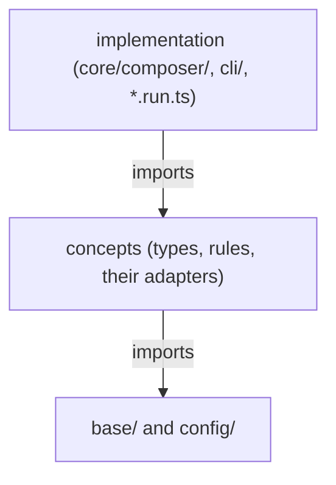

# Code Architecture

How TypeScript tooling under `src/` is built. The consuming repository names its scope, its libs,
and its checks in its own wrapper skill or AGENTS.md. Examples use `report-builder` (`RB` / `Rb`)
and `@<scope>/lib-zip` (`ZIP` / `Zip`).

**Package names and folders follow the consuming repository.** Take its scope, its name pattern, and
where its packages live from its wrapper skill or `AGENTS.md`; when neither says, follow what its
existing `package.json` files already do. `@<scope>/lib-<folder>` under `src/libs/` and
`@<scope>/app-<folder>` under `src/apps/` are this skill's layout, not a rename to impose. When
existing names disagree with each other, or the repository has no packages and states no convention,
ask the user before naming or placing a package, and offer this layout as the default.
`code-standards` decides the shape of code inside a module; this skill decides where code lives,
which package owns it, and how packages connect.

## When to use

**MUST** apply when creating, moving, renaming, or splitting a module, folder, or package under
`src/apps/` or `src/libs/`; adding or moving a dependency; deciding whether code belongs in a skill
script, an app, or a lib; and reviewing any change under `src/`.

## Scope

- `src/apps/**`, `src/libs/**`
- The workspace manifest, environment tsconfig bases, and the lint config's `src/**` overrides

## Where code lives

| Code                                                                        | Home                                                 |
| --------------------------------------------------------------------------- | ---------------------------------------------------- |
| Workflow, judgement, review steps, user-edit protocol, delegation           | The skill's `SKILL.md`                               |
| Inputs for one use: profiles, starter files, brand rules                    | The skill's `assets/`                                |
| A helper one skill runs: one job, no tests of its own                       | The skill's `scripts/`, run with `node --import tsx` |
| An engine: several modules, its own tests, or an input contract to document | An app, `src/apps/<app>/`                            |
| Code two packages use                                                       | A lib, `src/libs/<lib>/`                             |

- **One home per domain.** A domain is one area of knowledge the code relies on: an operating
  system, an external service, a file format, a tool, a workflow. Everything that belongs to it —
  its entities and types, the abstractions over it, its constants and paths, its configuration, and
  the adapters that reach it — lives in one home: the package that owns the domain, or one folder
  inside a package while only that package needs it. Every other place imports from that home. A
  second copy, even one line or one literal, is a defect: copies drift, and a reader cannot tell
  which one is right. A consumer keeps only what is its own — which part of the domain it uses and
  why — and asks the home for the rest. When a second package needs a domain that lives inside one
  package, the domain moves to a lib; it is never copied. The bullets below apply this rule; the
  lint and the checks enforce the parts they can.
- **An app is generic.** Every specific — template, profile, content, output path — arrives on argv
  or in a file named on argv. Nothing defaults to one template: report-builder requires
  `--profile <path>`, so a second template needs a profile, not code.
- **The skill is the agentic plane.** It runs the app as `pnpm app:<app> <command>` and never
  imports `src/`. The app's README and `docs/` own the engine facts (commands, input contract,
  engine notes) and `SKILL.md` links them instead of restating them. A behaviour change goes into
  the app, where every caller gets it.
- **A lib waits for its second consumer.** Code generic in shape but used by one package stays in
  that package until a second package needs it.
- **An operating system's layout lives in its platform lib.** Where the system installs
  applications, where it keeps per-user data, caches, and sandboxed app storage, and where its
  package managers put tools are facts of the platform, not of the package that needs them. The
  platform's lib exposes them as named paths built from what the caller passes in (a home folder, an
  application or bundle name); a package passes its own specifics and never spells a platform
  location itself, so supporting another system, or a new install location, changes one lib. The
  lint rejects platform locations outside the platform's lib and tests.

## Dependency direction

- Nothing under `src/` imports the skill tree.
- A lib never imports an app. An app never imports another app; code both need moves into a lib.
- A lib may depend on another lib (the PDF lib on the platform lib); the graph stays acyclic.
- A package reaches another only through its barrel, `@<scope>/lib-<folder>` or
  `@<scope>/app-<folder>`. `exports` lists only `.`, so a deep path does not resolve.
- Only a `<name>.adapter.ts` file imports a process or native library (`node:child_process`, resvg,
  Prism, puppeteer, mermaid-cli) or the API of the host the app runs inside (an editor's, a desktop
  shell's, a browser's extension API); the rest of the code calls the adapter. An app with several
  tools to run keeps one process runner in `base/` (`RB.base.ProcessRunner`), and each tool's
  wrapper takes it as a collaborator, so its arguments and parsing test without a process. An OS
  facility two apps use (`osascript`, `textutil`, `zip`, Office export) is a lib adapter.
- A process takes its inputs as an argv array through `execFile`, never interpolated into a shell
  command or script text, so a path with quotes or spaces cannot break out.
- **The host is an outside system.** In an app that runs inside a framework's process, the code that
  does the app's work imports neither the framework nor its types. Each need of the host (windows,
  dialogs, notifications, storage paths, its message bus) is a port in the concept's `types.ts` that
  a host adapter implements; an adapter with no other use for the host gets the host's functions
  passed in by the composition root (the host's `fetch` as its `Fetch` port). The work then tests on
  fakes, with no host running.
- **Errors are translated where they are understood.** The adapter that runs requests gives every
  call a timeout and turns a network failure into its unreachable error; the API client over it
  turns an error status into its API error, carrying the server's own message (and surviving a
  proxy's HTML error page); the same client maps the statuses that mean something to its callers
  into their outcomes or errors (409 "already running" → busy), per `code-standards` § Outcomes and
  faults. Nothing above the client reads a status code or a transport error.

ESLint enforces the import rules. The overrides for `src/apps/**/*.adapter.ts` and
`src/libs/**/*.adapter.ts` are the allowlist, so a new adapter needs only its suffix.

## Layers

A package is built bottom-up in three layers, and a module imports only from its own layer or the
ones below it:

1. **Base** (`base/`, and `config/` beside it) — what knows none of the package's concepts. `base/`
   holds stateless functions in `base/utils/`, generic classes (a cache, an Observer), an adapter no
   concept owns (a process runner), and the errors they throw. `config/` holds the package's
   settings and static inputs; every layer may read it, and it imports nothing above it.
2. **Core** (`core/<concept>/`) — the package's concepts: their types and interfaces in the folder's
   `types.ts`, the rules, the classes that hold them, their typed errors, and the adapters and
   strategies that implement the concept's interfaces, beside the code they serve. An adapter that
   implements a concept's interface lives with that concept, never in `base/`.
3. **Implementation** — what wires and runs the core: the composition root and use cases in
   `core/composer/`, and the entry layer (`cli/` and the `*.run.ts` entries in an app; in a lib, the
   ready instances its barrel hands out). No concept imports it.

- **Decompose before writing.** For a new package, or a module that grew a second job, name what is
  base (it knows none of the package's concepts), what is core (a concept and its contract), and
  what wires them, then give each its folder. A module that mixes layers splits along them: a
  command-line module holding an argv tokenizer, a flag reader with its usage error, and the run
  loop that dispatches commands becomes `base/utils/argv-parser.ts`, `core/` for the reader and the
  error, and the runner on top.
- **The lint region fails an import from a higher layer**, through the `#<folder>/` alias or a `../`
  path: `base/` or `config/` importing `core/` or `cli/`, a concept importing `core/composer/` or
  `cli/`, and `core/composer/` importing `cli/`. A barrel the module imports is not followed, so a
  module reaches only its own layer and the ones below through it.
- **The same split holds between packages.** Contracts and environment-free logic live in a
  `universal` lib; the implementation for one environment or tool lives in a lib or app on top of it
  (a log lib of loggers and sink interfaces, a server log lib of the sinks that write to a process),
  never the reverse.
- **Folders arrive with the code.** A lib stays flat (`src/<module>.ts`) while its modules all sit
  in one layer; once they span two, it takes the layer folders, and an empty layer has no folder.

## Package anatomy

Every folder under `src/apps/` and `src/libs/` is a private pnpm workspace package, consumed as
TypeScript source through tsx with no build step.

| Path                         | Lib                    | App            | Holds                                                                                                                                                                                                         |
| ---------------------------- | ---------------------- | -------------- | ------------------------------------------------------------------------------------------------------------------------------------------------------------------------------------------------------------- |
| `package.json`               | ✅                     | ✅             | `name` `@<scope>/lib-<folder>` or `@<scope>/app-<folder>`, `private`, `type: module`, `exports: { ".": "./src/index.ts" }`, `imports: { "#<folder>/*": "./src/*" }`, `typecheck` and `test` scripts, own deps |
| `tsconfig.json`              | ✅                     | ✅             | `extends` one [environment base](#environment-tsconfigs); `include` `src/**/*.ts`, plus `test/**/*.ts` when tests exist                                                                                       |
| `README.md`                  | ✅                     | ✅             | Per [§ README contract](#readme-contract)                                                                                                                                                                     |
| `src/index.ts`               | Barrel and type root   | Type root only | Per [§ Packages, namespaces, barrels](#packages-namespaces-barrels)                                                                                                                                           |
| `src/app.ts`                 | —                      | ✅             | The private barrel, grouped by folder                                                                                                                                                                         |
| `src/cli.run.ts`             | —                      | ✅             | The entry: passes `process` as the CLI lib's runner's argv source with the command list and sets `process.exitCode` from its result                                                                           |
| `bin/run.sh`                 | When it has an entry   | ✅             | Executable; `run.sh <entry> [args…]` runs `src/<entry>.run.ts` through tsx. The same bytes in every package                                                                                                   |
| `src/cli/commands/`          | —                      | ✅             | One command interface implementation per `<name>.command.ts`                                                                                                                                                  |
| `src/cli-interactive.run.ts` | —                      | When needed    | A menu entry over the same pipeline, run as `pnpm app:<folder>:interactive`; its modules in `src/cli/interactive/`                                                                                            |
| `src/base/`                  | When needed            | When needed    | The [base layer](#layers): building blocks no concept owns, shared interfaces, generic classes, and concept-free adapters (a cache, an Observer, a process runner)                                            |
| `src/base/utils/`            | When needed            | When needed    | Stateless functions that import nothing from `core/`, one topic per file (`units.ts`, `time-formatter.ts`); no classes                                                                                        |
| `src/core/<concept>/utils/`  | When needed            | When needed    | Stateless functions over that concept's data, one topic per file (`catalog-entries.ts`); no classes                                                                                                           |
| `src/config/`                | —                      | When needed    | Runtime configuration and static inputs the app ships (paths, prompt files), beside the [base layer](#layers)                                                                                                 |
| `src/core/<concept>/`        | When needed            | ✅             | The [core layer](#layers): one folder per concept (`core/deck/`, `core/verify/`), adapters beside the domain code they serve                                                                                  |
| `test/`                      | When it has pure logic | ✅             | node:test suites mirroring `src/`, per `code-unit-tests-architecture`                                                                                                                                         |
| `docs/`                      | —                      | When needed    | An input contract too large for the README (`deck-format.md`)                                                                                                                                                 |

- **Code lives in `src/`, tests in `test/`, the launcher in `bin/run.sh`.** Nothing else sits at the
  package root; the checks fail on an entry outside the table.
- **Dependencies live where they are imported.** Workspace package dependencies use `workspace:*`,
  and pnpm's non-hoisted `node_modules` turns an undeclared one into an error. The root keeps the
  tooling (ESLint, Prettier, TypeScript, tsx) and preview CLIs.
- **Pin what changes output.** A dependency whose version changes rendered output (mermaid-cli,
  marp-cli) is pinned exactly. After a lockfile change that moves it or a library it loads,
  re-render and recheck.
- **A package's `src/` is scoped by layer**, per [§ Layers](#layers). Beside its entry files an app
  holds only `cli/` (the entry layer: `commands/`, `interactive/`), `config/`, `core/` (domain code,
  one folder per concept), and `base/` (what several concepts build on); a lib holds `core/`,
  `base/`, and its services; the checks fail on anything else. Folders that share a prefix nest
  under it (`cli/commands/`, never `cli-commands/`); a hyphen only names one concept
  (`capture-builder/`). A `core/` of more than about eight concepts groups them into sub-scopes by
  stage, beside `composer/`: report-builder's `core/input/`, `core/output/`, `core/quality/`.
- **A role suffix names what a module is, from a closed set**, after the kebab-case stem
  `code-standards` § Names gives every file. `<name>.run.ts` is an entry Node runs, and only it
  reads argv and the working folder and sets the exit code, handing the first two down; nothing
  imports it. The environment and the streams have their own owners: the env lib reads
  `process.env`, a server log lib writes stdout and stderr, and an adapter reads stdin.
  `<name>.adapter.ts` imports a process or native library; `<name>.service.ts` holds a Service class
  (in its lib) or the package's one instance of one (`env.service.ts`, `paths.service.ts`);
  `<name>.command.ts` is one command interface implementation and is all `cli/commands/` holds;
  `<name>.config.ts` holds configuration values in `config/` (`runtime.config.ts`);
  `<name>.error.ts` holds one typed error class, `<Name>Error` (`env.error.ts` holds `EnvError`,
  `cli-usage.error.ts` holds `CliUsageError`). The barrel key keeps the role except for an adapter's
  (`envService`, `buildCommand`, `runtimeConfig`, `EnvError`, but `archiveBundleSource`);
  `<name>.test.ts` and `types.ts` complete the set, and the checks fail on any other suffix or a
  misplaced one.
- **A type lives with its source.** A module declares the types it defines in its own
  `declare module` block, in its folder's namespace: a class's `INSTANCE`, a function's options and
  result, a command's report, a config's shape. A folder's `types.ts` holds only the vocabulary no
  single module defines: the role interfaces its adapters implement, with the types their signatures
  use, and the values several concepts pass between them. A `types.ts` left empty is deleted.
- **A module with no runtime value is `types.ts`.** It holds only its folder's `declare module`
  block (`core/quality/verify/types.ts`); the checks fail on any other module without a default
  export.
- **Utils sit at the level of what they know**, one topic per file, stateless, no classes.
  `base/utils/` takes functions that import nothing from `core/`: unit conversions, clock and stamp
  formatting, hashing, guards, math, and tokenizers over plain values (argv to a flag map). A
  function over one concept's data goes in that concept's `utils/`
  (`core/catalog/utils/catalog-entries.ts`). A class module holds its class and constants and no
  free functions: a helper that needs no state is a util, and one that needs the instance's state is
  a `#private` method. A module whose functions are the concept's own job, such as the deck parser,
  stays a concept module named for its role. A util two packages need moves to a lib.
- **Folders name concepts** (`deck/`, `layout/`, `verify/`), never build output. `build/` and
  `dist/` collide with ignore patterns: an unanchored `build/` hides every folder of that name from
  git and lint. Composition lives in `core/composer/`.
- **An app runs as `pnpm app:<app> <command>`.** A root script running an app is named `app:<app>`
  or `app:<app>:<variant>`; the checks check this. For example,
  `"app:<app>": "src/apps/<app>/bin/run.sh cli"`, and `"app:<app>:interactive"` with
  `cli-interactive`. `bin/run.sh` is committed in each package and says how its entries run
  (`exec node --import tsx src/<entry>.run.ts`); a TypeScript entry carries no shebang. Every copy
  holds the same bytes, which the checks enforce, so a change to one is made to all. Nothing depends
  on install state: no `bin`, no links in `node_modules/.bin`, so a clone runs the same commands as
  this checkout. Relative argv paths resolve against the repo root, where pnpm runs root scripts,
  wherever the command is typed. A pnpm built-in (`docs`, `audit`) cannot be the folder name.
- **A package owns the scripts over its own folder; the root only fans them out.** A root script
  reaches a package only through its `bin/run.sh`, never into its files, and runs package scripts
  with `pnpm -r` (`typecheck`, `test`; `build:clear` with `--parallel` when packages build), never
  globs over package folders. A package that builds names its output in its own `build:clear`. An
  app is not run through `pnpm --filter`: a filtered run is recursive, so it turns every failing
  exit into `1` (losing the CLI's `2`), adds an error box on stderr, and runs in the package folder,
  breaking relative argv paths.

### Environment tsconfigs

Each package's `tsconfig.json` extends one environment base: `universal` (the ES library only),
`server` (adds Node types), or `client` (adds the DOM). A package that runs in both places stays
`universal`, so a stray `process` or `document` fails typecheck; its suites typecheck through a
project of their own, per `code-unit-tests-architecture` § Typecheck. `pnpm typecheck` checks the
root and every package.

## Packages, namespaces, barrels

A package exposes two names and nothing else:

- **Runtime barrel** — one UPPERCASE object in the package's `index.ts` (`ZIP`) that maps each
  module by name, with no spreads. A class module default-exports the class, keyed by it
  (`ZIP.ZipArchiveRW`); a module of one ready instance or constant exports that value, keyed by it
  (`ZIP.zipExporter`, `ZIP.toolPath`). Any other module — functions, with or without constants —
  default-exports an object of them, even of one, keyed by module name
  (`RB.core.input.deck.noteTimingParser.noteSeconds`, `ZIP.xmlText.escapeXml`): the key names the
  file, and a second function joins without moving a call site. The checks fail on a
  default-exported function. No class or function is exported by name. Keys in a barrel and in a
  default-export object run in three groups, each alphabetical: PascalCase classes, camelCase
  functions, instances, and folders, then UPPER_SNAKE constants
  (`{ ShapeReader, parseShape, MAX_SIZE }`); the checks check the order.
- **A barrel ends in `as const`**, so every key, nested folders included, is read-only to the type
  checker and nothing can swap a module out of it. It is never `Object.freeze`d: no code writes to a
  barrel at run time, the callers are typechecked, and a freeze stops at the top level while the
  classes and function objects it hands out stay open.
- **PascalCase constructs, camelCase is ready.** A module that exports a class is keyed by the class
  (`RB.verify.PdfFontReader`); one that exports a ready instance is keyed camelCase by it
  (`ZIP.zipExporter.convert`). A class that would hold only static members is exported as one
  instance instead, its public members delegating to private statics (`ZIP.zipTool.isAvailable`).
  The key spells the kebab-case file stem in camelCase, with a capital first letter for a class
  (`work-dir-rw.ts` is `RB.base.WorkDirRW`), and the checks fail on a mismatch. An app keeps its
  barrel private in `app.ts`, nested exactly like its folders: one camelCase key per folder from
  `src/` (`RB.cli.interactive.InteractiveSession`, `RB.core.output.render.RendererChain`,
  `RB.base.utils.timeFormatter.formatClock`), so a key says where the code lives and which layer it
  belongs to. Its `index.ts` holds only the type root.
- **Type root** — an empty PascalCase namespace in `index.ts` (`export namespace Zip {}`). Each
  module adds its types with `declare module "<package>" { namespace Zip.Feature { … } }`; a class's
  type is `Zip.ZipArchiveRW.INSTANCE`, declared as
  `namespace ZipArchiveRW { type INSTANCE = ZipArchiveRW; }`. An app's namespaces follow the same
  folder path in PascalCase (`Rb.Core.Input.Deck`, `Rb.Cli.Interactive`, `Rb.Core.Composer`).
  Consumers write `import { ZIP, type Zip } from "<package>"`, and the inline `type` erases the
  root. A module that only declares types, with no other import or export, is a script, where
  `declare module` declares a new module instead of adding to the root: it ends with `export {};`. A
  namespace member exists only in a program that contains its declaring file, so each tsconfig
  includes the folders that declare what it reads.
- **Imports** — another package only through its barrel, never a deep path. A package reaches its
  own modules through its `#<folder>/*` alias (`#zip/zip-archive-rw.adapter.ts`, `#zip/index.ts`),
  never by its own package name, and never by `./` or `../`. Import the `.ts` file, not NodeNext's
  `.js` name. The alias needs a name after `#`: Node 22 rejects `#/…`.
- **Module scope never reads the barrel.** A module and its barrel import each other, so a top-level
  read (a constant, a static field, an `extends`) runs before the barrel exists and throws
  `Cannot access … before initialization`. Read it inside functions and methods; the `barrelLoad`
  test catches a regression.
- **Lint the shape** — named exports only in barrel files, no spreads or renamed keys in a barrel, a
  barrel object without `as const`, no types exported from a barrel, no deep cross-package imports,
  no own-package self-import by name, and `consistent-type-imports` with inline type imports.

## Inside an app

The entry, domain, and adapter layers of `code-standards` § Module organisation take this shape:

- **Entry** — `cli.run.ts` lists the commands, runs the CLI lib's runner on them, and sets
  `process.exitCode` from its result, never `process.exit()`, which can cut off output still
  buffered for a pipe. A command parses and validates its flags, wires the modules, writes, and
  returns the exit code. It gets two channels in `run(commandLine, io)`: results go verbatim to
  `io.output` (stdout), diagnostics to `io.logger`, a logger already scoped `<app> <command>`
  (stderr). Never `console` or `process.stdout`; lint bans both.
- **Domain** — returns values, reports, warnings, and expected outcomes for the command to write,
  and throws typed errors for faults (`code-standards` § Outcomes and faults). The CLI lib's
  `CliUsageError` marks bad flags, and the runner prints the command's usage after it. A class that
  must log mid-run takes the log lib's logger interface in its constructor, never a module-level
  logger, so tests pass the log lib's silent logger or a memory sink.
- **Composition root** — one class per pipeline constructs the concrete adapters and strategies and
  passes them down: `DeckBuilder` builds the `ImageCatalog` with its loaders and the
  `RendererChain`. Below it, collaborators arrive through constructors typed as interfaces. A
  process that stays up builds every part once in one root module:
  - Each part is a constant named after its class in UPPER_SNAKE (`UPLOAD_QUEUE_SERVICE`), parts of
    one kind are one object keyed by name, and every constructor gets its deps object in the
    repository's dependency order (`code-standards` § Encapsulation).
  - A part builds its own wiring. The root writes a closure or an adapter inline only when it needs
    several of the root's own values: `new ApiClient({ config, versionHeader })`, not a fetch
    wrapper written at the root.
  - The root passes inputs, never a state it assembled for a part: a store derives its starting
    state from the config and files it is given.
- **Use case** — when two entries run one workflow (a command and the interactive menu), the
  workflow is one class in `core/composer/` (`RB.core.composer.IngestUseCase`): the entries gather
  input, call it, and show the result, and neither wires the pipeline itself.
- **Lifecycle** — in a process that stays up (a server, a daemon, a watcher, an extension, a desktop
  app), each part that holds a resource, a timer, or a subscription plays one `Startable` role,
  `start()` and `dispose()`. Building a part does nothing: it touches the host, opens, or subscribes
  only in `start()`. One lifecycle class starts the parts in the composition root's order and, on
  shutdown, disposes the started ones in reverse. The part that takes requests stops first, so
  nothing answers while the rest goes down, and an error in one `dispose()` is logged while the
  others still run.

### CLI contract

- `pnpm app:<app> <command>` runs a command; `pnpm app:<app>` alone lists the commands; an unknown
  command or a bad flag prints usage.
- Flags are `--flag value` or `--flag=value`; a bare flag reads as `"true"`.
- Exit `0` when done, `1` on bad input or a failed step, `2` for findings the caller must act on
  (`verify`).
- stdout carries results only, so it pipes; logs, errors, and usage go to stderr. Every app takes
  the log flags the runner reads, `--log-level`, `--silent`, `--log-format pretty|plain|json|gcp`,
  `--log-dest`, `--no-color`, and their `LOG_*`/`NO_COLOR` variables, as documented by the server
  logging lib.
- Outputs go only to paths named on argv, and a command never silently replaces a person's work on
  an output: report-builder stops when the deck changed since its build, until `--absorbed`.
- A command that writes to a live system (a database, a cloud account, a deployed app, a vendor API)
  also follows `code-ops-commands`.

### Inputs and expensive steps

- **Validate input files at the boundary.** A JSON input is parsed as `unknown` and checked into its
  type, with one error naming every missing or mistyped field (`parseProfile`). Never cast a parsed
  file to its type.
- **Skip unchanged work by content hash.** An expensive step records a sha256 over everything that
  changes its output (tool version, options, source) and reruns only on a mismatch or a missing
  output; `--force` overrides (`diagrams`).
- **Read the environment through `env.service.ts`.** A package that reads a variable declares it in
  its own `env.service.ts` (`src/config/` in an app, `src/` in a lib): a zod schema of every
  variable it reads, each with its type, `.optional()` when it may be unset, and a one-line comment,
  default-exported as one instance of the env lib's `EnvService` (`RB.config.envService`). Code
  reads `envService.values` inside functions, never at module scope, so a bad value fails inside the
  command; a child process gets `envService.getChildEnvMap(overridesMap)`; a suite passes
  `envService.read(source)`. The env lib is the only reader of `process.env`, and ESLint fails it
  anywhere else.
- **Name paths in `paths.service.ts`, never climb to them.** A package that reads its own files or
  the repo root declares them in its `paths.service.ts` (`src/config/` in an app, `src/` in a lib):
  one instance of the paths lib's `PathsService` over `import.meta.url` and a map of
  package-relative names (`RB.config.pathsService.getPath("prompts")`, `.repoRootPath`,
  `.getRepoPath(".cache")`). Code reads it inside functions. ESLint fails a `..` segment in a string
  passed to `path.*` and any `import.meta.dirname`; a skill script, which cannot import `src/`,
  roots on the nearest folder above `import.meta.url` that holds its `SKILL.md`.
- **Parse outside data tolerantly.** Data the package observes rather than owns — a server's
  response, a record another tool keeps, a file a released version wrote — is parsed in its adapter
  by a schema tagged `@external` and mapped there to a domain type. One list item in an unexpected
  shape is skipped and logged, a field that may arrive malformed takes a default
  (`.catch(fallback)`), and keys the parser does not know are reported by name: one bad entry never
  fails the list. Input the user hands over stays strict, per the first bullet.
- **A secret stops at its parser.** Code that reads a credential record parses it into a summary
  type with no field that could hold the secret (`hasPassword: boolean`, a key id cut to its first
  and last four characters), so nothing downstream can print one; the secret itself travels only
  from the env service or the secret store to the client that sends it. The log lib blanks fields
  whose key names a secret (`token`, `secret`, `password`, `cookie`, `authorization`, `api-key`)
  before it writes, and variables that work only together (a key id and its secret) are checked
  both-or-neither by a refinement in the env schema.

## Contracts between processes

Code on two sides of a process boundary — a worker, a window and the process that hosts it, an
extension and its page, the two ends of a socket, a client and the server it ships with — talks
through one contract module.

- **One schema per message, types inferred.** The contract declares each message once, as a schema,
  grouped by direction: requests that get an answer, notices that get none, and pushes from the
  other side. Every message type is inferred from its schema (`z.infer`); nothing restates a shape.
- **Transport names stay inside the contract.** Channel, topic, and route strings live in one module
  that only the contract and the transport adapters import. Everyone else calls by typed key
  (`router.handle("download", …)`, `bridge.invoke("download", request)`), and lint bans the raw
  transport (`postMessage`, the bus object, the channel module) outside those files.
- **The receiver checks, the sender types.** The side that runs a request checks who sent it
  (origin, frame, peer) and parses the payload against its schema, refusing and logging either
  failure. What the trusted side sends is only typed, so a sandboxed side imports the contract's
  types, never its schemas, and does not bundle the schema library.
- **A request always answers.** It resolves to the never-rejecting result of `code-standards` §
  Outcomes and faults, and the asking side gives up after a timeout, so a dead peer cannot stall it.
- **Generic access keeps its types.** The contract object is annotated as a mapped type over its own
  keys (`{ readonly [K in RequestKey]: { request: z.ZodType<Request<K>>; … } }`), so `contract[key]`
  with a generic `key` keeps that key's types without a cast.
- **Versions travel with requests.** A client that does not deploy with its server (an installed
  app, a CLI, an extension) names its version on every request; below the server's minimum the
  server answers HTTP 426 and the client shows the way to update. A server change is additive, or it
  raises that minimum in the same deploy.
- The inferred types have type-level assertions (`code-unit-tests-architecture` § Type-level tests).

## State with one owner

When several views or processes show the same state — a server and its clients, a background process
and its views, a worker and its pages — one side owns it and the others hold copies. The state
library is the repository's own (a reducer store, signals, observables); these rules hold for any of
them.

- **One owner changes the state, and data flows one way.** Only the owner applies a change. A view
  reads its copy and never writes it; it asks the owner through one typed object of named requests
  (`client.actions.sendSettingsEdit(edit)`), each a call that does not wait and whose failure the
  owner logs. A view awaits a call only for an answer it shows.
- **A control shows what the owner holds.** No view keeps its own optimistic copy of an owned value,
  so a change appears once the owner has made it, whichever view, menu, or command asked. Text the
  person is still typing is a draft local to the view until it is applied.
- **A copy is a snapshot plus numbered changes.** The owner sends each changed part with a version
  that only rises. A view subscribes before it reads the snapshot, so a change sent meanwhile is not
  lost, replaces a part only with a newer one, and renders once its copy holds the snapshot. A part
  only the owner needs is never sent.
- **Real-time data skips the state.** What changes many times a second (progress, a live position)
  would cost a reducer, an equality check, the reactions, and a copy to every view on each change:
  the part that produces it pushes it directly, and the one view that shows it listens and writes it
  to the screen itself.
- **An unchanged value keeps its identity.** A part that takes a whole new value keeps the old one
  when the two are equal, so reactions and copies see nothing to act on.
- **Reactions read through selectors.** Code that reacts to a change reads state only through the
  selectors views use, so a part's shape is read in one place. It does no I/O while it registers
  (that waits for `start()`, [§ Inside an app](#inside-an-app)), and when requests overlap, the
  latest wins and the older ones are cancelled.
- **A request splits into what needs nothing and what needs the outside world.** The state change
  applies what needs nothing more; a reaction runs what needs I/O (a dialog, the OS, the network)
  and records its result as a new change. Both list every request kind (`code-standards` § Module
  organisation).
- **The state starts from what is known.** Each part starts from what the owner reads at launch
  (config, saved files, the OS), never a placeholder default shown as real. What the outside world
  changes without telling the owner (an OS setting, who is signed in) is read again on an event that
  can follow it, such as a view gaining focus.

## State that outlives a run

- **Saved state goes through one store.** A JSON file of state is read and written by one store
  class. A write goes to a temporary sibling and is renamed over the file, so a crash leaves the old
  file or the new one. A read is checked by the file's schema, and a missing, unparseable, or
  wrong-shaped file gives the default with a logged warning. A key a released version wrote keeps
  its name and meaning; a change of meaning is a new key or a new format version.
- **Long work is a saved state machine.** Work that outlives one call (an upload, a sync, a batch)
  is a queue of jobs, each in one of a closed set of states (`queued`, `waitingNetwork`, `running`,
  `failed`), saved after every confirmed step. A restart resumes each job from its last confirmed
  step; a lost network parks jobs in their waiting state and its return wakes them; how many steps
  run at once is a named constant; a stop lets running workers finish their current step.
- **One at a time where overlap breaks.** An operation two callers must not run at once — a token
  refresh, a migration, a rebuild — keeps its promise in a field while it runs, and later callers
  join it: `this.#refreshing ??= this.#refresh().finally(() => { this.#refreshing = null; })`. A
  credential the provider rotates on use is saved before it is used, since the old one is already
  gone.
- **A file has one writer.** Only one part writes a saved file; the others read it at launch or ask
  that part. A part that reports a change it made itself settles its own state and file first and
  reports last, so the reaction to its report finds nothing left to change. A step that saves a
  choice before work that can fail (sign out, then restart) finishes in `finally`, so what is saved
  and what runs cannot drift apart.

## Regression gates

- **Unit tests** follow `code-unit-tests-architecture`: what gets a suite, `test/` mirroring `src/`,
  fakes for adapters, and the `barrelLoad` guard. This section covers the gates above them.
- **Output is deterministic**, so bytes can be compared: ids follow call order (shape ids follow
  drawing order), written JSON has sorted keys, and volatile ids are masked when comparing (`w14`
  paragraph ids).
- **A move or refactor is gated on byte equality.** Before the first change, capture a baseline in a
  scratch folder outside the tree: a sha256 per package part, since zip container bytes vary between
  runs, plus the stdout of every command. Re-capture after each phase and diff; only differences the
  plan names in advance may appear.
- **A rename is checked past the type system.** Keys in untyped literals, spreads, JSON written or
  read, CLI flags, and caches rename silently; give such literals their type, keep external keys
  behind an `@external` type, and bump a cache's format version. A language-service rename of
  `#name` can drop the `#`: grep for it after.
- **A guard is proven by breaking it.** A new lint rule, type check, or repository check lands with
  a violation planted to see it fire, removed before the commit, and a boundary added to the code
  gets its rule in the same change. `@ts-expect-error` hides every error on its line, a missing
  import included, so prove such a line by making the misuse valid and seeing "Unused
  '@ts-expect-error' directive".
- **A lint rule explains itself.** A boundary between layers or processes is a lint rule, not a
  review note. Every restriction's message says what to do instead ("Import through the package's
  `#<folder>/*` alias, never a relative path"), and a comment above the rule says why it exists. An
  override replaces a rule's options rather than merging them, so a pattern every folder needs is
  repeated in each override, with a comment saying so.
- Run the repository's typecheck, lint, and package anatomy checks.

## README contract

- **Lib** — `# @<scope>/lib-<folder>`, then one paragraph on what it gives the apps; a table of
  barrel keys and what each holds; a short usage snippet; who uses it, what it depends on, and
  platform limits.
- **App** — `# <folder>`, then what it builds and what comes from argv; `## Commands` with the
  command table and exit codes; sections for the input contract and engine behaviour; `## Structure`
  with the barrel, the folder table, and the libs it shares; `## Engine notes` for the gotchas;
  `## Tests`, with what the suites cover and the real runs that check the adapters.
- An app that runs as several processes, or whose state moves between parts, shows both in
  `## Structure` as Mermaid diagrams: one of its parts and what each depends on, one of how data
  flows from a request to the screen.

## Adding a package

1. Name its base, core, and implementation per [§ Layers](#layers), then create `src/apps/<folder>/`
   or `src/libs/<folder>/` with the files in [§ Package anatomy](#package-anatomy), and run
   `pnpm install` to link it.
2. In the lint config, add a per-package override for `src/<apps|libs>/<folder>/**/*.ts` whose
   `@typescript-eslint/no-restricted-imports` bans its own name (`@<scope>/lib-<folder>` or
   `@<scope>/app-<folder>`); an app's also bans every other app package. Repeat the `src/**/*.ts`
   pattern group in it: an override replaces a rule's options rather than merging them. Name each
   adapter `<name>.adapter.ts`.
3. For an app, copy another app's `bin/run.sh` (it keeps its executable bit) and add the root script
   `"app:<folder>": "src/apps/<folder>/bin/run.sh cli"`. Give a package with `test/` the `test`
   script.
4. Add the package's row and graph edges to the repository's architecture doc.
5. Link the README from the owning skill, and name `pnpm app:<folder>` in that skill's router row.
6. Run the repository's format, lint, typecheck, test, and package anatomy checks.

## Review checklist

- The code sits at the right level: workflow in the skill, the engine in an app, shared code in a
  lib that has two consumers.
- No import crosses a boundary, and no process or native import sits outside a named adapter.
- Each module sits in one layer and imports only its own or lower ones; a module mixing layers is
  split, and contracts sit below their implementations, in a package and between packages.
- Each type sits in the module that defines it, and `types.ts` holds only shared contracts; a class
  module holds no free functions, its stateless helpers living in its concept's `utils/`.
- Only a `*.run.ts` entry reads argv and the working folder, and it sets `process.exitCode`; the
  environment and the streams go through their libs or adapters.
- Every specific arrives on argv; nothing defaults to one template or profile.
- Commands alone write, results to `io.output` and diagnostics to `io.logger`; domain code returns
  warnings, takes an injected logger, and throws typed errors.
- Input files are validated, not cast. Outside data is parsed by `@external` schemas in its adapter
  and tolerated item by item; no secret value reaches a summary type or a log line.
- The host's API appears only in adapters and the composition root; errors are translated by the
  layer that understands them.
- Messages between processes come from one contract: each schema once, types inferred, the receiver
  checking sender and payload, every request answering within a timeout.
- Saved state goes through a store with atomic writes and schema-checked reads, each file with one
  writer; long work resumes from its last confirmed step; parts of a long-running process are
  `Startable`, built once in one composition root that passes inputs, not assembled state.
- Shared state has one owner: views read copies built from a snapshot and numbered changes, ask
  through named requests, and show what the owner holds; real-time data bypasses the state.
- Every lint restriction names its fix, and a boundary between layers is a rule.
- Each new guard was seen to fail on a planted violation.
- In a package: one default export per module (the value itself when there is one), types in the
  module's `declare module` block, nothing read from the barrel at module scope, and the barrel
  `as const`.
- A move or refactor shows its baseline diff.
- A new package passes the checks and appears in the repository's architecture doc.
- Its tests pass the `code-unit-tests-architecture` § Review checklist.
