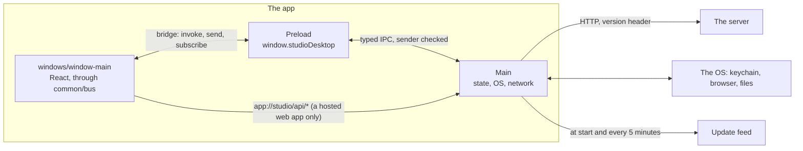

# The main process, the preload, the contract, and the windows

A whole Electron app's runtime, on the layers of `code-architecture` and the rules of this skill's
`SKILL.md`. Every file below is from one fixture app, Studio, as it is:

- typechecked per program with TypeScript 5.9, against Electron 45.5, electron-updater 6.8, and
  React 19.3, with no finding from `code-standards`' naming checker;
- unit tested (31 tests on Node 24, without Electron);
- built with esbuild and launched under Electron by a smoke test that passes all 19 of its steps.

[release.md](release.md) packages, signs, and releases the same app, and tries the packaged build.



## 1. The programs

Each process is a program with its own tsconfig, all extending one base. The base turns on what the
fixture relies on: strict checks, `noUncheckedIndexedAccess`, `verbatimModuleSyntax`, and
`erasableSyntaxOnly`, so plain Node runs the suites from source.

```jsonc
{
  // Shared by every program's tsconfig.json; each adds only its own lib, types, and include.
  "compilerOptions": {
    "target": "es2023",
    "lib": ["es2023"],
    "module": "esnext",
    "moduleResolution": "bundler",
    "strict": true,
    "noUncheckedIndexedAccess": true,
    "noImplicitOverride": true,
    "verbatimModuleSyntax": true,
    "erasableSyntaxOnly": true,
    "allowImportingTsExtensions": true,
    "jsx": "react-jsx",
    "skipLibCheck": true,
    "noEmit": true,
    "types": []
  }
}
```

```jsonc
{
  // The main process: Node and Electron, no DOM.
  "extends": "../../tsconfig.base.json",
  "compilerOptions": { "types": ["node"] },
  "include": [".", "../shared", "../index.ts"]
}
```

```jsonc
{
  // The sandboxed preload: the window's DOM and Electron's renderer API.
  "extends": "../../tsconfig.base.json",
  "compilerOptions": { "lib": ["es2023", "dom"], "types": ["node"] },
  "include": [".", "../shared", "../index.ts"]
}
```

```jsonc
{
  // The windows: the DOM only; the contract's types, never main's.
  "extends": "../../tsconfig.base.json",
  "compilerOptions": { "lib": ["es2023", "dom", "dom.iterable"] },
  "include": [".", "../shared", "../index.ts"]
}
```

```jsonc
{
  // What main, the preload, and the windows share: neither Node nor the DOM.
  "extends": "../../tsconfig.base.json",
  "include": [".", "../index.ts"]
}
```

Modules take `code-architecture`'s shape (§ Packages, namespaces, barrels):

- A class module default-exports its class (`export default class IpcMainRouter`).
- Any other module default-exports an object of its functions and constants, which callers read
  through the module's name (`appRoute.getIsAppPageUrl`, `desktopConfig.VERSION_HEADER`).
- React components and hooks are named exports (`react-architecture` § Files and folders).
- The type root holds one namespace. Each module adds its types with
  `declare module "@acme/app-desktop"`, in its folder's namespace (`Desktop.Main.Shell.Ipc`), with a
  class's own types under its name (`Desktop.Main.Shell.Ipc.IpcMainRouter.Deps`).

A program sees a type only when its tsconfig includes the module that declares it: a renderer module
that names `Desktop.Main.Config.Values` fails with
`Namespace 'Desktop' has no exported member 'Main'`.

```ts
/**
 * The type root. A module adds the types it defines with `declare module "@acme/app-desktop"` at its
 * bottom, in the namespace of its folder (`Desktop.Main.Shell.Ipc`). A program sees a type only when
 * its tsconfig includes the module that declares it, so main's types never reach the preload or a
 * window.
 */
export namespace Desktop {}
```

The package maps `#desktop/*` to `src/*`, and every program builds with esbuild. Main and the
preload are CommonJS bundles with `electron` left out; the preload's bundle is 2.2 KB, since it
imports the channel names and never the contract's schemas. The windows build together, so code they
share splits into one chunk, and each gets the default page.

```json
{
  "name": "@acme/app-desktop",
  "productName": "Studio",
  "version": "1.4.0",
  "private": true,
  "type": "module",
  "main": "out/main.cjs",
  "exports": {
    ".": "./src/index.ts"
  },
  "imports": {
    "#desktop/*": "./src/*",
    "#test/*": "./test/*"
  },
  "scripts": {
    "build:main": "esbuild src/main/main.run.ts --bundle --platform=node --format=cjs --external:electron --outfile=out/main.cjs",
    "build:preload": "esbuild src/preload/preload.ts --bundle --platform=node --format=cjs --external:electron --outfile=out/preload.cjs",
    "build:renderer": "esbuild src/renderer/windows/*/index.ts --bundle --splitting --format=esm --jsx=automatic --define:process.env.NODE_ENV='\"production\"' --target=chrome130 --outbase=src/renderer --outdir=out/renderer --chunk-names=chunks/[name]-[hash] && for dir in out/renderer/windows/*/; do cp src/renderer/assets/index.html \"$dir\"; done",
    "build": "rm -rf out && npm run build:main && npm run build:preload && npm run build:renderer",
    "start": "npm run build && electron .",
    "typecheck": "tsc -p src/main && tsc -p src/preload && tsc -p src/shared && tsc -p src/renderer && tsc -p test && tsc -p .",
    "test": "node --test \"test/**/*.test.ts\"",
    "smoke": "npm run build && node test/smoke/smoke.ts",
    "dist": "npm run build && electron-builder --config electron-builder.config.ts --dir -c.mac.identity=- -c.mac.notarize=false -c.mac.hardenedRuntime=false",
    "release": "npm run build && electron-builder --config electron-builder.config.ts --publish never"
  },
  "devDependencies": {
    "@types/node": "24.10.1",
    "@types/react": "19.3.1",
    "@types/react-dom": "19.3.0",
    "electron": "45.5.0",
    "electron-builder": "26.18.0",
    "electron-updater": "6.8.11",
    "esbuild": "0.28.2",
    "playwright-core": "1.65.1",
    "react": "19.3.1",
    "react-dom": "19.3.1",
    "typescript": "5.9.3",
    "zod": "4.6.7"
  }
}
```

## 2. The entry

A packaged app refuses the switches that let another process drive it, then takes the lock, so a
second launch builds nothing. The privileged scheme and the listeners for events that can fire
before ready follow; the composition root loads behind `import()`, which esbuild inlines into the
same bundle and resolves before Electron is ready. The first window opens once every part has
started, and `will-quit` disposes.

```ts
import { app } from "electron";

import AppSchemeHandler from "#desktop/main/shell/scheme/app-scheme-handler.ts";

// Chromium's own switches that let another process drive the app; no fuse turns them off
const REFUSED_SWITCH_LIST = ["remote-debugging-port", "remote-debugging-pipe"];

/** Builds the app, now that it is the only instance, and starts it once Electron is ready. */
async function startApp(): Promise<void> {
  const { default: root } = await import("#desktop/main/shell/composition-root.ts");

  // before ready: a failure while starting is logged, and a link the launch carries is kept
  root.PROCESS_ERROR_REPORTER.listen(process, app);
  root.OS_DEEP_LINK_LISTENER.listen(process.argv);

  // `will-quit`, not `before-quit`: a window's `beforeunload` can still cancel the quit before it
  app.on("will-quit", () => root.APP_LIFECYCLE.dispose());
  app.on("window-all-closed", () => {
    // a macOS app stays open without windows; elsewhere the last window closes the app
    if (process.platform !== "darwin") {
      app.quit();
    }
  });

  await app.whenReady();
  await root.APP_LIFECYCLE.start();

  root.LOGGER.info("app.config", {
    channel: root.CONFIG.channel,
    serverOrigin: root.CONFIG.serverOrigin,
    isPackaged: root.CONFIG.isPackaged
  });

  root.WINDOWS.main.open();
}

if (app.isPackaged && REFUSED_SWITCH_LIST.some(name => app.commandLine.hasSwitch(name))) {
  process.stderr.write("app.refused-switch\n");

  app.exit(1);
} else if (app.requestSingleInstanceLock()) {
  // One instance at a time: a second launch hands its arguments to the first (`second-instance`)
  // and quits before it builds anything, so it never reads a file or opens the log. Electron
  // accepts a privileged scheme only before it is ready.
  AppSchemeHandler.registerPrivilegedScheme();

  startApp().catch((err: unknown) => {
    process.stderr.write(`app.start-failed ${String(err)}\n`);

    app.exit(1);
  });
} else {
  app.quit();
}
```

- **No fuse covers `--remote-debugging-port`.** The fused, packaged app started with it listed
  `app://studio/` over the DevTools protocol, page and bridge included. With the check, it exits
  with code 1 and the port stays closed.
- **`before-quit` fires before the windows close**, and a window's `beforeunload` can still cancel
  the quit then. Disposing there left the app running with no IPC: the smoke test's cancelled quit
  then got `{"isOk":false,"code":"failed"}` from `getAppInfo`. On `will-quit` the quit is certain.

## 3. The composition root

Every part is built once, in dependency order, as a constant named after its class
(`code-architecture` § Inside an app). Building touches nothing; the lifecycle's list is the start
order, and its reverse the stop order. The IPC router is built last because its binding calls the
other parts, and started last so it stops first.

```ts
import path from "node:path";

import { app, ipcMain } from "electron";

import AppLifecycle from "#desktop/main/base/app-lifecycle.ts";
import ConsoleLogger from "#desktop/main/base/console-logger.ts";
import desktopConfig from "#desktop/main/config/desktop.config.ts";
import packageMetadata from "#desktop/main/config/package-metadata.ts";
import releaseChannelConfig from "#desktop/main/config/release-channel.config.ts";
import OsDeepLinkListener from "#desktop/main/shell/deep-link/os-deep-link-listener.ts";
import IpcMainPublisher from "#desktop/main/shell/ipc/ipc-main-publisher.ts";
import IpcMainRouter from "#desktop/main/shell/ipc/ipc-main-router.ts";
import ProcessErrorReporter from "#desktop/main/shell/lifecycle/process-error-reporter.ts";
import AppSchemeHandler from "#desktop/main/shell/scheme/app-scheme-handler.ts";
import AppSessionPolicy from "#desktop/main/shell/session/app-session-policy.ts";
import AppUpdater from "#desktop/main/shell/update/app-updater.ts";
import WindowMain from "#desktop/main/shell/windows/window-main.ts";

// Builds every part once, in dependency order. Building touches nothing: each part reaches the OS
// only in start(), which AppLifecycle calls in the order of its list.

const LOGGER = new ConsoleLogger();

const CONFIG = desktopConfig.buildDesktopConfig({
  env: process.env,
  packageMetadata: packageMetadata.readPackageMetadata(app.getAppPath()),
  isPackaged: app.isPackaged,
  userDataPath: app.getPath("userData"),
  logsPath: app.getPath("logs"),
  bundlePath: path.join(app.getAppPath(), "out")
});

const PROCESS_ERROR_REPORTER = new ProcessErrorReporter({ logger: LOGGER.createChild("process") });

const WINDOWS = {
  main: new WindowMain({ config: CONFIG, logger: LOGGER.createChild("window") })
} as const;

const IPC_MAIN_PUBLISHER = new IpcMainPublisher({
  pushTargetSource: {
    get pushTargetList() {
      return Object.values(WINDOWS).flatMap(window => window.pushTargetList);
    }
  }
});

const APP_UPDATER = new AppUpdater({
  config: CONFIG,
  publisher: IPC_MAIN_PUBLISHER,
  logger: LOGGER.createChild("update")
});

const APP_SCHEME_HANDLER = new AppSchemeHandler({
  config: CONFIG,
  versionHeader: desktopConfig.VERSION_HEADER,
  updateListener: APP_UPDATER,
  logger: LOGGER.createChild("scheme")
});

const APP_SESSION_POLICY = new AppSessionPolicy({
  appOrigin: CONFIG.appOrigin,
  logger: LOGGER.createChild("session")
});

const OS_DEEP_LINK_LISTENER = new OsDeepLinkListener({
  app,
  scheme: releaseChannelConfig.RELEASE_CHANNEL[CONFIG.channel].scheme,
  isPackaged: CONFIG.isPackaged,
  // a real app hands its sign-in callback to the sign-in service; the fixture logs the path only
  handler: {
    handleUrl: async url => LOGGER.info("deep-link.received", { path: new URL(url).pathname })
  },
  logger: LOGGER.createChild("deep-link")
});

const IPC_MAIN_ROUTER = new IpcMainRouter({
  appOrigin: CONFIG.appOrigin,
  ipcMain,
  binding: {
    invoke: {
      getAppInfo: () => ({
        productName: CONFIG.productName,
        version: CONFIG.appVersion,
        channel: CONFIG.channel
      }),
      getUpdateStatus: () => APP_UPDATER.status
    },
    send: {
      installUpdate: () => APP_UPDATER.install(),
      reportError: report => LOGGER.error("window.error", report)
    }
  },
  logger: LOGGER.createChild("ipc")
});

const APP_LIFECYCLE = new AppLifecycle({
  startableList: [
    APP_SESSION_POLICY, // before any page loads
    APP_SCHEME_HANDLER, // before any window: every page is on the app's origin
    WINDOWS.main, // its listeners only; the entry opens it once every part has started
    OS_DEEP_LINK_LISTENER,
    APP_UPDATER,
    IPC_MAIN_ROUTER // last, so disposed first: nothing answers a window while the rest stops
  ],
  logger: LOGGER.createChild("app")
});

export default {
  APP_LIFECYCLE,
  CONFIG,
  LOGGER,
  OS_DEEP_LINK_LISTENER,
  PROCESS_ERROR_REPORTER,
  WINDOWS
};
```

## 4. Configuration

The channel table is the one place that says what makes each channel its own app. The packager's
config reads it too ([release.md](release.md) § 1).

```ts
import type { Desktop } from "#desktop/index.ts";

/**
 * Each release channel is an app of its own on the computer: its id, name, link scheme, data
 * folder, and update cache. A dev build installs beside the released one with its own settings and
 * sign-in. The app and the packager's config both read this table.
 */
const RELEASE_CHANNEL = {
  prod: {
    appId: "com.example.studio",
    packageName: "studio",
    productName: "Studio",
    artifactPrefix: "Studio",
    scheme: "studio"
  },
  dev: {
    appId: "com.example.studio.dev",
    packageName: "studio-dev",
    productName: "Studio Dev",
    artifactPrefix: "Studio-Dev",
    scheme: "studio-dev"
  }
} as const;

const getIsReleaseChannel = (name: string): name is Desktop.Shared.ReleaseChannel =>
  Object.hasOwn(RELEASE_CHANNEL, name);

/** Where the system browser sends a sign-in back to, on the channel's own scheme. */
const getAuthRedirectUri = (channel: Desktop.Shared.ReleaseChannel): string =>
  `${RELEASE_CHANNEL[channel].scheme}://auth/callback`;

/** The channel's folder under the public releases URL, where CI publishes and the updater reads. */
const getUpdateFeedUrl = (releasesUrl: string, channel: Desktop.Shared.ReleaseChannel): string =>
  `${releasesUrl}/${channel}/`;

/** The channel a name stands for. No name is `dev`, so only a build that says `prod` is released. */
function parseReleaseChannel(name: string | null | undefined): Desktop.Shared.ReleaseChannel {
  if (!name) {
    return "dev";
  }

  if (!getIsReleaseChannel(name)) {
    const nameList = Object.keys(RELEASE_CHANNEL).join(" or ");

    throw new Error(`The release channel must be ${nameList}, got ${name}`);
  }

  return name;
}

export default { getAuthRedirectUri, getUpdateFeedUrl, parseReleaseChannel, RELEASE_CHANNEL };
```

The release build writes its facts into the packaged `package.json`; main reads them once.

```ts
import fs from "node:fs";
import path from "node:path";

import { z } from "zod";

import type { Desktop } from "#desktop/index.ts";

/**
 * The packaged package.json: its version, and what the release build wrote into it through the
 * packager's `extraMetadata` (the channel, the server, the update feed). A development run has no
 * `desktopRelease`.
 */
const PackageMetadataSchema = z.object({
  version: z.string(),
  desktopRelease: z
    .object({
      channel: z.string(),
      serverOrigin: z.string().nullable(),
      updateFeedUrl: z.string().nullable()
    })
    .optional()
});

/** Reads the app's own package.json once, at start; a malformed one stops the start. */
function readPackageMetadata(appPath: string): Desktop.Main.Config.PackageMetadata {
  const text = fs.readFileSync(path.join(appPath, "package.json"), "utf8");

  return PackageMetadataSchema.parse(JSON.parse(text));
}

export default { readPackageMetadata };

declare module "@acme/app-desktop" {
  namespace Desktop.Main.Config {
    type PackageMetadata = z.infer<typeof PackageMetadataSchema>;
  }
}
```

A packaged app talks to the server its release names, over https. `STUDIO_SERVER` points a
development run elsewhere and is ignored by a packaged one: the fixture's packaged build, started
with `STUDIO_SERVER=http://127.0.0.1:9`, logged `"serverOrigin":"http://localhost:8787"`, its own.

```ts
import path from "node:path";

import type { Desktop } from "#desktop/index.ts";
import releaseChannelConfig from "#desktop/main/config/release-channel.config.ts";

const { getAuthRedirectUri, parseReleaseChannel, RELEASE_CHANNEL } = releaseChannelConfig;

const APP_ORIGIN = "app://studio";
const DEFAULT_SERVER_ORIGIN = "http://localhost:8787";

/** The header naming the app's version on every request; the server answers 426 below its minimum. */
const VERSION_HEADER = "x-studio-version";

/** The server a run talks to, checked: https for a release, http(s) for a development run. */
function parseServerOrigin(server: string, isRelease: boolean): string {
  const serverUrl = new URL(server);
  const protocolList = isRelease ? ["https:"] : ["https:", "http:"];

  if (!protocolList.includes(serverUrl.protocol)) {
    throw new Error(`The server must be an ${isRelease ? "https" : "http(s)"} URL, got ${server}`);
  }

  return serverUrl.origin;
}

/**
 * Only a development run takes `STUDIO_SERVER`: whoever starts a released app must not be able to
 * send its traffic elsewhere. A release talks to the server it was built for, over https.
 */
function getServerOrigin(host: Desktop.Main.Config.Host): string {
  const devServer = host.isPackaged ? undefined : host.env.STUDIO_SERVER;
  const releaseServer = host.packageMetadata.desktopRelease?.serverOrigin;

  if (devServer) {
    return parseServerOrigin(devServer, false);
  }

  if (releaseServer) {
    return parseServerOrigin(releaseServer, true);
  }

  return DEFAULT_SERVER_ORIGIN;
}

/**
 * The app's configuration, built once at start from where it runs; a bad value stops the start
 * rather than being guessed. Only a packaged release build has an update feed.
 */
function buildDesktopConfig(host: Desktop.Main.Config.Host): Desktop.Main.Config.Values {
  const release = host.packageMetadata.desktopRelease ?? null;
  const channel = parseReleaseChannel(release?.channel);

  return {
    appOrigin: APP_ORIGIN,
    appVersion: host.packageMetadata.version,
    authRedirectUri: getAuthRedirectUri(channel),
    channel,
    isPackaged: host.isPackaged,
    logsPath: host.logsPath,
    preloadPath: path.join(host.bundlePath, "preload.cjs"),
    productName: RELEASE_CHANNEL[channel].productName,
    rendererPath: path.join(host.bundlePath, "renderer"),
    serverOrigin: getServerOrigin(host),
    updateFeedUrl: host.isPackaged ? (release?.updateFeedUrl ?? null) : null,
    userDataPath: host.userDataPath
  };
}

export default { buildDesktopConfig, VERSION_HEADER };

declare module "@acme/app-desktop" {
  namespace Desktop.Main.Config {
    type Values = {
      /** The origin every window loads from, served by the app scheme. */
      readonly appOrigin: string;
      readonly appVersion: string;
      readonly authRedirectUri: string;
      readonly channel: Desktop.Shared.ReleaseChannel;
      readonly isPackaged: boolean;
      readonly logsPath: string;
      readonly preloadPath: string;
      /** The channel's app name (Studio, Studio Dev), shown on windows and notifications. */
      readonly productName: string;
      readonly rendererPath: string;
      readonly serverOrigin: string;
      /** The channel's feed; null when the app cannot update itself (not a packaged CI build). */
      readonly updateFeedUrl: string | null;
      readonly userDataPath: string;
    };

    /** Where the app runs, read once at start by the composition root. */
    type Host = {
      readonly env: Readonly<Record<string, string | undefined>>;
      readonly packageMetadata: PackageMetadata;
      readonly isPackaged: boolean;
      readonly userDataPath: string;
      readonly logsPath: string;
      /** The folder of the bundled main process, beside the preload and the windows' pages. */
      readonly bundlePath: string;
    };
  }
}
```

## 5. The lifecycle

Each part that holds a resource, a timer, or a subscription plays `Startable`. One failed dispose is
logged, and the rest still run; a second dispose does nothing.

```ts
import type { Desktop } from "#desktop/index.ts";

/** Starts the app's parts in the composition root's order and disposes the started ones in reverse. */
export default class AppLifecycle {
  readonly #startableList: readonly Desktop.Main.Base.Startable[];
  readonly #logger: Desktop.Main.Base.Logger;
  readonly #startedList: Desktop.Main.Base.Startable[] = [];

  constructor(deps: Desktop.Main.Base.AppLifecycle.Deps) {
    this.#startableList = deps.startableList;
    this.#logger = deps.logger;
  }

  async start(): Promise<void> {
    for (const startable of this.#startableList) {
      await startable.start();

      this.#startedList.push(startable);
    }

    this.#logger.info("app.started", { partCount: this.#startedList.length });
  }

  /** Disposes each started part once, the last started first; one failure never skips the rest. */
  dispose(): void {
    for (const startable of this.#startedList.splice(0).reverse()) {
      try {
        startable.dispose();
      } catch (err: unknown) {
        this.#logger.error("app.dispose-failed", { part: startable.constructor.name, err });
      }
    }

    this.#logger.info("app.disposed");
  }
}

declare module "@acme/app-desktop" {
  namespace Desktop.Main.Base {
    /** A part that touches the host only in `start()`, once Electron is ready, and lets go in `dispose()`. */
    interface Startable {
      start(): void | Promise<void>;
      dispose(): void;
    }
  }

  namespace Desktop.Main.Base.AppLifecycle {
    type Deps = {
      readonly startableList: readonly Startable[];
      readonly logger: Logger;
    };
  }
}
```

The reporter listens before the root starts anything, so nothing that fails while the app starts
vanishes.

```ts
import type { App } from "electron";

import type { Desktop } from "#desktop/index.ts";

/** Logs what would otherwise vanish: uncaught errors, unhandled rejections, crashed helpers. */
export default class ProcessErrorReporter {
  readonly #logger: Desktop.Main.Base.Logger;

  constructor(deps: Desktop.Main.Shell.Lifecycle.ProcessErrorReporter.Deps) {
    this.#logger = deps.logger;
  }

  /** Called by the entry first, so nothing that fails while the app starts goes unlogged. */
  listen(proc: NodeJS.Process, app: App): void {
    proc.on("uncaughtException", err => this.#logger.error("process.uncaught-exception", { err }));
    proc.on("unhandledRejection", reason => {
      this.#logger.error("process.unhandled-rejection", { reason });
    });

    app.on("child-process-gone", (_event, details) => {
      this.#logger.error("process.child-gone", {
        type: details.type,
        reason: details.reason,
        exitCode: details.exitCode
      });
    });
  }
}

declare module "@acme/app-desktop" {
  namespace Desktop.Main.Shell.Lifecycle.ProcessErrorReporter {
    type Deps = {
      readonly logger: Desktop.Main.Base.Logger;
    };
  }
}
```

The fixture logs JSON lines to stderr, which the smoke test reads. A shipped app writes the same
events to a file in `app.getPath("logs")` through its log library, with secrets blanked.

```ts
import type { Desktop } from "#desktop/index.ts";

/**
 * The fixture's logger: one JSON line per event on stderr. A shipped app writes the same events to a
 * file in the OS's logs folder through its log library, with secrets blanked.
 */
export default class ConsoleLogger implements Desktop.Main.Base.Logger {
  readonly #scope: string;

  constructor(options: Desktop.Main.Base.ConsoleLogger.Options = {}) {
    this.#scope = options.scope ?? "main";
  }

  createChild(scope: string): Desktop.Main.Base.Logger {
    return new ConsoleLogger({ scope: `${this.#scope} ${scope}` });
  }

  info(event: string, fields: Desktop.Main.Base.LogFields = {}): void {
    this.#write("info", event, fields);
  }

  warn(event: string, fields: Desktop.Main.Base.LogFields = {}): void {
    this.#write("warn", event, fields);
  }

  error(event: string, fields: Desktop.Main.Base.LogFields = {}): void {
    this.#write("error", event, fields);
  }

  #write(level: string, event: string, fields: Desktop.Main.Base.LogFields): void {
    const line = JSON.stringify({ level, scope: this.#scope, event, ...fields }, (_key, value) =>
      value instanceof Error ? { name: value.name, message: value.message } : value
    );

    process.stderr.write(`${line}\n`);
  }
}

declare module "@acme/app-desktop" {
  namespace Desktop.Main.Base {
    type LogFields = Readonly<Record<string, unknown>>;

    interface Logger {
      createChild(scope: string): Logger;
      info(event: string, fields?: LogFields): void;
      warn(event: string, fields?: LogFields): void;
      error(event: string, fields?: LogFields): void;
    }
  }

  namespace Desktop.Main.Base.ConsoleLogger {
    type Options = {
      readonly scope?: string;
    };
  }
}
```

## 6. Windows

The window base holds every rule a window keeps; a window adds its spec and its events. Main's
`shell/windows/window-main.ts` opens the renderer's `windows/window-main/`.

```ts
const CRASH_WINDOW_MS = 60_000;
const MAX_RELOADS_PER_CRASH_WINDOW = 3;

/** More reloads than the budget within a minute: the page is left down instead of looping. */
const getIsCrashLoop = (recentCrashTimeMsList: readonly number[]): boolean =>
  recentCrashTimeMsList.length > MAX_RELOADS_PER_CRASH_WINDOW;

/** The crash times inside the last minute, the new crash included. */
const getRecentCrashTimeMsList = (crashTimeMsList: readonly number[], nowMs: number): number[] =>
  [...crashTimeMsList, nowMs].filter(timeMs => nowMs - timeMs <= CRASH_WINDOW_MS);

export default { getIsCrashLoop, getRecentCrashTimeMsList };
```

```ts
import { BrowserWindow, shell } from "electron";

import type { Desktop } from "#desktop/index.ts";
import appRoute from "#desktop/main/shell/scheme/utils/app-route.ts";
import crashLoop from "#desktop/main/shell/windows/utils/crash-loop.ts";

const EXTERNAL_PROTOCOL_SET: ReadonlySet<string> = new Set(["https:", "http:", "mailto:"]);

/**
 * Every window the app opens, opened one way: a page on the app's origin, isolated and sandboxed,
 * kept on the app's own pages (a web link opens in the system browser), shown once its page has
 * painted, titled by main, and reloaded when its page crashes, unless it keeps crashing. A window
 * adds only its spec and what it does.
 */
export default abstract class WindowBase implements Desktop.Main.Shell.Ipc.PushTargetSource {
  protected readonly config: Desktop.Main.Config.Values;
  protected readonly logger: Desktop.Main.Base.Logger;

  #crashTimeMsList: readonly number[] = [];
  #window: BrowserWindow | null = null;

  constructor(deps: Desktop.Main.Shell.Windows.WindowBase.Deps) {
    this.config = deps.config;
    this.logger = deps.logger;
  }

  /** The page the window opens on and its frame; read each time it opens. */
  protected abstract get spec(): Desktop.Main.Shell.Windows.Spec;

  get isOpen(): boolean {
    return this.openWindow !== null;
  }

  get pushTargetList(): readonly Desktop.Main.Shell.Ipc.PushTarget[] {
    return this.openWindow ? [this.openWindow.webContents] : [];
  }

  /** The window while it is open. */
  protected get openWindow(): BrowserWindow | null {
    return this.#window && !this.#window.isDestroyed() ? this.#window : null;
  }

  /** Brings the window forward, opening it first if it was closed. */
  open(): void {
    const window = this.openWindow;

    if (window) {
      if (window.isMinimized()) {
        window.restore();
      }

      window.focus();

      return;
    }

    this.#window = this.#createWindow();
  }

  /** The app-origin URL of a path (`/windows/window-settings/index.html`). */
  protected getPageUrl(pagePath: string): string {
    return `${this.config.appOrigin}${pagePath}`;
  }

  #createWindow(): BrowserWindow {
    const { pagePath, options } = this.spec;

    const window = new BrowserWindow({
      ...options,
      show: false,
      webPreferences: {
        preload: this.config.preloadPath,
        contextIsolation: true,
        sandbox: true,
        nodeIntegration: false,
        webSecurity: true
      }
    });

    window.once("ready-to-show", () => window.show());

    // the title is main's (the spec's), never the page's own <title>
    window.on("page-title-updated", event => event.preventDefault());

    window.webContents.on("will-navigate", details => {
      if (!appRoute.getIsAppPageUrl(details.url, this.config.appOrigin)) {
        details.preventDefault();

        this.#openExternal(details.url);
      }
    });

    window.webContents.setWindowOpenHandler(({ url }) => {
      this.#openExternal(url);

      return { action: "deny" };
    });

    window.webContents.on("render-process-gone", (_event, details) => {
      this.#handleRenderGone(window, details);
    });

    window.on("closed", () => {
      if (this.#window === window) {
        this.#window = null;
      }
    });

    void window.loadURL(this.getPageUrl(pagePath));

    return window;
  }

  /** Only a web or mail link leaves the app, to the system's handler; anything else is dropped. */
  #openExternal(url: string): void {
    const protocol = URL.parse(url)?.protocol ?? "";

    if (!EXTERNAL_PROTOCOL_SET.has(protocol)) {
      this.logger.warn("window.external-refused", { protocol });

      return;
    }

    shell.openExternal(url).catch((err: unknown) => {
      this.logger.warn("window.external-failed", { err });
    });
  }

  /** A crashed page reloads; one that keeps crashing is left down instead of reloading in a loop. */
  #handleRenderGone(window: BrowserWindow, details: Electron.RenderProcessGoneDetails): void {
    this.logger.error("window.render-gone", {
      reason: details.reason,
      exitCode: details.exitCode
    });

    if (details.reason === "clean-exit") {
      return;
    }

    this.#crashTimeMsList = crashLoop.getRecentCrashTimeMsList(this.#crashTimeMsList, Date.now());

    if (crashLoop.getIsCrashLoop(this.#crashTimeMsList)) {
      this.logger.error("window.crash-loop", { crashCount: this.#crashTimeMsList.length });

      return;
    }

    window.reload();
  }
}

declare module "@acme/app-desktop" {
  namespace Desktop.Main.Shell.Windows {
    /** What makes one window itself: the page it opens on and its frame. */
    type Spec = {
      /** A path on the app's origin: `/windows/window-<name>/index.html`. */
      pagePath: string;
      options: Omit<Electron.BrowserWindowConstructorOptions, "show" | "webPreferences">;
    };
  }

  namespace Desktop.Main.Shell.Windows.WindowBase {
    /** What every window needs; a window that needs more extends it. */
    type Deps = {
      readonly config: Desktop.Main.Config.Values;
      readonly logger: Desktop.Main.Base.Logger;
    };
  }
}
```

```ts
import { app } from "electron";

import type { Desktop } from "#desktop/index.ts";
import WindowBase from "#desktop/main/shell/windows/window-base.ts";

const BACKGROUND_COLOR = "#16171b";

/**
 * The app's main window: opened by the entry once the app has started, again from the Dock, and
 * brought forward when a second launch hands over to this one.
 */
export default class WindowMain extends WindowBase implements Desktop.Main.Base.Startable {
  protected override get spec(): Desktop.Main.Shell.Windows.Spec {
    return {
      pagePath: "/windows/window-main/index.html",
      options: {
        title: this.config.productName,
        width: 1200,
        height: 800,
        minWidth: 720,
        minHeight: 480,
        backgroundColor: BACKGROUND_COLOR
      }
    };
  }

  start(): void {
    app.on("second-instance", this.#handleOpenRequest);
    app.on("activate", this.#handleOpenRequest);
  }

  dispose(): void {
    app.off("second-instance", this.#handleOpenRequest);
    app.off("activate", this.#handleOpenRequest);
  }

  readonly #handleOpenRequest = (): void => {
    this.open();
  };
}
```

- `will-navigate` fires for a navigation the page starts; `loadURL` from main never triggers it, so
  main can still move a window to another app page.
- The window-open handler is the only way a page could make a window; it denies all, which also
  covers `target="_blank"` links.
- `BrowserWindow`'s `webPreferences` stay out of a window's spec (`Omit<…, "webPreferences">`), so
  no window can turn isolation or the sandbox off.

## 7. The app scheme

The route and the page check are pure functions, tested without Electron. A path under `/api/` is
the server's, never one of the app's pages.

```ts
import path from "node:path";

import type { Desktop } from "#desktop/index.ts";

const SERVER_PREFIX = "/api/";

/**
 * Where an app-origin request goes: the server, a packaged file, or `index.html` for an app route
 * (a path without a file extension). A path that resolves outside the pages' folder is missing.
 */
function getAppRoute(pathname: string, rendererPath: string): Desktop.Main.Shell.Scheme.Route {
  if (pathname.startsWith(SERVER_PREFIX)) {
    return { kind: "proxy" };
  }

  const lastSegment = pathname.split("/").pop() ?? "";

  if (!lastSegment.includes(".")) {
    return { kind: "file", filePath: path.join(rendererPath, "index.html") };
  }

  let decodedPath: string;

  try {
    decodedPath = decodeURIComponent(pathname);
  } catch {
    return { kind: "missing" };
  }

  const basePath = path.resolve(rendererPath);
  const filePath = path.resolve(basePath, `.${decodedPath}`);

  return filePath.startsWith(basePath + path.sep)
    ? { kind: "file", filePath }
    : { kind: "missing" };
}

/**
 * A page of the app's own: on its origin, and not a server answer passed through the scheme, which
 * may be content the server stores. Windows navigate only to these, and IPC hears only these.
 */
const getIsAppPageUrl = (url: string, appOrigin: string): boolean =>
  url.startsWith(`${appOrigin}/`) && !url.startsWith(`${appOrigin}${SERVER_PREFIX}`);

export default { getAppRoute, getIsAppPageUrl };

declare module "@acme/app-desktop" {
  namespace Desktop.Main.Shell.Scheme {
    type Route = { kind: "proxy" } | { kind: "file"; filePath: string } | { kind: "missing" };
  }
}
```

The handler serves the pages with their policy, and passes `/api/` to the server with a policy that
runs nothing. Comparing the request's URL as text matters: the first version compared
`new URL(request.url).origin` with `app://studio`, and every page answered 404, because Node's `URL`
gives a custom scheme the origin `"null"`.

```ts
import { pathToFileURL } from "node:url";

import { net, protocol } from "electron";

import type { Desktop } from "#desktop/index.ts";
import appRoute from "#desktop/main/shell/scheme/utils/app-route.ts";

const SCHEME = "app";
const UPGRADE_REQUIRED_STATUS_CODE = 426;
// the server sees main's request, not the page's: the app origin means nothing to it
const DROPPED_REQUEST_HEADER_LIST = ["origin", "referer", "host"];

/** The app's pages load only the app's own code, and reach only the app's own origin. */
const PAGE_POLICY = [
  "default-src 'self'",
  "script-src 'self'",
  "style-src 'self'",
  "img-src 'self' data: blob:",
  "connect-src 'self'",
  "object-src 'none'",
  "base-uri 'none'",
  "frame-ancestors 'none'"
].join("; ");

/** A server answer opened as a page runs nothing: no script, an opaque origin, no bridge use. */
const SERVER_ANSWER_POLICY = "sandbox; default-src 'none'";

/**
 * Serves the app's origin: the packaged pages, with a content security policy, and `/api/` passed
 * to the server with the app's version. The pages call the server on their own origin, so they need
 * no CORS, and a 426 from the server tells the updater this version is too old.
 */
export default class AppSchemeHandler implements Desktop.Main.Base.Startable {
  readonly #config: Desktop.Main.Config.Values;
  readonly #versionHeader: string;
  readonly #updateListener: Desktop.Main.Shell.Scheme.UpdateRequiredListener;
  readonly #logger: Desktop.Main.Base.Logger;

  constructor(deps: Desktop.Main.Shell.Scheme.AppSchemeHandler.Deps) {
    this.#config = deps.config;
    this.#versionHeader = deps.versionHeader;
    this.#updateListener = deps.updateListener;
    this.#logger = deps.logger;
  }

  /** Electron accepts privileged schemes only before the app is ready, so the entry calls this. */
  static registerPrivilegedScheme(): void {
    protocol.registerSchemesAsPrivileged([
      {
        scheme: SCHEME,
        privileges: { standard: true, secure: true, supportFetchAPI: true, stream: true }
      }
    ]);
  }

  start(): void {
    protocol.handle(SCHEME, request => this.#respond(request));
  }

  dispose(): void {
    protocol.unhandle(SCHEME);
  }

  async #respond(request: Request): Promise<Response> {
    // compared as text: a custom scheme's `URL.origin` is "null", even a standard one
    if (!request.url.startsWith(`${this.#config.appOrigin}/`)) {
      return new Response("not found", { status: 404 });
    }

    const url = new URL(request.url);
    const route = appRoute.getAppRoute(url.pathname, this.#config.rendererPath);

    if (route.kind === "proxy") {
      return this.#proxy(request, url);
    }

    if (route.kind === "missing") {
      return new Response("not found", { status: 404 });
    }

    const response = await net.fetch(pathToFileURL(route.filePath).toString());

    if (!route.filePath.endsWith(".html")) {
      return response;
    }

    return this.#withHeaders(response, { "content-security-policy": PAGE_POLICY });
  }

  async #proxy(request: Request, url: URL): Promise<Response> {
    const headers = new Headers(request.headers);

    for (const name of DROPPED_REQUEST_HEADER_LIST) {
      headers.delete(name);
    }

    headers.set(this.#versionHeader, this.#config.appVersion);

    try {
      const body =
        request.method === "GET" || request.method === "HEAD"
          ? undefined
          : await request.arrayBuffer();
      const response = await net.fetch(this.#config.serverOrigin + url.pathname + url.search, {
        method: request.method,
        headers,
        body
      });

      if (response.status === UPGRADE_REQUIRED_STATUS_CODE) {
        this.#updateListener.requireUpdate();
      }

      return this.#withHeaders(response, {
        "content-security-policy": SERVER_ANSWER_POLICY,
        "x-content-type-options": "nosniff"
      });
    } catch (err: unknown) {
      this.#logger.warn("scheme.server-unreachable", { pathname: url.pathname, err });

      return Response.json({ detail: "The server cannot be reached." }, { status: 503 });
    }
  }

  #withHeaders(response: Response, headerMap: Readonly<Record<string, string>>): Response {
    const headers = new Headers(response.headers);

    for (const [name, value] of Object.entries(headerMap)) {
      headers.set(name, value);
    }

    return new Response(response.body, {
      status: response.status,
      statusText: response.statusText,
      headers
    });
  }
}

declare module "@acme/app-desktop" {
  namespace Desktop.Main.Shell.Scheme {
    /** Who hears that the server refused this version of the app. */
    interface UpdateRequiredListener {
      requireUpdate(): void;
    }
  }

  namespace Desktop.Main.Shell.Scheme.AppSchemeHandler {
    type Deps = {
      readonly config: Desktop.Main.Config.Values;
      readonly versionHeader: string;
      readonly updateListener: UpdateRequiredListener;
      readonly logger: Desktop.Main.Base.Logger;
    };
  }
}
```

- **A server answer shares the app's origin**, so without its own policy, stored HTML or SVG that a
  window opened would run with the bridge. `sandbox` gives it an opaque origin and no script,
  `nosniff` keeps a mislabelled file from becoming a page, and the window and the router refuse
  `/api/` URLs besides.
- The page policy allows only the app's own scripts and styles. A bundler that injects styles at run
  time needs `'unsafe-inline'` in `style-src` only; `script-src` never takes it.
- With the policy set, Electron's "Insecure Content-Security-Policy" warning is gone from a
  development run; a packaged app never prints it, so the smoke test checks the header instead.
- An app that reads offline keeps the JSON of `GET /api/` answers in a bounded cache, answers from
  it when the server is unreachable with a header the page can show ("offline, read only"), saves it
  on dispose, and clears it on sign-out.

## 8. IPC

The channel names are their own module, so the preload bundles them without the schema library.

```ts
// The transport's names, imported only by the contract and the preload's bridge. A module of its
// own, so the sandboxed preload imports them without bundling the schema library.

const IPC_INVOKE_CHANNEL = {
  getAppInfo: "studio:get-app-info",
  getUpdateStatus: "studio:get-update-status"
} as const;

/** How long a window waits for main to answer an invoke before it reports a timeout. */
const IPC_INVOKE_TIMEOUT_MS = 10_000;

const IPC_PUSH_CHANNEL = {
  updateStatus: "studio:update-status"
} as const;

const IPC_SEND_CHANNEL = {
  installUpdate: "studio:install-update",
  reportError: "studio:report-error"
} as const;

export default { IPC_INVOKE_CHANNEL, IPC_INVOKE_TIMEOUT_MS, IPC_PUSH_CHANNEL, IPC_SEND_CHANNEL };
```

The contract has a schema per message, grouped by direction, and every type is inferred from it
(`code-architecture` § Contracts between processes).

```ts
import { z } from "zod";

import type { Desktop } from "#desktop/index.ts";
import ipcChannels from "#desktop/shared/ipc-channels.ts";

const { IPC_INVOKE_CHANNEL, IPC_PUSH_CHANNEL, IPC_SEND_CHANNEL } = ipcChannels;

const ReleaseChannelSchema = z.enum(["dev", "prod"]);

const AppInfoSchema = z.object({
  productName: z.string(),
  version: z.string(),
  channel: ReleaseChannelSchema
});

/** The app's own update; `isRequired` once the server refused this version (HTTP 426). */
const UpdateStatusSchema = z.object({
  state: z.enum(["unsupported", "idle", "downloading", "ready", "failed"]),
  isRequired: z.boolean(),
  progress: z.number().min(0).max(1),
  version: z.string().nullable()
});

/** A window's error, for main's log; the window's reporter dedupes and caps before it sends. */
const ErrorReportSchema = z.object({
  source: z.enum(["boundary", "root", "window", "promise"]),
  message: z.string().max(2_000),
  stack: z.string().max(20_000).nullable()
});

const INVOKE_DEFINITIONS = {
  getAppInfo: {
    channel: IPC_INVOKE_CHANNEL.getAppInfo,
    request: z.void(),
    response: AppInfoSchema
  },
  getUpdateStatus: {
    channel: IPC_INVOKE_CHANNEL.getUpdateStatus,
    request: z.void(),
    response: UpdateStatusSchema
  }
} as const;

const SEND_DEFINITIONS = {
  installUpdate: { channel: IPC_SEND_CHANNEL.installUpdate, payload: z.void() },
  reportError: { channel: IPC_SEND_CHANNEL.reportError, payload: ErrorReportSchema }
} as const;

const PUSH_DEFINITIONS = {
  updateStatus: { channel: IPC_PUSH_CHANNEL.updateStatus, payload: UpdateStatusSchema }
} as const;

type Definitions = Desktop.Shared.Definitions;

type InvokeEntry<K extends keyof Definitions["invoke"]> = {
  readonly channel: string;
  readonly request: z.ZodType<z.infer<Definitions["invoke"][K]["request"]>>;
  readonly response: z.ZodType<z.infer<Definitions["invoke"][K]["response"]>>;
};

type PayloadEntry<D extends Definitions["send"] | Definitions["push"], K extends keyof D> = {
  readonly channel: string;
  readonly payload: z.ZodType<
    z.infer<D[K] extends { payload: z.ZodType } ? D[K]["payload"] : never>
  >;
};

/**
 * The one list of messages between the windows and main, a schema each. Annotated as a mapped type
 * over its own keys, so `ipcContract.invoke[key]` with a generic key keeps that key's types.
 */
const ipcContract: {
  readonly invoke: { readonly [K in keyof Definitions["invoke"]]: InvokeEntry<K> };
  readonly send: {
    readonly [K in keyof Definitions["send"]]: PayloadEntry<Definitions["send"], K>;
  };
  readonly push: {
    readonly [K in keyof Definitions["push"]]: PayloadEntry<Definitions["push"], K>;
  };
} = { invoke: INVOKE_DEFINITIONS, send: SEND_DEFINITIONS, push: PUSH_DEFINITIONS };

export default ipcContract;

declare module "@acme/app-desktop" {
  namespace Desktop.Shared {
    type Definitions = {
      invoke: typeof INVOKE_DEFINITIONS;
      send: typeof SEND_DEFINITIONS;
      push: typeof PUSH_DEFINITIONS;
    };

    type InvokeKey = keyof Definitions["invoke"];

    type InvokeRequest<K extends InvokeKey> = z.infer<Definitions["invoke"][K]["request"]>;

    type InvokeResponse<K extends InvokeKey> = z.infer<Definitions["invoke"][K]["response"]>;

    /** An invoke's arguments after its key: none when the request is void. */
    type InvokeArgs<K extends InvokeKey> =
      InvokeRequest<K> extends void ? [] : [request: InvokeRequest<K>];

    type SendKey = keyof Definitions["send"];

    type SendPayload<K extends SendKey> = z.infer<Definitions["send"][K]["payload"]>;

    /** A notice's arguments after its key: none when the payload is void. */
    type SendArgs<K extends SendKey> = SendPayload<K> extends void ? [] : [payload: SendPayload<K>];

    type PushKey = keyof Definitions["push"];

    type PushPayload<K extends PushKey> = z.infer<Definitions["push"][K]["payload"]>;

    type ErrorCode = "refused" | "failed" | "timeout";

    /** What every invoke answers: it never rejects, so a window can always tell what happened. */
    type Result<T> = { isOk: true; data: T } | { isOk: false; code: ErrorCode };

    /** What the preload hands a window: typed calls by key, never the transport. */
    type WindowBridge = {
      invoke<K extends InvokeKey>(
        key: K,
        ...args: InvokeArgs<K>
      ): Promise<Result<InvokeResponse<K>>>;
      send<K extends SendKey>(key: K, ...args: SendArgs<K>): void;
      subscribe<K extends PushKey>(key: K, listener: (payload: PushPayload<K>) => void): () => void;
    };

    type AppInfo = z.infer<typeof AppInfoSchema>;

    type ReleaseChannel = z.infer<typeof ReleaseChannelSchema>;

    type UpdateStatus = z.infer<typeof UpdateStatusSchema>;

    type ErrorReport = z.infer<typeof ErrorReportSchema>;
  }
}
```

Main's router takes the binding in its deps and registers it in `start()`. `MainPort` and
`SenderEvent` are the parts of `ipcMain` it reads, so its suite runs on a fake.

```ts
import type { z } from "zod";

import type { Desktop } from "#desktop/index.ts";
import appRoute from "#desktop/main/shell/scheme/utils/app-route.ts";
import ipcContract from "#desktop/shared/ipc-contract.ts";

type Accepted<T> = { isAccepted: true; value: T } | { isAccepted: false };

/**
 * Main's side of the contract. Every invoke and notice is bound in one object, so a message the
 * contract adds does not compile until it has a handler. Only the app's own pages are heard, and only
 * payloads that match their schema; an invoke answers a `Desktop.Shared.Result`, and the error's
 * text stays in the log.
 */
export default class IpcMainRouter implements Desktop.Main.Base.Startable {
  readonly #appOrigin: string;
  readonly #ipcMain: Desktop.Main.Shell.Ipc.MainPort;
  readonly #binding: Desktop.Main.Shell.Ipc.Binding;
  readonly #logger: Desktop.Main.Base.Logger;
  readonly #handledChannelSet = new Set<string>();
  readonly #listenedChannelSet = new Set<string>();

  constructor(deps: Desktop.Main.Shell.Ipc.IpcMainRouter.Deps) {
    this.#appOrigin = deps.appOrigin;
    this.#ipcMain = deps.ipcMain;
    this.#binding = deps.binding;
    this.#logger = deps.logger;
  }

  start(): void {
    for (const key of Object.keys(this.#binding.invoke) as Desktop.Shared.InvokeKey[]) {
      this.#handle(key, this.#binding.invoke[key]);
    }

    for (const key of Object.keys(this.#binding.send) as Desktop.Shared.SendKey[]) {
      this.#listen(key, this.#binding.send[key]);
    }
  }

  dispose(): void {
    for (const channel of this.#handledChannelSet) {
      this.#ipcMain.removeHandler(channel);
    }

    for (const channel of this.#listenedChannelSet) {
      this.#ipcMain.removeAllListeners(channel);
    }

    this.#handledChannelSet.clear();
    this.#listenedChannelSet.clear();
  }

  #handle<K extends Desktop.Shared.InvokeKey>(
    key: K,
    handler: Desktop.Main.Shell.Ipc.InvokeHandler<K>
  ): void {
    const { channel, request } = ipcContract.invoke[key];

    this.#ipcMain.handle(
      channel,
      async (event, payload): Promise<Desktop.Shared.Result<Desktop.Shared.InvokeResponse<K>>> => {
        const accepted = this.#accept(channel, event, request, payload);

        if (!accepted.isAccepted) {
          return { isOk: false, code: "refused" };
        }

        try {
          return { isOk: true, data: await handler(accepted.value) };
        } catch (err: unknown) {
          this.#logger.error("ipc.handler-failed", { channel, err });

          return { isOk: false, code: "failed" };
        }
      }
    );

    this.#handledChannelSet.add(channel);
  }

  #listen<K extends Desktop.Shared.SendKey>(
    key: K,
    listener: Desktop.Main.Shell.Ipc.SendListener<K>
  ): void {
    const { channel, payload: schema } = ipcContract.send[key];

    this.#ipcMain.on(channel, (event, payload) => {
      const accepted = this.#accept(channel, event, schema, payload);

      if (accepted.isAccepted) {
        listener(accepted.value);
      }
    });

    this.#listenedChannelSet.add(channel);
  }

  /** The sender must be one of the app's own pages, and the payload must match its schema. */
  #accept<T>(
    channel: string,
    event: Desktop.Main.Shell.Ipc.SenderEvent,
    schema: z.ZodType<T>,
    payload: unknown
  ): Accepted<T> {
    const senderUrl = event.senderFrame?.url ?? null;

    if (!senderUrl || !appRoute.getIsAppPageUrl(senderUrl, this.#appOrigin)) {
      this.#logger.warn("ipc.foreign-sender", { channel, senderUrl });

      return { isAccepted: false };
    }

    const parsed = schema.safeParse(payload);

    if (!parsed.success) {
      const issueList = parsed.error.issues.map(issue => issue.message);

      this.#logger.warn("ipc.bad-payload", { channel, issueList });

      return { isAccepted: false };
    }

    return { isAccepted: true, value: parsed.data };
  }
}

declare module "@acme/app-desktop" {
  namespace Desktop.Main.Shell.Ipc {
    /** The part of Electron's `ipcMain` the router uses. */
    interface MainPort {
      handle(channel: string, listener: (event: SenderEvent, payload: unknown) => unknown): void;
      removeHandler(channel: string): void;
      on(channel: string, listener: (event: SenderEvent, payload: unknown) => void): void;
      removeAllListeners(channel: string): void;
    }

    /** The part of an Electron IPC event the router reads: which page sent it. */
    type SenderEvent = { readonly senderFrame: { readonly url: string } | null };

    type InvokeHandler<K extends Desktop.Shared.InvokeKey> = (
      request: Desktop.Shared.InvokeRequest<K>
    ) => Desktop.Shared.InvokeResponse<K> | Promise<Desktop.Shared.InvokeResponse<K>>;

    type SendListener<K extends Desktop.Shared.SendKey> = (
      payload: Desktop.Shared.SendPayload<K>
    ) => void;

    /** What main answers and hears: one handler per invoke and one listener per notice. */
    type Binding = {
      readonly invoke: { readonly [K in Desktop.Shared.InvokeKey]: InvokeHandler<K> };
      readonly send: { readonly [K in Desktop.Shared.SendKey]: SendListener<K> };
    };
  }

  namespace Desktop.Main.Shell.Ipc.IpcMainRouter {
    type Deps = {
      readonly appOrigin: string;
      readonly ipcMain: MainPort;
      readonly binding: Binding;
      readonly logger: Desktop.Main.Base.Logger;
    };
  }
}
```

```ts
import type { Desktop } from "#desktop/index.ts";
import ipcContract from "#desktop/shared/ipc-contract.ts";

/** Main's pushes, by contract key, to every open window; nothing else calls `webContents.send`. */
export default class IpcMainPublisher implements Desktop.Main.Shell.Ipc.Publisher {
  readonly #pushTargetSource: Desktop.Main.Shell.Ipc.PushTargetSource;

  constructor(deps: Desktop.Main.Shell.Ipc.IpcMainPublisher.Deps) {
    this.#pushTargetSource = deps.pushTargetSource;
  }

  publish<K extends Desktop.Shared.PushKey>(key: K, payload: Desktop.Shared.PushPayload<K>): void {
    const { channel } = ipcContract.push[key];

    for (const target of this.#pushTargetSource.pushTargetList) {
      target.send(channel, payload);
    }
  }
}

declare module "@acme/app-desktop" {
  namespace Desktop.Main.Shell.Ipc {
    /** Who sends main's pushes to the windows. */
    interface Publisher {
      publish<K extends Desktop.Shared.PushKey>(
        key: K,
        payload: Desktop.Shared.PushPayload<K>
      ): void;
    }

    type PushTarget = { send(channel: string, payload: unknown): void };

    /** The open windows' pages, read at each push. */
    interface PushTargetSource {
      readonly pushTargetList: readonly PushTarget[];
    }
  }

  namespace Desktop.Main.Shell.Ipc.IpcMainPublisher {
    type Deps = {
      readonly pushTargetSource: PushTargetSource;
    };
  }
}
```

The preload's bridge, and the preload itself:

```ts
import type { Desktop } from "#desktop/index.ts";
import ipcChannels from "#desktop/shared/ipc-channels.ts";

const { IPC_INVOKE_CHANNEL, IPC_INVOKE_TIMEOUT_MS, IPC_PUSH_CHANNEL, IPC_SEND_CHANNEL } =
  ipcChannels;

type RendererListener = (event: unknown, payload: unknown) => void;

/**
 * IPC from a window's side, built from the channel list: one typed `invoke` for every request,
 * `send` for every notice, and `subscribe` for every push, so a new message is a contract entry, not
 * new preload code. An invoke always resolves.
 */
export default class IpcRendererBridge implements Desktop.Shared.WindowBridge {
  readonly #ipcRenderer: Desktop.Preload.RendererPort;
  readonly #timeoutMs: number;

  constructor(
    deps: Desktop.Preload.IpcRendererBridge.Deps,
    options: Desktop.Preload.IpcRendererBridge.Options = {}
  ) {
    this.#ipcRenderer = deps.ipcRenderer;
    this.#timeoutMs = options.timeoutMs ?? IPC_INVOKE_TIMEOUT_MS;
  }

  async invoke<K extends Desktop.Shared.InvokeKey>(
    key: K,
    ...args: Desktop.Shared.InvokeArgs<K>
  ): Promise<Desktop.Shared.Result<Desktop.Shared.InvokeResponse<K>>> {
    // the page is not trusted to pass a key the contract has
    if (!Object.hasOwn(IPC_INVOKE_CHANNEL, key)) {
      return { isOk: false, code: "refused" };
    }

    let timer: ReturnType<typeof setTimeout> | undefined;

    const timeout = new Promise<Desktop.Shared.Result<never>>(resolve => {
      timer = setTimeout(() => resolve({ isOk: false, code: "timeout" }), this.#timeoutMs);
    });

    try {
      const response = this.#ipcRenderer.invoke(IPC_INVOKE_CHANNEL[key], ...args) as Promise<
        Desktop.Shared.Result<Desktop.Shared.InvokeResponse<K>>
      >;

      return await Promise.race([response, timeout]);
    } catch {
      return { isOk: false, code: "failed" }; // the transport broke; main logs its own failures
    } finally {
      clearTimeout(timer);
    }
  }

  send<K extends Desktop.Shared.SendKey>(key: K, ...args: Desktop.Shared.SendArgs<K>): void {
    if (Object.hasOwn(IPC_SEND_CHANNEL, key)) {
      this.#ipcRenderer.send(IPC_SEND_CHANNEL[key], ...args);
    }
  }

  subscribe<K extends Desktop.Shared.PushKey>(
    key: K,
    listener: (payload: Desktop.Shared.PushPayload<K>) => void
  ): () => void {
    const channel = IPC_PUSH_CHANNEL[key];
    const forward: RendererListener = (_event, payload) =>
      listener(payload as Desktop.Shared.PushPayload<K>);

    this.#ipcRenderer.on(channel, forward);

    return () => this.#ipcRenderer.off(channel, forward);
  }
}

declare module "@acme/app-desktop" {
  namespace Desktop.Preload {
    /** The part of Electron's `ipcRenderer` the bridge uses. */
    interface RendererPort {
      invoke(channel: string, ...args: unknown[]): Promise<unknown>;
      send(channel: string, ...args: unknown[]): void;
      on(channel: string, listener: RendererListener): void;
      off(channel: string, listener: RendererListener): void;
    }
  }

  namespace Desktop.Preload.IpcRendererBridge {
    type Deps = {
      readonly ipcRenderer: RendererPort;
    };

    type Options = {
      readonly timeoutMs?: number;
    };
  }
}
```

```ts
import { contextBridge, ipcRenderer } from "electron";

import type { Desktop } from "#desktop/index.ts";
import IpcRendererBridge from "#desktop/preload/ipc-renderer-bridge.ts";

const bridge = new IpcRendererBridge({ ipcRenderer });

// contextBridge copies own properties only, so the class's methods are handed over bound
const exposed: Desktop.Shared.WindowBridge = {
  invoke: bridge.invoke.bind(bridge),
  send: bridge.send.bind(bridge),
  subscribe: bridge.subscribe.bind(bridge)
};

contextBridge.exposeInMainWorld("studioDesktop", exposed);
```

- A page drops a file on a window: the preload reads its path with `webUtils.getPathForFile(file)`
  and sends the path, since `File.path` no longer exists.

## 9. The windows

The renderer is `react-architecture` § Desktop renderer: `assets/` for what every window starts
from, `common/` for what every window uses, and one `windows/window-<name>/` per window. Every
window starts from the same default page; the build copies it beside each window's script.

```html
<!doctype html>
<html lang="en">
  <head>
    <meta charset="utf-8" />
    <title>Studio</title>
    <script type="module" src="./index.js"></script>
  </head>
  <body>
    <div id="root"></div>
  </body>
</html>
```

`common/bus/` is the only module that reads the bridge. It turns the never-rejecting invokes into
calls that resolve with data or throw a `BusError` for the window's boundary, and names the requests
that do not wait.

```ts
import type { Desktop } from "#desktop/index.ts";

/** Main did not answer an invoke: it refused the call, failed, or took too long. */
export default class BusError extends Error {
  readonly code: Desktop.Shared.ErrorCode;

  constructor(key: string, code: Desktop.Shared.ErrorCode) {
    super(`Main did not answer ${key}: ${code}`);

    this.name = "BusError";
    this.code = code;
  }
}
```

```ts
import type { Desktop } from "#desktop/index.ts";
import BusError from "#desktop/renderer/common/bus/bus.error.ts";

declare global {
  interface Window {
    /** The preload's bridge; the windows reach it only through `bus`. */
    readonly studioDesktop: Desktop.Shared.WindowBridge;
  }
}

const bridge = window.studioDesktop;

/** An invoke's data, or a `BusError` for the window's boundary. */
async function call<K extends Desktop.Shared.InvokeKey>(
  key: K,
  ...args: Desktop.Shared.InvokeArgs<K>
): Promise<Desktop.Shared.InvokeResponse<K>> {
  const result = await bridge.invoke(key, ...args);

  if (!result.isOk) {
    throw new BusError(key, result.code);
  }

  return result.data;
}

/**
 * Main, as a window calls it: answers a window shows (`bus.getAppInfo()`), pushes it hears
 * (`bus.listen.updateStatus`), and requests that do not wait (`bus.actions.sendUpdateInstall()`),
 * whose failure main logs.
 */
const bus = {
  getAppInfo: () => call("getAppInfo"),
  getUpdateStatus: () => call("getUpdateStatus"),
  listen: {
    updateStatus: (listener: (status: Desktop.Shared.UpdateStatus) => void): (() => void) =>
      bridge.subscribe("updateStatus", listener)
  },
  actions: {
    sendErrorReport: (report: Desktop.Shared.ErrorReport): void => {
      bridge.send("reportError", report);
    },
    sendUpdateInstall: (): void => {
      bridge.send("installUpdate");
    }
  }
} as const;

export default bus;
```

Every window mounts through one function, which sends main what React and the page see go wrong
(`react-architecture` § Mounting and § Errors).

```ts
import type React from "react";
import { createElement, StrictMode } from "react";
import { createRoot } from "react-dom/client";

import type { Desktop } from "#desktop/index.ts";
import bus from "#desktop/renderer/common/bus/bus.ts";

const MAX_MESSAGE_LENGTH = 2_000;
const MAX_STACK_LENGTH = 20_000;

const toErrorReport = (
  source: Desktop.Shared.ErrorReport["source"],
  thrown: unknown
): Desktop.Shared.ErrorReport => {
  const error = thrown instanceof Error ? thrown : new Error(String(thrown));

  return {
    source,
    message: error.message.slice(0, MAX_MESSAGE_LENGTH),
    stack: error.stack?.slice(0, MAX_STACK_LENGTH) ?? null
  };
};

/**
 * The one way a window mounts: strict mode on the page's `#root`, with every error React sees and
 * every one the page drops sent to main's log. A window with providers wraps its component in them.
 */
function mountWindow(WindowComponent: React.FC): void {
  const rootElement = document.getElementById("root");

  if (!rootElement) {
    throw new Error("The window's page has no #root element.");
  }

  window.addEventListener("error", event => {
    bus.actions.sendErrorReport(toErrorReport("window", event.error ?? event.message));
  });
  window.addEventListener("unhandledrejection", event => {
    bus.actions.sendErrorReport(toErrorReport("promise", event.reason));
  });

  createRoot(rootElement, {
    onCaughtError: error => bus.actions.sendErrorReport(toErrorReport("boundary", error)),
    onUncaughtError: error => bus.actions.sendErrorReport(toErrorReport("root", error))
  }).render(createElement(StrictMode, null, createElement(WindowComponent)));
}

export default { mountWindow };
```

```tsx
import type React from "react";

type Props = Omit<React.ComponentProps<"button">, "type">;

/** A plain push button; never submits a form. */
export const Button: React.FC<Props> = props => <button {...props} type="button" />;

Button.displayName = "Button";
```

A window's folder holds its entry, its component, its sections, and its own hooks.

```ts
import windowMount from "#desktop/renderer/common/window-mount.ts";
import { MainWindow } from "#desktop/renderer/windows/window-main/MainWindow.tsx";

windowMount.mountWindow(MainWindow);
```

```tsx
import type React from "react";

import { useAppInfo } from "#desktop/renderer/windows/window-main/hooks/useAppInfo.tsx";
import { UpdateSection } from "#desktop/renderer/windows/window-main/sections/UpdateSection.tsx";

/** The main window: which app this is, and its update. */
export const MainWindow: React.FC = () => {
  const appInfo = useAppInfo();

  return (
    <main>
      <h1 id="app-info">
        {appInfo ? `${appInfo.productName} ${appInfo.version} (${appInfo.channel})` : "Loading…"}
      </h1>
      <UpdateSection />
    </main>
  );
};

MainWindow.displayName = "MainWindow";
```

```tsx
import { useEffect, useState } from "react";

import type { Desktop } from "#desktop/index.ts";
import bus from "#desktop/renderer/common/bus/bus.ts";

/** Which app this is, once main has answered; a refused or failed answer goes to the boundary. */
export function useAppInfo(): Desktop.Shared.AppInfo | null {
  const [appInfo, setAppInfo] = useState<Desktop.Shared.AppInfo | null>(null);

  useEffect(() => {
    let isCurrent = true;

    bus.getAppInfo().then(
      answer => {
        if (isCurrent) {
          setAppInfo(answer);
        }
      },
      (err: unknown) => {
        if (isCurrent) {
          setAppInfo(() => {
            throw err;
          });
        }
      }
    );

    return () => {
      isCurrent = false;
    };
  }, []);

  return appInfo;
}
```

The update's progress changes every percent, so it skips both main's store and React's render: the
hook subscribes before it reads the snapshot, lets a push that arrives first win over it, writes the
text through a ref, and renders again only when the state changes (`code-architecture` § State with
one owner, `react-architecture` § State).

```tsx
import type React from "react";
import { useEffect, useState } from "react";

import type { Desktop } from "#desktop/index.ts";
import bus from "#desktop/renderer/common/bus/bus.ts";

const getUpdateText = (status: Desktop.Shared.UpdateStatus): string =>
  status.state === "downloading"
    ? `update: downloading ${Math.round(status.progress * 100)}%`
    : `update: ${status.state}`;

/**
 * The update's state, rendered again only when it changes; the text goes straight into the element
 * the ref holds, so a download's every percent skips React. It subscribes before it reads the
 * snapshot, and a push that arrives first wins over the snapshot.
 */
export function useRealtimeUpdateStatus(
  textRef: React.RefObject<HTMLElement | null>
): Desktop.Shared.UpdateStatus["state"] | null {
  const [state, setState] = useState<Desktop.Shared.UpdateStatus["state"] | null>(null);

  useEffect(() => {
    let hasPush = false;
    let isCurrent = true;

    const show = (status: Desktop.Shared.UpdateStatus): void => {
      setState(status.state);

      if (textRef.current) {
        textRef.current.textContent = getUpdateText(status);
      }
    };

    const stop = bus.listen.updateStatus(status => {
      hasPush = true;

      show(status);
    });

    bus.getUpdateStatus().then(
      status => {
        if (isCurrent && !hasPush) {
          show(status);
        }
      },
      (err: unknown) => {
        if (isCurrent) {
          setState(() => {
            throw err;
          });
        }
      }
    );

    return () => {
      isCurrent = false;

      stop();
    };
  }, [textRef]);

  return state;
}
```

```tsx
import type React from "react";
import { useRef } from "react";

import bus from "#desktop/renderer/common/bus/bus.ts";
import { Button } from "#desktop/renderer/common/components/ui/Button.tsx";
import { useRealtimeUpdateStatus } from "#desktop/renderer/windows/window-main/hooks/useRealtimeUpdateStatus.tsx";

/** Where the update stands, and the restart once it is downloaded. */
export const UpdateSection: React.FC = () => {
  const textRef = useRef<HTMLParagraphElement>(null);
  const state = useRealtimeUpdateStatus(textRef);

  return (
    <section>
      <p id="update-status" ref={textRef} />
      {state === "ready" && (
        <Button onClick={bus.actions.sendUpdateInstall}>Restart to update</Button>
      )}
    </section>
  );
};

UpdateSection.displayName = "UpdateSection";
```

- A state with many parts (settings, account, a list) lives in main's store and reaches the windows
  as a snapshot plus versioned slices; a window renders from its read-only copy through
  `common/hooks/useAppSelector.tsx` and changes it through `bus.actions`.
- A window that hosts the product's web app loads it at `/` (the scheme's app routes) instead of a
  `windows/` page, runs it unchanged, and lets it call the server through `/api/`. It finds the
  desktop through the bridge in one platform module of its own, never through main's store.

## 10. The session policy

```ts
import { app, session } from "electron";

import type { Desktop } from "#desktop/index.ts";
import appRoute from "#desktop/main/shell/scheme/utils/app-route.ts";

type Permission = Parameters<
  Exclude<Parameters<Electron.Session["setPermissionRequestHandler"]>[0], null>
>[1];

/** What the app's own pages may use without asking; everything else is refused. */
const ALLOWED_PERMISSION_SET: ReadonlySet<Permission> = new Set<Permission>([
  "clipboard-sanitized-write",
  "fullscreen"
]);

/**
 * What no page may do: a permission outside the app's short list, or one any page off the app's own
 * pages asks for, is refused, and no page may attach a `<webview>`.
 */
export default class AppSessionPolicy implements Desktop.Main.Base.Startable {
  readonly #appOrigin: string;
  readonly #logger: Desktop.Main.Base.Logger;

  constructor(deps: Desktop.Main.Shell.Session.AppSessionPolicy.Deps) {
    this.#appOrigin = deps.appOrigin;
    this.#logger = deps.logger;
  }

  start(): void {
    session.defaultSession.setPermissionRequestHandler((webContents, permission, callback) => {
      const isAllowed = this.#getIsAllowed(webContents.getURL(), permission);

      if (!isAllowed) {
        this.#logger.warn("session.permission-refused", { permission });
      }

      callback(isAllowed);
    });

    session.defaultSession.setPermissionCheckHandler((_webContents, permission, requestingOrigin) =>
      this.#getIsAllowed(`${requestingOrigin}/`, permission)
    );

    app.on("web-contents-created", this.#handleWebContentsCreated);
  }

  /**
   * The deny handlers stay: Electron's default grants every permission, and a page can outlive this
   * call when a window cancels the quit.
   */
  dispose(): void {
    app.off("web-contents-created", this.#handleWebContentsCreated);
  }

  #getIsAllowed(pageUrl: string, permission: Permission): boolean {
    return (
      appRoute.getIsAppPageUrl(pageUrl, this.#appOrigin) && ALLOWED_PERMISSION_SET.has(permission)
    );
  }

  readonly #handleWebContentsCreated = (
    _event: Electron.Event,
    webContents: Electron.WebContents
  ): void => {
    webContents.on("will-attach-webview", event => {
      event.preventDefault();

      this.#logger.warn("session.webview-refused");
    });
  };
}

declare module "@acme/app-desktop" {
  namespace Desktop.Main.Shell.Session.AppSessionPolicy {
    type Deps = {
      readonly appOrigin: string;
      readonly logger: Desktop.Main.Base.Logger;
    };
  }
}
```

- The request handler answers a page that asks (the camera, notifications); the check handler
  answers a page that only queries (`navigator.permissions.query`). Both refuse by default.
- Both stay set after dispose: with no handler, Electron grants every permission, and a window that
  cancelled the quit is still open.
- An app that needs the camera or the microphone adds the permission to the list and, on macOS, the
  entitlement and its usage text ([release.md](release.md) § 3).

## 11. The OS's doors

A link to the app (the sign-in's callback) can arrive before the app is ready, on macOS as
`open-url` and elsewhere in a second instance's arguments.

```ts
import type { App } from "electron";

import type { Desktop } from "#desktop/index.ts";

/**
 * Hands the app's own links (`studio://auth/callback?code=…`) to their handler. macOS delivers one
 * as `open-url`, which can fire before the app is ready, so the entry calls `listen` first; Windows
 * and Linux start a second instance with the link in its arguments, which the single-instance lock
 * hands to this one. A link that arrives before `start()` waits for it.
 */
export default class OsDeepLinkListener implements Desktop.Main.Base.Startable {
  readonly #app: App;
  readonly #scheme: string;
  readonly #isPackaged: boolean;
  readonly #handler: Desktop.Main.Shell.DeepLink.Handler;
  readonly #logger: Desktop.Main.Base.Logger;
  readonly #pendingUrlList: string[] = [];

  #isStarted = false;

  constructor(deps: Desktop.Main.Shell.DeepLink.OsDeepLinkListener.Deps) {
    this.#app = deps.app;
    this.#scheme = deps.scheme;
    this.#isPackaged = deps.isPackaged;
    this.#handler = deps.handler;
    this.#logger = deps.logger;
  }

  /** Must run before the app is ready, with the launch's own arguments, or a link can be lost. */
  listen(argList: readonly string[]): void {
    this.#app.on("open-url", this.#handleOpenUrl);
    this.#app.on("second-instance", this.#handleSecondInstance);

    this.#receiveFromArgs(argList);
  }

  start(): void {
    // packaged, the scheme is also declared in the bundle (the packager's `protocols`); a development
    // Electron is not the app, so it registers nothing
    if (this.#isPackaged && !this.#app.setAsDefaultProtocolClient(this.#scheme)) {
      this.#logger.warn("deep-link.scheme-not-registered", { scheme: this.#scheme });
    }

    this.#isStarted = true;

    for (const url of this.#pendingUrlList.splice(0)) {
      this.#deliver(url);
    }
  }

  dispose(): void {
    this.#app.off("open-url", this.#handleOpenUrl);
    this.#app.off("second-instance", this.#handleSecondInstance);
  }

  readonly #handleOpenUrl = (event: Electron.Event, url: string): void => {
    event.preventDefault();

    this.#receive(url);
  };

  readonly #handleSecondInstance = (_event: Electron.Event, argList: string[]): void => {
    this.#receiveFromArgs(argList);
  };

  #receiveFromArgs(argList: readonly string[]): void {
    for (const arg of argList) {
      if (arg.startsWith(`${this.#scheme}://`)) {
        this.#receive(arg);
      }
    }
  }

  #receive(url: string): void {
    if (!url.startsWith(`${this.#scheme}://`)) {
      return;
    }

    if (!this.#isStarted) {
      this.#pendingUrlList.push(url);

      return;
    }

    this.#deliver(url);
  }

  #deliver(url: string): void {
    this.#handler.handleUrl(url).catch((err: unknown) => {
      this.#logger.error("deep-link.failed", { err });
    });
  }
}

declare module "@acme/app-desktop" {
  namespace Desktop.Main.Shell.DeepLink {
    /** Who acts on one of the app's links: the sign-in, for its callback. */
    interface Handler {
      handleUrl(url: string): Promise<void>;
    }
  }

  namespace Desktop.Main.Shell.DeepLink.OsDeepLinkListener {
    type Deps = {
      readonly app: App;
      readonly scheme: string;
      readonly isPackaged: boolean;
      readonly handler: Handler;
      readonly logger: Desktop.Main.Base.Logger;
    };
  }
}
```

The refresh token of a sign-in through the system browser is the one secret the app keeps.
`safeStorage`'s sync calls are deprecated in Electron 45; the async ones also say when the OS has
rotated the key (`shouldReEncrypt`). On Linux without a keyring the backend is `basic_text`, a key
built into Chromium, which still reports encryption as available, so the store refuses it by name.

```ts
import fs from "node:fs/promises";
import path from "node:path";

import { safeStorage } from "electron";

import type { Desktop } from "#desktop/index.ts";

const getIsMissingFile = (err: unknown): boolean =>
  err instanceof Error && "code" in err && err.code === "ENOENT";

/**
 * One secret (a refresh token) in a file encrypted with `safeStorage`, whose key the OS keeps for
 * this app (the macOS Keychain, DPAPI, the Linux secret service). Unreadable is signed out, and
 * without a key from the OS nothing is kept.
 */
export default class OsSecretStore implements Desktop.Main.Shell.Secret.SecretStore {
  readonly #filePath: string;
  readonly #platform: NodeJS.Platform;
  readonly #logger: Desktop.Main.Base.Logger;

  constructor(deps: Desktop.Main.Shell.Secret.OsSecretStore.Deps) {
    this.#filePath = deps.filePath;
    this.#platform = deps.platform;
    this.#logger = deps.logger;
  }

  /**
   * Null when there is none, and also, with a warning, when it cannot be decrypted. A secret the OS
   * asks to encrypt again (its key rotated) is written back at once.
   */
  async read(): Promise<string | null> {
    try {
      const encrypted = await fs.readFile(this.#filePath);
      const { result, shouldReEncrypt } = await safeStorage.decryptStringAsync(encrypted);

      if (shouldReEncrypt) {
        await this.write(result);
      }

      return result;
    } catch (err: unknown) {
      if (!getIsMissingFile(err)) {
        this.#logger.warn("secret.read-failed", { err });
      }

      return null;
    }
  }

  /** Written to a temporary sibling, then renamed over the file, readable by this user only. */
  async write(secret: string): Promise<void> {
    await this.#assertOsKey();

    const tempPath = `${this.#filePath}.${process.pid}.tmp`;

    await fs.mkdir(path.dirname(this.#filePath), { recursive: true });
    await fs.writeFile(tempPath, await safeStorage.encryptStringAsync(secret), { mode: 0o600 });
    await fs.rename(tempPath, this.#filePath);
  }

  async clear(): Promise<void> {
    await fs.rm(this.#filePath, { force: true });
  }

  /** Linux without a keyring falls back to a key built into Chromium, which protects nothing. */
  async #assertOsKey(): Promise<void> {
    const isHardcodedKey =
      this.#platform === "linux" && safeStorage.getSelectedStorageBackend() === "basic_text";

    if (isHardcodedKey || !(await safeStorage.isAsyncEncryptionAvailable())) {
      throw new Error("The OS keeps no key for this app, so the secret cannot be kept.");
    }
  }
}

declare module "@acme/app-desktop" {
  namespace Desktop.Main.Shell.Secret {
    /** One secret kept between launches, encrypted at rest. */
    interface SecretStore {
      read(): Promise<string | null>;
      write(secret: string): Promise<void>;
      clear(): Promise<void>;
    }
  }

  namespace Desktop.Main.Shell.Secret.OsSecretStore {
    type Deps = {
      readonly filePath: string;
      readonly platform: NodeJS.Platform;
      readonly logger: Desktop.Main.Base.Logger;
    };
  }
}
```

- The store is typechecked but was not run: a run would write the developer's keychain.
- Sign-in: main opens the provider's page in the system browser with PKCE and the channel's callback
  (`studio://auth/callback`, `studio-dev://` for the dev app), trades the code for tokens, keeps the
  refresh token in the secret store, and refreshes the session on a timer and after a restart. A
  development run cannot receive the callback on macOS: only an app bundle that declares the scheme
  gets it, so the sign-in is tested on a packaged build.
- Files opened from the OS: `open-file` events are collected from before ready and handled together
  a moment after the last one, once the app has started.

## 12. Tests

The suites run from source on plain Node, through the package's `#desktop/*` and `#test/*` imports.

| Suite                                      | What it proves                                                 |
| ------------------------------------------ | -------------------------------------------------------------- |
| `test/main/shell/scheme/utils/app-route`   | `/api/` goes to the server and is no page; traversal missing   |
| `test/main/shell/windows/utils/crash-loop` | Three reloads a minute, then the page stays down               |
| `test/main/config/desktop.config`          | Channels; the server's precedence, https, no override packaged |
| `test/main/base/app-lifecycle`             | Order, reverse disposal, once, a failed dispose logged         |
| `test/main/shell/ipc/ipc-main-router`      | Answers; refusals off the app's pages; failures; bad payloads  |
| `test/preload/ipc-renderer-bridge`         | Answers, timeout, transport failure, unknown keys, push        |

```ts
import assert from "node:assert/strict";
import { describe, it } from "node:test";

import type { Desktop } from "#desktop/index.ts";
import IpcMainRouter from "#desktop/main/shell/ipc/ipc-main-router.ts";
import ipcChannels from "#desktop/shared/ipc-channels.ts";
import RecordingLogger from "#test/support/recording-logger.ts";

const { IPC_INVOKE_CHANNEL, IPC_SEND_CHANNEL } = ipcChannels;

type Listener = (event: Desktop.Main.Shell.Ipc.SenderEvent, payload: unknown) => unknown;

/** Electron's `ipcMain`, as far as the router uses it: a handler or listener per channel. */
class FakeIpcMain implements Desktop.Main.Shell.Ipc.MainPort {
  readonly handlerMap = new Map<string, Listener>();
  readonly listenerMap = new Map<string, Listener>();

  handle(channel: string, listener: Listener): void {
    this.handlerMap.set(channel, listener);
  }

  removeHandler(channel: string): void {
    this.handlerMap.delete(channel);
  }

  on(channel: string, listener: Listener): void {
    this.listenerMap.set(channel, listener);
  }

  removeAllListeners(channel: string): void {
    this.listenerMap.delete(channel);
  }
}

const APP_PAGE = { senderFrame: { url: "app://studio/windows/window-main/index.html" } };
const SERVER_ANSWER = { senderFrame: { url: "app://studio/api/files/note.html" } };
const FOREIGN_PAGE = { senderFrame: { url: "https://example.com/" } };
const UPDATE_STATUS = { state: "idle", isRequired: false, progress: 0, version: null } as const;

const buildRouter = (change: Partial<Desktop.Main.Shell.Ipc.Binding["send"]> = {}) => {
  const ipcMain = new FakeIpcMain();
  const logger = new RecordingLogger();
  const reportList: unknown[] = [];
  const router = new IpcMainRouter({
    appOrigin: "app://studio",
    ipcMain,
    binding: {
      invoke: {
        getAppInfo: () => ({ productName: "Studio", version: "1.4.0", channel: "prod" }),
        getUpdateStatus: () => {
          throw new Error("updater down");
        }
      },
      send: { installUpdate: () => {}, reportError: report => reportList.push(report), ...change }
    },
    logger
  });

  router.start();

  const invoke = (channel: string, event: Desktop.Main.Shell.Ipc.SenderEvent, payload?: unknown) =>
    ipcMain.handlerMap.get(channel)?.(event, payload);

  return { ipcMain, logger, reportList, router, invoke };
};

describe("IpcMainRouter", () => {
  it("answers an app page with the handler's data", async () => {
    const { invoke } = buildRouter();

    assert.deepEqual(await invoke(IPC_INVOKE_CHANNEL.getAppInfo, APP_PAGE), {
      isOk: true,
      data: { productName: "Studio", version: "1.4.0", channel: "prod" }
    });
  });

  it("refuses a page off the app's origin, a server answer, and a frame-less sender", async () => {
    const { invoke, logger } = buildRouter();

    assert.deepEqual(await invoke(IPC_INVOKE_CHANNEL.getAppInfo, SERVER_ANSWER), {
      isOk: false,
      code: "refused"
    });

    assert.deepEqual(await invoke(IPC_INVOKE_CHANNEL.getAppInfo, FOREIGN_PAGE), {
      isOk: false,
      code: "refused"
    });
    assert.deepEqual(await invoke(IPC_INVOKE_CHANNEL.getAppInfo, { senderFrame: null }), {
      isOk: false,
      code: "refused"
    });
    assert.deepEqual(logger.eventList, [
      "ipc.foreign-sender",
      "ipc.foreign-sender",
      "ipc.foreign-sender"
    ]);
  });

  it("answers failed when the handler throws, and keeps the error in the log", async () => {
    const { invoke, logger } = buildRouter();

    assert.deepEqual(await invoke(IPC_INVOKE_CHANNEL.getUpdateStatus, APP_PAGE), {
      isOk: false,
      code: "failed"
    });
    assert.deepEqual(logger.eventList, ["ipc.handler-failed"]);
  });

  it("drops a notice whose payload fails its schema", () => {
    const { ipcMain, logger, reportList } = buildRouter();
    const listener = ipcMain.listenerMap.get(IPC_SEND_CHANNEL.reportError);

    listener?.(APP_PAGE, { bad: true });
    listener?.(APP_PAGE, { source: "window", message: "boom", stack: null });

    assert.deepEqual(reportList, [{ source: "window", message: "boom", stack: null }]);
    assert.deepEqual(logger.eventList, ["ipc.bad-payload"]);
  });

  it("lets go of every channel on dispose", () => {
    const { ipcMain, router } = buildRouter();

    router.dispose();

    assert.equal(ipcMain.handlerMap.size + ipcMain.listenerMap.size, 0);
  });

  it("checks the push payload type at compile time", () => {
    const status: Desktop.Shared.PushPayload<"updateStatus"> = UPDATE_STATUS;

    assert.equal(status.state, "idle");
  });
});
```

```ts
import type { Desktop } from "#desktop/index.ts";

/** A logger that keeps each event it is given, for a suite to read. */
export default class RecordingLogger implements Desktop.Main.Base.Logger {
  readonly eventList: string[] = [];

  createChild(): Desktop.Main.Base.Logger {
    return this;
  }

  info(event: string): void {
    this.eventList.push(event);
  }

  warn(event: string): void {
    this.eventList.push(event);
  }

  error(event: string): void {
    this.eventList.push(event);
  }
}
```

The test program includes the renderer, so the smoke test can name the window's bridge type.

```jsonc
{
  // The suites: Node, with the programs they test; the smoke reads the window's bridge type.
  "extends": "../tsconfig.base.json",
  "compilerOptions": { "lib": ["es2023", "dom"], "types": ["node"] },
  "include": [
    ".",
    "../src/main",
    "../src/preload",
    "../src/renderer",
    "../src/shared",
    "../src/index.ts"
  ]
}
```

The smoke test launches the built app the way a person would, with its own data folder and a stub
server, and checks each promise from inside a window.

```ts
// Launches the built app with a throwaway data folder against a stub server, and checks the shell's
// promises from a window: the app origin, its policy, the bridge, the proxy, and one instance.
import { spawn } from "node:child_process";
import fs from "node:fs";
import http from "node:http";
import type { AddressInfo } from "node:net";
import os from "node:os";
import path from "node:path";
import { fileURLToPath } from "node:url";

import { _electron as electron } from "playwright-core";

const STEP_TIMEOUT_MS = 15_000;

const WINDOW_URL = "app://studio/windows/window-main/index.html";

const appDirPath = fileURLToPath(new URL("../..", import.meta.url));
const electronPath = (await import("electron")).default as unknown as string;
const userDataPath = fs.mkdtempSync(path.join(os.tmpdir(), "studio-smoke-"));

const pass = (step: string): void => console.log(`PASS ${step}`);

const check = (isTrue: boolean, step: string, detail: unknown): void => {
  if (!isTrue) {
    throw new Error(`${step}: ${JSON.stringify(detail)}`);
  }

  pass(step);
};

// the stub server: echoes the version header, refuses an old app on /api/too-old, and serves a
// page with a script on /api/page, as a server that stores content might
const server = http.createServer((request, response) => {
  if (request.url === "/api/page") {
    response.writeHead(200, { "content-type": "text/html" });
    response.end("<script>window.studioDesktop.send('installUpdate')</script>");

    return;
  }

  const status = request.url === "/api/too-old" ? 426 : 200;

  response.writeHead(status, { "content-type": "application/json" });
  response.end(JSON.stringify({ version: request.headers["x-studio-version"] ?? null }));
});

await new Promise<void>(resolve => server.listen(0, "127.0.0.1", resolve));

const serverOrigin = `http://127.0.0.1:${(server.address() as AddressInfo).port}`;
const app = await electron.launch({
  executablePath: electronPath,
  args: [".", `--user-data-dir=${userDataPath}`],
  cwd: appDirPath,
  env: { ...process.env, STUDIO_SERVER: serverOrigin }
});

let mainLog = "";

app.process().stderr?.on("data", (chunk: Buffer) => {
  mainLog += chunk.toString();
});

const waitForLog = async (event: string): Promise<boolean> => {
  const endMs = Date.now() + STEP_TIMEOUT_MS;

  while (!mainLog.includes(event) && Date.now() < endMs) {
    await new Promise(resolve => setTimeout(resolve, 100));
  }

  return mainLog.includes(event);
};

try {
  const page = await app.firstWindow();

  await page.waitForFunction(() => document.getElementById("app-info")?.textContent?.includes("("));

  const appInfoText = await page.textContent("#app-info");

  check(appInfoText === "Studio Dev 1.4.0 (dev)", "the window shows main's answer", appInfoText);
  check(page.url() === WINDOW_URL, "the window loads from the app origin", page.url());

  const updateText = await page.textContent("#update-status");

  check(updateText === "update: unsupported", "a development run cannot update", updateText);

  const isolation = await page.evaluate(() => ({
    hasRequire: "require" in window,
    hasProcess: "process" in window,
    bridgeKeyList: Object.keys(window.studioDesktop).sort()
  }));

  check(
    !isolation.hasRequire &&
      !isolation.hasProcess &&
      isolation.bridgeKeyList.join() === "invoke,send,subscribe",
    "the page sees the bridge only",
    isolation
  );

  const policy = await page.evaluate(() =>
    fetch("/windows/window-main/index.html").then(response =>
      response.headers.get("content-security-policy")
    )
  );

  check(policy?.startsWith("default-src 'self'") === true, "pages carry the CSP", policy);

  const traversalStatus = await page.evaluate(() =>
    fetch("/..%2f..%2fpackage.json").then(response => response.status)
  );

  check(traversalStatus === 404, "a path out of the pages' folder is missing", traversalStatus);

  const echoed = await page.evaluate(() => fetch("/api/echo").then(response => response.json()));

  check(echoed.version === "1.4.0", "the proxy names the app's version", echoed);

  const serverPage = await page.evaluate(() =>
    fetch("/api/page").then(response => [
      response.headers.get("content-security-policy"),
      response.headers.get("x-content-type-options")
    ])
  );

  check(
    serverPage.join() === "sandbox; default-src 'none',nosniff",
    "a server answer runs nothing as a page",
    serverPage
  );

  const refusedKey = await page.evaluate(() =>
    // a page's script is not typed: it can pass any key
    (window.studioDesktop.invoke as (key: string) => Promise<unknown>)("deleteEverything")
  );

  check(
    JSON.stringify(refusedKey) === '{"isOk":false,"code":"refused"}',
    "a key off the contract is refused",
    refusedKey
  );

  await page.evaluate(() => {
    (window.studioDesktop.send as (key: string, payload: unknown) => void)("reportError", {
      bad: true
    });
  });

  check(await waitForLog("ipc.bad-payload"), "main refuses a payload off its schema", null);

  await page.evaluate(() => fetch("/api/too-old"));

  const required = await page.evaluate(() => window.studioDesktop.invoke("getUpdateStatus"));

  check(required.isOk && required.data.isRequired, "a 426 marks the update required", required);

  const geolocation = await page.evaluate(() =>
    navigator.permissions.query({ name: "geolocation" }).then(status => status.state)
  );

  check(geolocation === "denied", "a permission off the list is refused", geolocation);

  const popup = await page.evaluate(() => window.open("file:///etc/hosts") === null);

  check(popup, "window.open never makes a window", popup);

  for (const target of ["file:///etc/hosts", "app://studio/api/page"]) {
    await page.evaluate(url => {
      window.location.href = url;
    }, target);
    await page.waitForTimeout(500);

    check(page.url() === WINDOW_URL, `navigation to ${target} is refused`, page.url());
  }

  // a window that cancels the quit keeps a working app: nothing was disposed
  // a click gives the page the user activation a `beforeunload` needs; a raw click does not wait
  // for the refused navigation above
  await page.mouse.click(20, 20);
  await page.evaluate(() => {
    window.onbeforeunload = event => {
      event.preventDefault();
    };
  });
  await app.evaluate(({ app: electronApp }) => electronApp.quit());
  await page.waitForTimeout(1_000);

  const afterCancel = await page.evaluate(() => window.studioDesktop.invoke("getAppInfo"));

  check(
    afterCancel.isOk && !mainLog.includes("app.disposed"),
    "a cancelled quit disposes nothing",
    afterCancel
  );

  await page.evaluate(() => {
    window.onbeforeunload = null;
  });

  // a second launch with the same data folder hands its link to this one and exits
  const second = spawn(
    electronPath,
    [".", `--user-data-dir=${userDataPath}`, "studio-dev://auth/callback?code=x"],
    {
      cwd: appDirPath,
      stdio: "ignore"
    }
  );
  const exitCode = await new Promise<number | null>(resolve => second.on("exit", resolve));

  check(exitCode === 0, "a second instance quits", exitCode);
  check(await waitForLog('"path":"/callback"'), "its link reaches the first instance", null);
} finally {
  await app.close();

  server.close();
  fs.rmSync(userDataPath, { recursive: true, force: true });
}

check(await waitForLog("app.disposed"), "quitting disposes every part", null);
```

Its run on Electron 45.5.0, macOS on Apple silicon:

```text
PASS the window shows main's answer
PASS the window loads from the app origin
PASS a development run cannot update
PASS the page sees the bridge only
PASS pages carry the CSP
PASS a path out of the pages' folder is missing
PASS the proxy names the app's version
PASS a server answer runs nothing as a page
PASS a key off the contract is refused
PASS main refuses a payload off its schema
PASS a 426 marks the update required
PASS a permission off the list is refused
PASS window.open never makes a window
PASS navigation to file:///etc/hosts is refused
PASS navigation to app://studio/api/page is refused
PASS a cancelled quit disposes nothing
PASS a second instance quits
PASS its link reaches the first instance
PASS quitting disposes every part
```

- Playwright attaches through the inspector, which the packaged app's fuses turn off, so the smoke
  test drives `electron .`; [release.md](release.md) § 2 tries the packaged binary.
- A smoke run that fails can leave Electron running: kill the app's process before a rerun.
- Linux CI runs it under a virtual display (`xvfb-run`).

## Porting

- **Vite or webpack** builds the windows the same way (`react-architecture` § Build), one entry per
  window from the default page; main and the preload stay separate CommonJS bundles with `electron`
  external.
- **Electron Forge** in place of electron-builder changes the packaging only; everything here holds.
- **A child process**: `child_process.fork` needs the `runAsNode` fuse on, so use
  `utilityProcess.fork` instead, with its own contract (`code-architecture` § Work off the main
  thread).
- **More windows**: each gets `shell/windows/window-<name>.ts` in main, extending the base with its
  spec, and `windows/window-<name>/` in the renderer; it joins the keyed object and gets the
  publisher's pushes through the same push-target source.
- **The tray, the menu, notifications, and the login item** are `shell/` parts that implement roles
  and take their text from `config.productName`; the login item exists only in a packaged app.
- **Windows and Linux**: the deep link arrives in `second-instance`, the first launch's link in
  `process.argv` (both handled above), and the scheme is registered by the installer.
