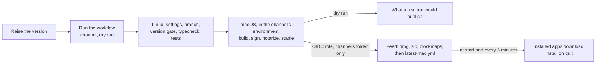

# Packaging, signing, updates, and the release workflow

How the app of [main-process.md](main-process.md) ships: what goes into the package, what the binary
refuses, how macOS trusts it, how an installed app updates, and the workflow that releases it with
no stored cloud key. What was checked, and how, is stated at each step:

- The packager's config typechecks against electron-builder 26.18. A directory build of it launches;
  its fuses were read back and tried, and so were the switches no fuse covers. A zip build with a
  feed URL wrote the feed file, the blockmap, and `app-update.yml`.
- The workflow's YAML parses, its shell passes `bash -n`, and its version gate ran against stub
  feeds in all eight cases below.
- The Terraform passes `terraform fmt`. Signing, notarizing, publishing, the updater's install, and
  the AWS role follow a workflow in production use, but were not run here: they need the release
  identities.
- The rules behind the workflow are `ci-github-actions`' and those behind the role
  `ci-cloud-oidc`'s, in the `ci` plugin; this page keeps what a desktop release adds to them: the
  macOS runner, signing, notarizing, and the update feed.



## 1. What ships

The packager's config reads the channel table the app reads, so a channel's id, name, and scheme are
written once.

```ts
// The packager's config for the channel in DESKTOP_CHANNEL (dev unless it says prod). CI also sets
// DESKTOP_SERVER, the server the build talks to, and DESKTOP_RELEASES_URL, the public folder of the
// channels' feeds; a local build has neither, so it has no feed and never updates itself.
import type { Configuration } from "electron-builder";

import releaseChannelConfig from "#desktop/main/config/release-channel.config.ts";

const { getUpdateFeedUrl, parseReleaseChannel, RELEASE_CHANNEL } = releaseChannelConfig;

const { DESKTOP_CHANNEL, DESKTOP_SERVER, DESKTOP_RELEASES_URL } = process.env;

const channel = parseReleaseChannel(DESKTOP_CHANNEL);
const identity = RELEASE_CHANNEL[channel];
const updateFeedUrl = DESKTOP_RELEASES_URL ? getUpdateFeedUrl(DESKTOP_RELEASES_URL, channel) : null;

const config: Configuration = {
  appId: identity.appId,
  productName: identity.productName,
  artifactName: `${identity.artifactPrefix}-\${version}-\${arch}.\${ext}`,
  directories: { output: "dist", buildResources: "build" },
  // the bundles and the manifest only: every dependency is inside the bundles
  files: ["out/**", "package.json"],
  asar: true,
  // the product name names the data folder, the logs, and the keychain entry; the package name names
  // the updater's cache; `desktopRelease` is read at start (config/package-metadata.ts)
  extraMetadata: {
    name: identity.packageName,
    productName: identity.productName,
    desktopRelease: { channel, serverOrigin: DESKTOP_SERVER ?? null, updateFeedUrl }
  },
  // what the shipped binary refuses, whatever its environment says
  electronFuses: {
    runAsNode: false,
    enableCookieEncryption: true,
    enableNodeOptionsEnvironmentVariable: false,
    enableNodeCliInspectArguments: false,
    enableEmbeddedAsarIntegrityValidation: true,
    onlyLoadAppFromAsar: true,
    grantFileProtocolExtraPrivileges: false
  },
  protocols: [{ name: `${identity.productName} link`, schemes: [identity.scheme] }],
  mac: {
    // the zip is what the updater downloads; the dmg is what people install from
    target: [
      { target: "dmg", arch: "universal" },
      { target: "zip", arch: "universal" }
    ],
    category: "public.app-category.productivity",
    hardenedRuntime: true,
    entitlements: "build/entitlements.mac.plist",
    entitlementsInherit: "build/entitlements.mac.plist",
    notarize: true
  },
  win: { target: [{ target: "nsis", arch: ["x64", "arm64"] }] },
  nsis: { oneClick: true, perMachine: false },
  linux: { target: ["AppImage"], category: "Utility" },
  // writes the feed file (latest-mac.yml, latest.yml) beside the builds and app-update.yml into the app
  publish: updateFeedUrl ? { provider: "generic", url: updateFeedUrl } : null
};

export default config;
```

- **The package holds the bundles and the manifest only.** Every runtime dependency (zod,
  electron-updater) is a dev dependency the bundler inlines, so the packager finds no `node_modules`
  to copy. The asar of the fixture's build holds `out/main.cjs`, `out/preload.cjs`, `out/renderer/`,
  and `package.json`, nothing else.
- **`extraMetadata` carries the build's facts**: the channel's package name (the updater's cache)
  and product name (the data folder, the logs, the keychain entry), and `desktopRelease`, which main
  parses at start. The fixture's directory build wrote
  `{"channel":"dev","serverOrigin":null,"updateFeedUrl":null}`.
- **macOS ships a dmg and a zip, both universal**: people install from the dmg, and the updater
  downloads the zip (Squirrel.Mac takes nothing else).
- **`publish` writes the feed file** beside the builds (`latest-mac.yml`, `latest.yml`) and
  `app-update.yml` into the app, even with `--publish never`: a zip build of the fixture with
  `DESKTOP_RELEASES_URL` set wrote `latest-mac.yml`, the zip's blockmap, and `app-update.yml`. The
  workflow uploads them itself; the packager publishes nothing.

The fixture's own `package.json` scripts are in [main-process.md](main-process.md) § 1: `dist`
builds an ad hoc signed directory to try locally, and `release` builds what CI signs.

## 2. The fuses

The fuses are flipped in the Electron binary when it is packaged, so a shipped app refuses them
whatever its environment says.

| Fuse                                    | Set | So that                                              |
| --------------------------------------- | --- | ---------------------------------------------------- |
| `runAsNode`                             | off | `ELECTRON_RUN_AS_NODE` cannot turn the app into Node |
| `enableNodeOptionsEnvironmentVariable`  | off | `NODE_OPTIONS` cannot load code into main            |
| `enableNodeCliInspectArguments`         | off | `--inspect` opens no debugger                        |
| `enableEmbeddedAsarIntegrityValidation` | on  | A changed asar fails to load                         |
| `onlyLoadAppFromAsar`                   | on  | No loose `app/` folder replaces the asar             |
| `grantFileProtocolExtraPrivileges`      | off | `file://` pages get no more than a browser's         |
| `enableCookieEncryption`                | on  | Cookies on disk are encrypted with the OS's key      |

What the fixture's directory build did:

```text
$ npx @electron/fuses read --app "dist/mac-arm64/Studio Dev.app"
  RunAsNode is Disabled
  EnableCookieEncryption is Enabled
  EnableNodeOptionsEnvironmentVariable is Disabled
  EnableNodeCliInspectArguments is Disabled
  EnableEmbeddedAsarIntegrityValidation is Enabled
  OnlyLoadAppFromAsar is Enabled
  LoadBrowserProcessSpecificV8Snapshot is Disabled
  GrantFileProtocolExtraPrivileges is Disabled
```

- Launched, it logged `app.started`, and `app.disposed` on `SIGTERM`.
- With `ELECTRON_RUN_AS_NODE=1` and `-e 'console.log(…)'`, it started as the app and ran no code.
- With `--inspect=9339`, it started as the app, and nothing listened on the port.

No fuse covers Chromium's own `--remote-debugging-port` and `--remote-debugging-pipe`: before the
entry checked for them, the fused build started with `--remote-debugging-port=9447` and listed
`app://studio/` over the DevTools protocol, so any process that can start the app could script its
pages and their bridge. The entry now exits when a packaged app sees either
([main-process.md](main-process.md) § 2), and the same build printed `app.refused-switch`, exited
with code 1, and left the port closed. Started with `STUDIO_SERVER=http://127.0.0.1:9`, it kept its
own server.

The cost: Playwright drives Electron through the inspector, so the smoke test runs the unpackaged
app (`electron .`), and the packaged binary is tried as above.

## 3. Signing and notarizing

```xml
<?xml version="1.0" encoding="UTF-8"?>
<!DOCTYPE plist PUBLIC "-//Apple//DTD PLIST 1.0//EN" "http://www.apple.com/DTDs/PropertyList-1.0.dtd">
<!-- The hardened runtime's one exception Electron needs: V8's JIT. Add one only for a feature that
     needs it (the camera, the microphone), with its usage text in the packager's extendInfo. -->
<plist version="1.0">
<dict>
  <key>com.apple.security.cs.allow-jit</key>
  <true/>
</dict>
</plist>
```

- **A release is signed with the Developer ID Application certificate** (`CSC_LINK`, a base64
  `.p12`, and `CSC_KEY_PASSWORD`), under the hardened runtime, with the JIT entitlement only. An
  entitlement is added for a feature that needs it (the camera's
  `com.apple.security.device.camera`), with its usage text in `mac.extendInfo`.
- **It is notarized with an App Store Connect API key**, never an Apple ID and password: the
  packager reads `APPLE_API_KEY` (the `.p8` file's path), `APPLE_API_KEY_ID`, and
  `APPLE_API_ISSUER`, and staples the ticket. The workflow checks each app with
  `xcrun stapler validate` before anything is published.
- **A local build is signed ad hoc, with the hardened runtime off**
  (`-c.mac.identity=- -c.mac.hardenedRuntime=false -c.mac.notarize=false`). Both halves were needed:
  - `identity=null` left the binary unsigned after the fuses were flipped
    (`code has no resources but signature indicates they must be present`), and Apple silicon killed
    it at launch;
  - ad hoc with the hardened runtime on failed library validation, and the app never started.

  An ad hoc build opens on another Mac only through System Settings → Privacy & Security → Open
  Anyway, since macOS 15 no longer lets a right-click → Open pass Gatekeeper. It never updates
  itself: it has no feed, and macOS refuses to swap in an ad hoc app.

## 4. Updates

```ts
import { autoUpdater } from "electron-updater";
import type { ProgressInfo, UpdateDownloadedEvent } from "electron-updater";

import type { Desktop } from "#desktop/index.ts";

const CHECK_INTERVAL_MS = 5 * 60 * 1000;

/**
 * Keeps the app on the latest release of its channel, read from the channel's public feed: a newer
 * version downloads in the background, installs when the app quits, or at once when the person asks.
 * Only a packaged CI build has a feed; any other build says it cannot update itself.
 */
export default class AppUpdater
  implements Desktop.Main.Base.Startable, Desktop.Main.Shell.Scheme.UpdateRequiredListener
{
  readonly #config: Desktop.Main.Config.Values;
  readonly #publisher: Desktop.Main.Shell.Ipc.Publisher;
  readonly #logger: Desktop.Main.Base.Logger;

  #status: Desktop.Shared.UpdateStatus = {
    state: "idle",
    isRequired: false,
    progress: 0,
    version: null
  };

  #timer: NodeJS.Timeout | null = null;

  constructor(deps: Desktop.Main.Shell.Update.AppUpdater.Deps) {
    this.#config = deps.config;
    this.#publisher = deps.publisher;
    this.#logger = deps.logger;
  }

  get status(): Desktop.Shared.UpdateStatus {
    return this.#status;
  }

  start(): void {
    const feedUrl = this.#config.updateFeedUrl;

    if (!feedUrl) {
      this.#setStatus({ state: "unsupported" });

      return;
    }

    autoUpdater.logger = null;
    autoUpdater.autoInstallOnAppQuit = true;
    autoUpdater.setFeedURL({ provider: "generic", url: feedUrl });
    autoUpdater.on("download-progress", this.#handleProgress);
    autoUpdater.on("update-downloaded", this.#handleDownloaded);
    autoUpdater.on("error", this.#handleError);

    this.#check();
    this.#timer = setInterval(() => this.#check(), CHECK_INTERVAL_MS);
  }

  dispose(): void {
    if (this.#timer) {
      clearInterval(this.#timer);
    }

    autoUpdater.off("download-progress", this.#handleProgress);
    autoUpdater.off("update-downloaded", this.#handleDownloaded);
    autoUpdater.off("error", this.#handleError);
  }

  /** The server refused this version (426): the windows show that an update is required. */
  requireUpdate(): void {
    if (this.#status.isRequired) {
      return;
    }

    this.#logger.warn("update.required", { version: this.#config.appVersion });

    this.#setStatus({ isRequired: true });

    this.#check();
  }

  /** Restarts into the downloaded version; nothing happens until one is ready. */
  install(): void {
    if (this.#status.state === "ready") {
      autoUpdater.quitAndInstall();
    }
  }

  #check(): void {
    const { state } = this.#status;

    if (state === "unsupported" || state === "downloading" || state === "ready") {
      return;
    }

    this.#setStatus({ state: "idle" });

    autoUpdater.checkForUpdates().catch((err: unknown) => {
      this.#logger.warn("update.check-failed", { err });

      this.#setStatus({ state: "failed" });
    });
  }

  #setStatus(change: Partial<Desktop.Shared.UpdateStatus>): void {
    this.#status = { ...this.#status, ...change };

    this.#publisher.publish("updateStatus", this.#status);
  }

  readonly #handleProgress = ({ percent }: ProgressInfo): void => {
    this.#setStatus({ state: "downloading", progress: percent / 100 });
  };

  readonly #handleDownloaded = ({ version }: UpdateDownloadedEvent): void => {
    this.#logger.info("update.downloaded", { version });

    this.#setStatus({ state: "ready", progress: 1, version });
  };

  readonly #handleError = (err: Error): void => {
    this.#logger.warn("update.failed", { err });

    this.#setStatus({ state: "failed" });
  };
}

declare module "@acme/app-desktop" {
  namespace Desktop.Main.Shell.Update.AppUpdater {
    type Deps = {
      readonly config: Desktop.Main.Config.Values;
      readonly publisher: Desktop.Main.Shell.Ipc.Publisher;
      readonly logger: Desktop.Main.Base.Logger;
    };
  }
}
```

| In the channel's folder                      | Written by          | Read by                   |
| -------------------------------------------- | ------------------- | ------------------------- |
| `Studio-1.4.0-universal.dmg`                 | The workflow, first | People installing the app |
| `Studio-1.4.0-universal.zip` and `.blockmap` | The workflow, first | The updater (in parts)    |
| `latest-mac.yml`                             | The workflow, last  | The updater, and the gate |

- **The feed file goes last, and is never cached** (`Cache-Control: no-store`), so it never names a
  file that is not there yet, and an app sees a release as soon as it is out.
- **The blockmaps make updates differential**: the updater downloads only the parts of the zip that
  changed.
- **A release can roll out in stages**: `stagingPercentage: 10` in the feed file offers it to that
  share of installs, by a stable id each install keeps; raising it widens the rollout, and a release
  with a fault is stopped by publishing a higher version.
- **A server that cannot serve an old app raises its minimum version**, in the same deploy as the
  change. Every request names the app's version (`x-studio-version`); below the minimum the server
  answers 426, the scheme marks the update required, and the windows say so. Every other server
  change is additive, since installed apps call it at whatever version they are.
- **Only a packaged CI build has a feed**; any other build reports `unsupported` and never checks.
- **`quitAndInstall()` closes every window before `before-quit` fires**, so the lifecycle disposes
  as on any quit.

## 5. The release workflow

```yaml
name: Desktop release

# Run by hand with a channel: builds the macOS app (universal), signs it with the Developer ID
# certificate, notarizes it, and publishes the dmg, the zip, their blockmaps, and latest-mac.yml to
# the channel's folder in the public release bucket, where installed apps read their updates. Each
# channel's environment enforces its branches: dev any protected branch, since it holds the same
# signing identity as prod; prod the release branch only. A run releases only a version newer than
# its channel's feed. A dry run, the default, does all of it but publish, and reports what a real
# run would refuse instead of stopping.
on:
  workflow_dispatch:
    inputs:
      channel:
        description:
          dev (Studio Dev, from a protected branch) or prod (Studio, from the release branch)
        type: choice
        options: [dev, prod]
        default: dev
      dry_run:
        description: "Dry run: check, build, sign, and notarize, but publish nothing"
        type: boolean
        default: true
      first_release:
        description: "The channel's first release: read a 403 from its feed as nothing published"
        type: boolean
        default: false

# One run per channel at a time: a second waits, then finds its version published and stops.
concurrency:
  group: desktop-release-${{ inputs.channel }}
  cancel-in-progress: false

permissions: {}

jobs:
  # Everything that can refuse a run, on Linux, so a refused run never starts a macOS runner, which
  # costs about ten times the minutes.
  prepare:
    runs-on: ubuntu-latest
    timeout-minutes: 15
    permissions:
      contents: read
    outputs:
      version: ${{ steps.check.outputs.version }}
    defaults:
      run:
        working-directory: src/apps/desktop
    steps:
      - uses: actions/checkout@3d3c42e5aac5ba805825da76410c181273ba90b1 # v7.0.1
        with:
          persist-credentials: false
      - name: Check the channel and the version
        id: check
        env:
          CHANNEL: ${{ inputs.channel }}
          DRY_RUN: ${{ inputs.dry_run }}
          FIRST_RELEASE: ${{ inputs.first_release }}
          RELEASES_URL: ${{ vars.DESKTOP_RELEASES_URL }}
          RELEASE_BRANCH: ${{ vars.DESKTOP_RELEASE_BRANCH }}
        run: |
          fail() { echo "::error::$1"; exit 1; }
          # what a real run refuses, a dry run only reports
          refuse() {
            if [ "$DRY_RUN" = true ]; then echo "::warning::a real run stops here: $1"; else fail "$1"; fi
          }

          test -n "$RELEASES_URL" || fail "set the repository variable DESKTOP_RELEASES_URL"
          test -n "$RELEASE_BRANCH" || fail "set the repository variable DESKTOP_RELEASE_BRANCH"
          case "$RELEASES_URL" in */) fail "write DESKTOP_RELEASES_URL without the trailing slash" ;; esac

          if [ "$CHANNEL" = prod ] && [ "$GITHUB_REF" != "refs/heads/$RELEASE_BRANCH" ]; then
            refuse "prod releases from $RELEASE_BRANCH, not $GITHUB_REF_NAME"
          fi

          # MAJOR.MINOR.PATCH only: sort -V orders those as semver does, but not pre-releases
          semver='^[0-9]+\.[0-9]+\.[0-9]+$'
          version=$(node -p "require('./package.json').version")
          [[ $version =~ $semver ]] || fail "the version must be MAJOR.MINOR.PATCH, not $version"

          # a feed that cannot be read stops the run, so a network error never lets an old version out
          feed="$RUNNER_TEMP/latest-mac.yml"
          published=
          status=$(curl -s -o "$feed" -w '%{http_code}' "$RELEASES_URL/$CHANNEL/latest-mac.yml" || true)
          case "$status" in
            404) ;;
            # a bucket that may not be listed answers 403 for a missing key, but so does one whose
            # reads broke: only a first release, said so, reads 403 as nothing published
            403)
              if [ "$FIRST_RELEASE" != true ]; then
                refuse "the $CHANNEL feed answered HTTP 403: if $CHANNEL has never been released, run with first_release"
              fi
              ;;
            200)
              published=$(sed -n 's/^version: *//p' "$feed")
              [[ $published =~ $semver ]] || refuse "cannot read the version in the $CHANNEL feed"
              ;;
            *) refuse "cannot check the version: the $CHANNEL feed answered HTTP $status" ;;
          esac

          newest=$(printf '%s\n%s\n' "$version" "$published" | sort -V | tail -n 1)
          if [ -n "$published" ] && { [ "$version" = "$published" ] || [ "$newest" != "$version" ]; }; then
            refuse "$CHANNEL already has $published: raise the version in package.json (it says $version)"
          fi

          echo "::notice::$CHANNEL $version (published: ${published:-nothing})"
          echo "version=$version" >> "$GITHUB_OUTPUT"
      # no cache in a release: what ships is built from the lockfile's packages, never a restored one
      - uses: actions/setup-node@949feb2413d6458794dcd2491c4babbbce0c15c1 # v7.1.0
        with:
          node-version: "24"
      # the unit tests never start Electron, so its binary is not downloaded here
      - name: Install dependencies
        env:
          ELECTRON_SKIP_BINARY_DOWNLOAD: "1"
        run: npm ci
      - name: Typecheck and unit tests
        run: npm run typecheck && npm test

  # Builds, signs, and notarizes with the channel's signing secrets, and keeps the result as this
  # run's artifact. No cloud access: every step here runs the dependencies' code.
  macos-build:
    needs: prepare
    runs-on: macos-15
    timeout-minutes: 60
    environment: desktop-${{ inputs.channel }}
    permissions:
      contents: read
    defaults:
      run:
        working-directory: src/apps/desktop
    env:
      DESKTOP_CHANNEL: ${{ inputs.channel }}
      DESKTOP_RELEASES_URL: ${{ vars.DESKTOP_RELEASES_URL }}
    steps:
      # the environment's variables, which the prepare job cannot see, before the long build
      - name: Check the environment's variables
        working-directory: .
        env:
          SERVER: ${{ vars.DESKTOP_SERVER }}
          APPLE_API_KEY_ID: ${{ vars.DESKTOP_APPLE_API_KEY_ID }}
          APPLE_API_ISSUER: ${{ vars.DESKTOP_APPLE_API_ISSUER_ID }}
        run: |
          need() { test -n "$1" || { echo "::error::set the variable $2"; exit 1; }; }
          need "$SERVER" DESKTOP_SERVER
          need "$APPLE_API_KEY_ID" DESKTOP_APPLE_API_KEY_ID
          need "$APPLE_API_ISSUER" DESKTOP_APPLE_API_ISSUER_ID
      - uses: actions/checkout@3d3c42e5aac5ba805825da76410c181273ba90b1 # v7.0.1
        with:
          persist-credentials: false
      - uses: actions/setup-node@949feb2413d6458794dcd2491c4babbbce0c15c1 # v7.1.0
        with:
          node-version: "24"
      # again on macOS: Electron and native modules are per platform
      - name: Install dependencies
        run: npm ci
      - name: Build, sign, and notarize
        env:
          CSC_LINK: ${{ secrets.DESKTOP_CSC_LINK }}
          CSC_KEY_PASSWORD: ${{ secrets.DESKTOP_CSC_KEY_PASSWORD }}
          APPLE_API_KEY_P8: ${{ secrets.DESKTOP_APPLE_API_KEY }}
          APPLE_API_KEY_ID: ${{ vars.DESKTOP_APPLE_API_KEY_ID }}
          APPLE_API_ISSUER: ${{ vars.DESKTOP_APPLE_API_ISSUER_ID }}
          DESKTOP_SERVER: ${{ vars.DESKTOP_SERVER }}
        run: |
          export APPLE_API_KEY="$RUNNER_TEMP/notary.p8"
          printf '%s' "$APPLE_API_KEY_P8" > "$APPLE_API_KEY"
          npm run release
          for app in dist/mac-universal/*.app; do xcrun stapler validate "$app"; done
      - uses: actions/upload-artifact@cf430e030ddbb5b0abf93d22962f4752f3646cd9 # v7.0.2
        with:
          name: desktop-release
          path: |
            src/apps/desktop/dist/*.dmg
            src/apps/desktop/dist/*.zip
            src/apps/desktop/dist/*.blockmap
            src/apps/desktop/dist/latest-mac.yml
          if-no-files-found: error
          retention-days: 7

  # Publishes the build with the channel's role. It installs and builds nothing, so no dependency's
  # code runs in the one job that can ask for the OIDC token.
  publish:
    needs: [prepare, macos-build]
    runs-on: ubuntu-latest
    timeout-minutes: 15
    # DESKTOP_AWS_ROLE_ARN: the role that may write only this channel's folder and trusts only this
    # environment
    environment: desktop-${{ inputs.channel }}
    permissions:
      id-token: write
    env:
      DESKTOP_CHANNEL: ${{ inputs.channel }}
      DESKTOP_S3_PATH: ${{ vars.DESKTOP_S3_PATH }}
    steps:
      - name: Check the environment's variables
        env:
          ROLE_ARN: ${{ vars.DESKTOP_AWS_ROLE_ARN }}
          REGION: ${{ vars.DESKTOP_AWS_REGION }}
        run: |
          need() { test -n "$1" || { echo "::error::set the variable $2"; exit 1; }; }
          need "$DESKTOP_S3_PATH" DESKTOP_S3_PATH
          need "$ROLE_ARN" DESKTOP_AWS_ROLE_ARN
          need "$REGION" DESKTOP_AWS_REGION
      - uses: actions/download-artifact@9000827ccba6bdab643e8b6fd33ac0654aef8333 # v8.0.2
        with:
          name: desktop-release
          path: dist
      # credentials for an hour and no stored key; a dry run signs in too, which proves the role's
      # trust before a real run needs it
      - name: Sign in to AWS as the channel's role
        uses: aws-actions/configure-aws-credentials@e1253824e5c10ff9df46874f81ed3ec929e19cfd # v6.3.0
        with:
          role-to-assume: ${{ vars.DESKTOP_AWS_ROLE_ARN }}
          aws-region: ${{ vars.DESKTOP_AWS_REGION }}
      - name: Dry run (nothing published)
        if: inputs.dry_run
        run: |
          ls -l dist/*.dmg dist/*.zip dist/*.blockmap dist/latest-mac.yml
          echo "::notice::would publish the files above to s3://$DESKTOP_S3_PATH/$DESKTOP_CHANNEL/"
      # the feed goes last, so it never names a file that is not there yet
      - name: Publish to the release bucket
        if: ${{ !inputs.dry_run }}
        env:
          VERSION: ${{ needs.prepare.outputs.version }}
        run: |
          folder="s3://$DESKTOP_S3_PATH/$DESKTOP_CHANNEL"
          for file in dist/*.dmg dist/*.zip dist/*.blockmap; do
            aws s3 cp "$file" "$folder/$(basename "$file")"
          done
          aws s3 cp dist/latest-mac.yml "$folder/latest-mac.yml" --cache-control no-store
          echo "::notice::published $DESKTOP_CHANNEL $VERSION"
```

What each channel's GitHub environment holds; nothing release-specific sits at repository level
except the public URLs:

| Where                 | Name                                           | Holds                                        |
| --------------------- | ---------------------------------------------- | -------------------------------------------- |
| Repository variables  | `DESKTOP_RELEASES_URL`, `DESKTOP_S3_PATH`      | Where apps read, where CI writes (no slash)  |
| Repository variables  | `DESKTOP_RELEASE_BRANCH`                       | The branch prod releases from                |
| Environment variables | `DESKTOP_SERVER`                               | The server built into the channel's app      |
| Environment variables | `DESKTOP_AWS_ROLE_ARN`, `DESKTOP_AWS_REGION`   | The channel's role (§ 6)                     |
| Environment variables | `DESKTOP_APPLE_API_KEY_ID`, `…_API_ISSUER_ID`  | The App Store Connect key's ids (not secret) |
| Environment secrets   | `DESKTOP_CSC_LINK`, `DESKTOP_CSC_KEY_PASSWORD` | The Developer ID certificate                 |
| Environment secrets   | `DESKTOP_APPLE_API_KEY`                        | The App Store Connect key (`.p8` text)       |

- **The signing identity is one for both channels.** The Developer ID certificate and the notary key
  sign and notarize as the company, whichever channel's environment holds them, so the dev
  environment needs the same care as prod.
- **Each environment limits its branches** with a deployment branch rule: prod the release branch
  only, dev protected branches only, and either can require a reviewer, who then approves both of
  the run's jobs in it. GitHub itself withholds the secrets and the role from any other run, a dry
  run included, and from a branch whose pushed workflow would print them.
- **Three jobs, each holding only what it needs.** `prepare` holds nothing. `macos-build` holds the
  signing secrets and no cloud access, since every step there runs the dependencies' code. `publish`
  installs and builds nothing, downloads the signed build, and is the one job with
  `id-token: write`: every step of a job with it can ask for the token, so no package's script runs
  there.
- **No cache**: the jobs install from the registry, since a cache the default branch's other
  workflows can write would reach the signed app.
- **The gate runs on Linux, before the macOS runner starts**, which costs about ten times the
  minutes. A dry run reports what a real run would refuse instead of stopping, and still signs,
  notarizes, and assumes the role, which proves the secrets and the trust before a real run needs
  them.
- **The gate reads the published feed and refuses the same or an older version.** A feed it cannot
  read stops the run, so a network error never lets an old version out. A 404 is nothing published;
  a 403 is only on a channel's first release, run with `first_release`, since a bucket that may not
  be listed answers 403 for a missing file, and so does every file once its reads break.
- **One run per channel at a time** (`concurrency`): a second waits, then finds the version
  published and stops.
- **Actions are pinned to a commit**, with the tag in a comment, and the checkout keeps no
  credentials.

The gate's step, run against stub feeds (`exit=1` is a refusal):

```text
feed      channel ref                 dry  first  result
1.3.9     prod    refs/heads/release  no   no     exit=0 prod 1.4.0 (published: 1.3.9)
none 403  dev     refs/heads/main     no   no     exit=1 the dev feed answered HTTP 403
none 403  dev     refs/heads/main     no   yes    exit=0 dev 1.4.0 (published: nothing)
1.4.0     dev     refs/heads/main     no   no     exit=1 dev already has 1.4.0
1.5.0     dev     refs/heads/main     no   no     exit=1 dev already has 1.5.0
HTTP 500  dev     refs/heads/main     no   no     exit=1 cannot check the version: HTTP 500
garbled   dev     refs/heads/main     no   no     exit=1 cannot read the version in the dev feed
1.3.9     prod    refs/heads/main     no   no     exit=1 prod releases from release, not main
1.4.0     dev     refs/heads/main     yes  no     exit=0 warning: a real run stops here
none 403  dev     refs/heads/main     yes  no     exit=0 warning: a real run stops here
HTTP 500  dev     refs/heads/main     yes  no     exit=0 warning: a real run stops here
```

## 6. Cloud access without a stored key

The publish job asks GitHub for an OIDC token (`id-token: write`) and trades it for an hour as its
channel's role. The role trusts only jobs in its own environment, and may write only its channel's
folder, so a dev run can never write the feed every released app reads.

```hcl
# The roles a desktop release job assumes with GitHub's OIDC token, so the job holds no AWS key. One
# role per channel: each trusts only jobs in its own GitHub environment, and may write only its own
# channel's folder, so a dev run can never write the feed every released app reads.

variable "github_repository" {
  description = "owner/name of the repository whose release workflow assumes the roles"
  type        = string
}

variable "release_bucket" {
  description = "The bucket the apps read their updates from"
  type        = string
}

variable "release_prefix" {
  description = "The app's folder in the bucket, holding one folder per channel"
  type        = string
  default     = "desktop"
}

variable "channels" {
  description = "One role per release channel"
  type        = set(string)
  default     = ["dev", "prod"]
}

# created once per account: url https://token.actions.githubusercontent.com, audience sts.amazonaws.com
data "aws_iam_openid_connect_provider" "github_actions" {
  url = "https://token.actions.githubusercontent.com"
}

data "aws_iam_policy_document" "desktop_release_trust" {
  for_each = var.channels

  statement {
    effect  = "Allow"
    actions = ["sts:AssumeRoleWithWebIdentity"]

    principals {
      type        = "Federated"
      identifiers = [data.aws_iam_openid_connect_provider.github_actions.arn]
    }

    condition {
      test     = "StringEquals"
      variable = "token.actions.githubusercontent.com:aud"
      values   = ["sts.amazonaws.com"]
    }

    # the environment, not the branch: the environment's own rules decide which branch may use it
    condition {
      test     = "StringEquals"
      variable = "token.actions.githubusercontent.com:sub"
      values   = ["repo:${var.github_repository}:environment:desktop-${each.key}"]
    }
  }
}

resource "aws_iam_role" "desktop_release" {
  for_each = var.channels

  name                 = "desktop-release-${each.key}"
  assume_role_policy   = data.aws_iam_policy_document.desktop_release_trust[each.key].json
  max_session_duration = 3600
}

data "aws_iam_policy_document" "desktop_release_write" {
  for_each = var.channels

  statement {
    effect    = "Allow"
    actions   = ["s3:PutObject", "s3:AbortMultipartUpload"]
    resources = ["arn:aws:s3:::${var.release_bucket}/${var.release_prefix}/${each.key}/*"]
  }
}

resource "aws_iam_role_policy" "desktop_release_write" {
  for_each = var.channels

  name   = "desktop-release-write"
  role   = aws_iam_role.desktop_release[each.key].id
  policy = data.aws_iam_policy_document.desktop_release_write[each.key].json
}

output "role_arns" {
  description = "Each channel's role, for its GitHub environment's DESKTOP_AWS_ROLE_ARN"
  value       = { for channel, role in aws_iam_role.desktop_release : channel => role.arn }
}
```

- **The trust names the environment**, `repo:<owner>/<repo>:environment:desktop-<channel>`, not a
  branch: the environment's own branch rule decides who reaches it (§ 5), and a job that names no
  environment gets a different subject and is refused.
- **The audience is checked too** (`sts.amazonaws.com`); the account's GitHub OIDC provider is
  created once and shared by every role that trusts GitHub.
- **The role writes, and nothing else**: `s3:PutObject` overwrites the feed file, and
  `s3:AbortMultipartUpload` cleans up a large upload cut short. It cannot read, list, or delete.
- **The bucket lets anyone read the app's prefix and nobody list it**, so a missing feed answers
  403, which the gate reads as nothing published on a first release only. A bucket name with dots
  fails TLS at its `<bucket>.s3.<region>.amazonaws.com` address; the apps read through the CDN's
  host instead.

**Google Cloud Storage** in place of S3 follows `ci-cloud-oidc` (the `ci` plugin): the channel's
environment principal itself holds `roles/storage.objectUser` on the channel's folder and a
bucket-wide list role, with no service account and no key, and the publish job uploads with
`gcloud storage cp`, the feed last with `--cache-control=no-store`.

## Porting

- **Windows**: an `nsis` target per architecture, and `latest.yml` beside it. Sign with Authenticode
  through a cloud key (`win.azureSignOptions`: `publisherName`, `endpoint`,
  `certificateProfileName`, `codeSigningAccountName`), since a code-signing key may no longer live
  in a file on a runner. A new certificate starts with no SmartScreen reputation, so the first
  installs warn.
- **Linux**: an `AppImage` updates itself from `latest-linux.yml`; a `deb` or `rpm` updates through
  its package manager instead.
- **Releases on GitHub** in place of a bucket: the `github` publish provider, with the token's
  permission limited to `contents: write` on the release job. A public repository can also use
  `update.electronjs.org` with Electron Forge.
- **A private feed**: the updater sends `requestHeaders` (or `addAuthHeader(token)`) with each
  request, and the token comes from the signed-in session, never the build.
- **The release identities rotate** in the environments only; a developer never holds the
  certificate or the API key, and a local build never needs them.
