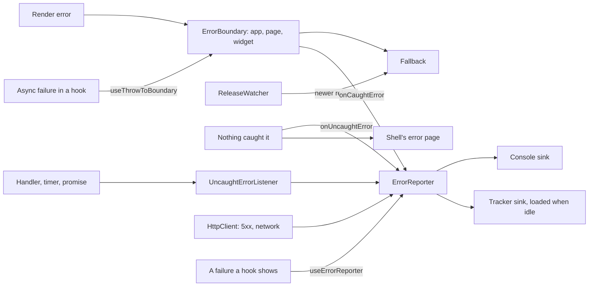

# Error boundaries and unhandled errors

How a React app catches, shows, and reports every error, for [§ Errors](../SKILL.md#errors). Every
module below typechecks against React 19.3 in one app with the router of
[web-router.md](web-router.md) and the release watcher of [web-build.md](web-build.md), and the
suites at the end pass over a DOM in Node. It holds with any state library and any error tracker.
`@acme/app-web` and its type root `Web` stand for the app's package and namespace.

## The idea

1. **Every error reaches one reporter, once.** React's root options report what React sees: an error
   a boundary caught, and a render React had to retry. A window listener reports what React never
   sees: an error thrown in an event handler or a timer, and a promise nobody awaited. The API
   client reports a request that failed unexpectedly, and a hook that shows a failure itself reports
   it through the reporter's context. The reporter drops an error it has already sent, noise, and a
   flood.
2. **Boundaries go by layer, and each keeps what is above it.** The app's sits under the theme and
   replaces everything else; a page's sits in its layout, so the navigation stays, and a new
   location clears it; a widget's surrounds a part that fails on its own (a player, an editor, a
   chart), so the rest of the page works.
3. **A boundary only renders a fallback.** Reporting stays at the root, so a boundary added later
   cannot forget to report, and none reports twice.
4. **A fallback uses nothing that may have failed**: no store, no router, no request.
5. **A fallback says what the person can do.** Offline, they reconnect. When a file a deploy
   replaced failed to load, or a newer release is out and this page's old code may be what broke, a
   reload brings the new release. A bug is retried by mounting the part again with a fresh model,
   and at the app's layer by a reload. A failed lazy import is never retried in place: `lazy()`
   keeps the failure.
6. **A failure outside render goes where the person sees it**: shown where it happened (an inline
   error, a toast), or handed to the nearest boundary when the view cannot go on. Nothing is
   swallowed.
7. **A report says where to look**: the release, the page's path without its query, where the error
   was seen, the boundary's name, and the component stack. The tracker loads when the first view is
   idle and receives what was reported before it.
8. **The shell is the last line.** An error no boundary caught unmounts the whole app; the shell's
   static error page then shows, since it needs no React.



## Files

```text
src/
  index.ts                              the one entry: reporting, then the app; the type root
  config/errors.config.ts               what the reporter drops and caps
  base/
    ErrorBoundary.tsx                   a fallback in place of a subtree that threw
    useThrowToBoundary.tsx              a failure from outside render, to the boundary
    useIsOnline.tsx                     the network, as it comes and goes
    to-error.ts, *.error.ts             any thrown value as an Error; a missing provider
  core/errors/
    error-reporter.ts                   ErrorReporter: once, filtered, capped, to every sink
    uncaught-error-listener.ts          window errors and rejections nobody awaited
    console-error-sink.ts               reports to the console
    tracker-error-sink.ts               reports to the error tracker
    error-reporter-context.ts           the reporter, for hooks
    useErrorReporter.tsx
  core/http/                            HttpClient, which reports what fails unexpectedly
  core/release/                         the release watcher (web-build.md), and its context
  app/
    mount-app.ts                        the composition root, loaded behind import()
    create-app-root.ts                  the React root and its error options
    start-error-tracker.ts              the tracker, once the first view is idle
    error-tracker-client.adapter.ts     the tracker's SDK, set up for this app
    load-chunk.ts                       lazy chunks (web-build.md), aware of the network
    comp/errors/                        the error kinds, ErrorPanel, and the fallbacks
    comp/player/                        a widget that shows and reports its own failure
    App.tsx                             the services' providers, and the app's boundary
    router/layouts/MainLayout.tsx       the page's boundary
    pages/video/                        a widget's boundary, and a hook handing a failure over
```

## 1. Configuration

```ts
// config/errors.config.ts
/** What the reporter drops, how much one page sends, and what a fallback shows. */
const errorsConfig = {
  // A stack that starts in a browser extension: code the page never shipped.
  EXTENSION_FRAME_PATTERN: /(chrome|moz|safari(-web)?)-extension:\/\//,
  // Cancelling is not failing: work stopped on purpose rejects with an AbortError.
  IGNORED_ERROR_NAMES_SET: new Set(["AbortError"]) as ReadonlySet<string>,
  // Browser noise with nothing to fix, and a third-party script's error with its details hidden.
  IGNORED_MESSAGE_PATTERNS_LIST: [/^ResizeObserver loop/, /^Script error\.?$/] as readonly RegExp[],
  // Development shows the error itself in a fallback; production never does.
  IS_DETAIL_SHOWN: __RELEASE_ID__ === "development",
  // The recent reports a sink that attaches late receives, such as the tracker loaded when idle.
  MAX_BACKLOG_REPORTS: 20,
  // One failure repeating in a loop is a few reports, not thousands.
  MAX_REPORTS_PER_MESSAGE: 5
} as const;

export default errorsConfig;
```

`__RELEASE_ID__` is the build's release id
([web-build.md § New releases](web-build.md#new-releases)), `"development"` in a development build.

## 2. Any thrown value as an Error

```ts
// base/thrown-value.error.ts
/** Something other than an Error was thrown or rejected; `cause` holds the value itself. */
export default class ThrownValueError extends Error {
  override readonly name = "ThrownValueError";
}
```

```ts
// base/to-error.ts
import ThrownValueError from "#web/base/thrown-value.error.ts";

const describeThrown = (thrown: unknown): string => {
  if (typeof thrown === "string") return thrown;
  try {
    return JSON.stringify(thrown) ?? String(thrown);
  } catch {
    return String(thrown);
  }
};

/** The thrown value as an Error: an Error as it is, anything else wrapped, the value as `cause`. */
export const toError = (thrown: unknown): Error =>
  thrown instanceof Error
    ? thrown
    : new ThrownValueError(describeThrown(thrown), { cause: thrown });
```

JavaScript throws anything: a string, a response object, `undefined`. Everything past this point
holds an `Error`, with a message, a stack, and the original value as its `cause`.

## 3. The reporter

```ts
// core/errors/error-reporter.ts
import { toError } from "#web/base/to-error.ts";
import errorsConfig from "#web/config/errors.config.ts";
import type { Web } from "#web/index.ts";

type ErrorReport = Web.Core.Errors.ErrorReport;
type ErrorSink = Web.Core.Errors.ErrorSink;

const STACK_FRAME_PATTERN = /:\d+:\d+/;

/**
 * The one place an error is reported. Each error goes out once, whoever saw it first (the root, a
 * window listener, a catch); noise is dropped, a repeating failure is capped, and a sink that
 * attaches late receives the recent reports.
 */
export default class ErrorReporter {
  readonly #releaseId: string;
  readonly #readPath: () => string;
  readonly #sinksList: ErrorSink[] = [];
  readonly #reportedErrorsSet = new WeakSet<Error>();
  readonly #messageCountsMap = new Map<string, number>();
  readonly #backlogReportsList: ErrorReport[] = [];

  constructor({ releaseId, readPath }: Web.Core.Errors.ErrorReporter.Deps) {
    this.#releaseId = releaseId;
    this.#readPath = readPath;
  }

  /** Adds a destination and sends it the recent reports it missed. */
  addSink(sink: ErrorSink): void {
    this.#sinksList.push(sink);

    for (const report of this.#backlogReportsList) {
      this.#sendToSink(sink, report);
    }
  }

  /** Reports a thrown value unless it went out already or is noise; true when it went out. */
  report(thrown: unknown, context: Web.Core.Errors.ErrorContext): boolean {
    const error = toError(thrown);

    if (this.#reportedErrorsSet.has(error) || this.#getIsIgnored(error)) {
      return false;
    }

    this.#reportedErrorsSet.add(error);

    const messageKey = `${error.name}: ${error.message}`;
    const messageCount = (this.#messageCountsMap.get(messageKey) ?? 0) + 1;

    this.#messageCountsMap.set(messageKey, messageCount);

    if (messageCount > errorsConfig.MAX_REPORTS_PER_MESSAGE) {
      return false;
    }

    const report: ErrorReport = {
      ...context,
      error,
      releaseId: this.#releaseId,
      pagePath: this.#readPath()
    };

    this.#backlogReportsList.push(report);

    if (this.#backlogReportsList.length > errorsConfig.MAX_BACKLOG_REPORTS) {
      this.#backlogReportsList.shift();
    }

    for (const sink of this.#sinksList) {
      this.#sendToSink(sink, report);
    }

    return true;
  }

  #getIsIgnored(error: Error): boolean {
    const firstFrameLine = error.stack?.split("\n").find(line => STACK_FRAME_PATTERN.test(line));

    return (
      errorsConfig.IGNORED_ERROR_NAMES_SET.has(error.name) ||
      errorsConfig.IGNORED_MESSAGE_PATTERNS_LIST.some(pattern => pattern.test(error.message)) ||
      errorsConfig.EXTENSION_FRAME_PATTERN.test(firstFrameLine ?? "")
    );
  }

  /** A failing sink neither breaks the caller nor keeps the report from the other sinks. */
  #sendToSink(sink: ErrorSink, report: ErrorReport): void {
    try {
      sink.send(report);
    } catch (sinkError) {
      console.warn("An error sink failed", sinkError);
    }
  }
}

declare module "@acme/app-web" {
  namespace Web.Core.Errors {
    /** Where an error was seen: the entry, React's root, a listener, the API client, a catch. */
    type ErrorSource =
      "start" | "boundary" | "root" | "recovered" | "window" | "promise" | "request" | "handled";

    type ErrorContext = Readonly<{
      source: ErrorSource;
      /** The `name` of the boundary that caught it. */
      boundaryName?: string | undefined;
      /** Where in the component tree it was thrown, as React reports it. */
      componentStack?: string | undefined;
    }>;

    type ErrorReport = ErrorContext &
      Readonly<{
        error: Error;
        releaseId: string;
        /** The page's path without its query, which may hold what a report must not carry. */
        pagePath: string;
      }>;

    /** A destination for reports: the console, the error tracker. */
    interface ErrorSink {
      send(report: ErrorReport): void;
    }
  }

  namespace Web.Core.Errors.ErrorReporter {
    type INSTANCE = ErrorReporter;
    type Deps = Readonly<{ releaseId: string; readPath: () => string }>;
  }
}
```

- **Once per error.** The same error object can reach the reporter from the API client, a boundary,
  and the window; a `WeakSet` keeps the first and lets the rest go, without holding the error in
  memory.
- **Noise is dropped by rule, in the config**: a cancellation (`AbortError`), a resize observer's
  skipped frame, a third-party script's masked `Script error.`, and a stack that starts in a browser
  extension. Each pattern names something with nothing to fix in the app.
- **A flood is capped**: one message goes out five times per page. A failure inside a loop or a
  polling interval would otherwise send thousands of copies and spend the tracker's quota.
- **A late sink catches up.** The console sink attaches at the entry; the tracker loads when the
  first view is idle and receives the last twenty reports when it attaches.
- **A failing sink is contained.** A tracker that throws neither breaks the caller (React's root, a
  listener) nor keeps the report from the console.
- **The path, never the query.** A query may hold a token, an email, or a search; the report keeps
  the path, which locates the page.

## 4. Sinks

```ts
// core/errors/console-error-sink.ts
import type { Web } from "#web/index.ts";

/**
 * Writes each report to the console, where development reads it and a support session finds it.
 * React logs a caught error itself only while the root has no `onCaughtError` of its own.
 */
export default class ConsoleErrorSink implements Web.Core.Errors.ErrorSink {
  readonly #errorOutput: Pick<Console, "error">;

  constructor({ errorOutput }: Readonly<{ errorOutput: Pick<Console, "error"> }>) {
    this.#errorOutput = errorOutput;
  }

  send({ error, source, boundaryName, componentStack }: Web.Core.Errors.ErrorReport): void {
    const label = boundaryName === undefined ? source : `${source}: ${boundaryName}`;

    this.#errorOutput.error(`[${label}]`, error, componentStack ?? "");
  }
}
```

```ts
// core/errors/tracker-error-sink.ts
import type { Web } from "#web/index.ts";

/** @external The error tracker's client: its SDK takes an exception with tags and extra data. */
type TrackerClient = {
  captureException(
    error: Error,
    context: { tags: Record<string, string>; extra: Record<string, unknown> }
  ): unknown;
};

/** Sends each report to the error tracker, tagged so its issues group by source and release. */
export default class TrackerErrorSink implements Web.Core.Errors.ErrorSink {
  readonly #trackerClient: TrackerClient;

  constructor({ trackerClient }: Readonly<{ trackerClient: TrackerClient }>) {
    this.#trackerClient = trackerClient;
  }

  send(report: Web.Core.Errors.ErrorReport): void {
    const { error, source, releaseId, pagePath, boundaryName, componentStack } = report;

    this.#trackerClient.captureException(error, {
      tags: { source, release: releaseId, boundary: boundaryName ?? "none" },
      extra: { pagePath, componentStack }
    });
  }
}
```

- The tracker sink calls the client it is given; `error-tracker-client.adapter.ts` sets up the
  vendor's SDK with the release id and **turns off the SDK's own global handlers**, so the reporter
  alone decides what goes out, once.
- The tracker matches a report's stack to the hidden source maps the release uploaded under the same
  id ([web-build.md § Source maps](web-build.md#source-maps)).

## 5. What React never sees

```ts
// core/errors/uncaught-error-listener.ts
import type ErrorReporter from "#web/core/errors/error-reporter.ts";
import type { Web } from "#web/index.ts";

/**
 * Reports what nothing caught: an error thrown in an event handler or a timer, and a rejected
 * promise nobody awaited. React's boundaries never see these, and the page stays as it was.
 */
export default class UncaughtErrorListener {
  readonly #errorReporter: ErrorReporter;
  readonly #eventTarget: Web.Core.Errors.UncaughtErrorListener.ErrorEventTarget;
  readonly #reportErrorEvent = (event: ErrorEvent): void => {
    // A script from another origin, loaded without CORS, hides its error: only a message arrives.
    this.#errorReporter.report(event.error ?? new Error(event.message), { source: "window" });
  };
  readonly #reportRejection = (event: PromiseRejectionEvent): void => {
    this.#errorReporter.report(event.reason, { source: "promise" });
  };

  #isListening = false;

  constructor({ errorReporter, eventTarget }: Web.Core.Errors.UncaughtErrorListener.Deps) {
    this.#errorReporter = errorReporter;
    this.#eventTarget = eventTarget;
  }

  start(): void {
    if (this.#isListening) return;
    this.#isListening = true;
    this.#eventTarget.addEventListener("error", this.#reportErrorEvent);
    this.#eventTarget.addEventListener("unhandledrejection", this.#reportRejection);
  }

  stop(): void {
    if (!this.#isListening) return;
    this.#isListening = false;
    this.#eventTarget.removeEventListener("error", this.#reportErrorEvent);
    this.#eventTarget.removeEventListener("unhandledrejection", this.#reportRejection);
  }
}

declare module "@acme/app-web" {
  namespace Web.Core.Errors.UncaughtErrorListener {
    type INSTANCE = UncaughtErrorListener;

    /** The window, as far as the listener uses it. */
    type ErrorEventTarget = {
      addEventListener(type: "error", listener: (event: ErrorEvent) => void): void;
      addEventListener(
        type: "unhandledrejection",
        listener: (event: PromiseRejectionEvent) => void
      ): void;
      removeEventListener(type: "error", listener: (event: ErrorEvent) => void): void;
      removeEventListener(
        type: "unhandledrejection",
        listener: (event: PromiseRejectionEvent) => void
      ): void;
    };

    type Deps = Readonly<{ errorReporter: ErrorReporter; eventTarget: ErrorEventTarget }>;
  }
}
```

- **React's boundaries catch only render errors**: an error in a component's render, a lifecycle
  method, or a hook's body while rendering. An error thrown in an event handler, a timer, or an
  awaited promise passes them by; React leaves the page as it was, and the window receives it.
- **`error` and `unhandledrejection` cover what is left.** A rejection fires the event only when
  nothing has handled it once its microtasks have run, so a failure that is awaited and handled
  never arrives.
- **A resource that fails to load** (an image, a script tag) fires its `error` on the element
  without bubbling, so it never reaches this listener; the component that shows it handles it.
- **Scripts from another origin load with CORS**, or their errors arrive as `Script error.`, with no
  message, file, or stack: the page's script tags carry `crossorigin` (Vite adds it; under webpack,
  `output.crossOriginLoading: "anonymous"` covers the chunks it loads), and the asset host answers
  with `Access-Control-Allow-Origin`.

## 6. The API client

```ts
// core/http/http-status.error.ts
/** The API answered with a status outside 2xx; `statusCode` says which. */
export default class HttpStatusError extends Error {
  override readonly name = "HttpStatusError";
  readonly #statusCode: number;

  constructor(message: string, { statusCode }: Readonly<{ statusCode: number }>) {
    super(message);
    this.#statusCode = statusCode;
  }

  get statusCode(): number {
    return this.#statusCode;
  }
}
```

```ts
// core/http/http-client.ts
import type ErrorReporter from "#web/core/errors/error-reporter.ts";
import type { Web } from "#web/index.ts";
import HttpStatusError from "#web/core/http/http-status.error.ts";

type RequestOptions = Readonly<{ signal?: AbortSignal | undefined }>;

// A status from here up is the server's failure; below it, an answer the caller handles.
const SERVER_ERROR_STATUS_CODE = 500;

/**
 * The app's one way to its API. Every endpoint goes through it, so an unexpected failure (the
 * server's error, a network that fails while online) is reported here once, whether the caller
 * then shows it inline or hands it to a boundary. A 4xx is an answer, such as not found, and a
 * cancelled request or one made offline is nobody's failure; neither is reported.
 */
export default class HttpClient {
  readonly #baseUrl: string;
  readonly #errorReporter: ErrorReporter;
  readonly #fetchResponse: typeof fetch;

  constructor({ baseUrl, errorReporter, fetchResponse }: Web.Core.Http.HttpClient.Deps) {
    this.#baseUrl = baseUrl;
    this.#errorReporter = errorReporter;
    this.#fetchResponse = fetchResponse;
  }

  /** The answer's JSON, unchecked: the endpoint that asked parses it. */
  async readJson(endpointPath: string, { signal }: RequestOptions = {}): Promise<unknown> {
    const response = await this.#send(endpointPath, { signal });

    return response.json();
  }

  async #send(endpointPath: string, { signal }: RequestOptions): Promise<Response> {
    let response: Response;

    try {
      response = await this.#fetchResponse(`${this.#baseUrl}${endpointPath}`, {
        signal: signal ?? null
      });
    } catch (error) {
      if (signal?.aborted !== true && navigator.onLine) {
        this.#errorReporter.report(error, { source: "request" });
      }
      throw error;
    }

    if (!response.ok) {
      const error = new HttpStatusError(`${response.status} for ${endpointPath}`, {
        statusCode: response.status
      });

      if (response.status >= SERVER_ERROR_STATUS_CODE) {
        this.#errorReporter.report(error, { source: "request" });
      }
      throw error;
    }

    return response;
  }
}

declare module "@acme/app-web" {
  namespace Web.Core.Http.HttpClient {
    type INSTANCE = HttpClient;
    type Deps = Readonly<{
      /** Where the API lives, such as `/api`. */
      baseUrl: string;
      errorReporter: ErrorReporter;
      fetchResponse: typeof fetch;
    }>;
  }
}
```

```ts
// core/http/http-client-context.ts
import { createContext } from "react";

import type HttpClient from "#web/core/http/http-client.ts";

/** The app's HttpClient, for the hooks that call an endpoint. */
export default createContext<HttpClient | null>(null);
```

```tsx
// core/http/useHttpClient.tsx
import { useContext } from "react";

import ContextMissingError from "#web/base/context-missing.error.ts";
import httpClientContext from "#web/core/http/http-client-context.ts";
import type HttpClient from "#web/core/http/http-client.ts";

export function useHttpClient(): HttpClient {
  const httpClient = useContext(httpClientContext);

  if (httpClient === null) {
    throw new ContextMissingError("useHttpClient ran outside the app's HTTP client provider");
  }

  return httpClient;
}
```

- **Most failures in production are requests**, and most of them are shown where they happened (a
  save that did not go through, a list that did not load), so no boundary ever sees them. The client
  every endpoint goes through reports them, once, whatever the caller does next.
- **What is reported is what nobody planned**: a 5xx, and a network failure while the browser is
  online. A 4xx is the API's answer, which the caller turns into what the person sees; a cancelled
  request and one made offline are no failure of the app's.
- **It reports and still throws.** The caller decides what the person sees; the reporter keeps the
  same error from going out again when a boundary catches it later.
- **Services reach hooks through contexts** that `App` provides, one per service, each read by a
  hook that throws when its provider is missing, as the router's does.

## 7. The boundary

```tsx
// base/ErrorBoundary.tsx
import { Component, type ReactNode } from "react";

import { toError } from "#web/base/to-error.ts";

export type FallbackProps = Readonly<{ error: Error; resetBoundary: () => void }>;

type Props = Readonly<{
  /** The layer it guards ("app", "page", "video-player"), named in every report it causes. */
  name: string;
  renderFallback: (fallbackProps: FallbackProps) => ReactNode;
  /** A change of any key clears the error: a page's boundary passes the location. */
  resetKeysList?: readonly unknown[];
  /** Runs before the subtree mounts again, to clear what failed (a cached request). */
  onReset?: () => void;
  children?: ReactNode;
}>;

type State = Readonly<{ error: Error | null }>;

const getIsKeyChanged = (
  previousKeysList: readonly unknown[] = [],
  keysList: readonly unknown[] = []
): boolean =>
  previousKeysList.length !== keysList.length ||
  previousKeysList.some((key, keyIdx) => !Object.is(key, keysList[keyIdx]));

/**
 * Shows its fallback in place of a subtree that threw while rendering. React catches render errors
 * only in a class, so this is the app's one class component. It reports nothing itself: the root's
 * `onCaughtError` reports every caught error once, with this boundary's name.
 */
export class ErrorBoundary extends Component<Props, State> {
  static readonly displayName = "ErrorBoundary";

  static getDerivedStateFromError(error: unknown): State {
    return { error: toError(error) };
  }

  override readonly state: State = { error: null };

  readonly #resetBoundary = (): void => {
    this.props.onReset?.();
    this.setState({ error: null });
  };

  override componentDidUpdate(previousProps: Props, previousState: State): void {
    // An error caught in this update stays; a key that changes after it clears it.
    if (
      previousState.error !== null &&
      getIsKeyChanged(previousProps.resetKeysList, this.props.resetKeysList)
    ) {
      this.#resetBoundary();
    }
  }

  override render(): ReactNode {
    const { error } = this.state;

    if (error === null) {
      return this.props.children;
    }

    return this.props.renderFallback({ error, resetBoundary: this.#resetBoundary });
  }
}
```

- **A class, by React's rule.** Only a class component can catch: `getDerivedStateFromError` turns
  the error into state, and the next render shows the fallback. It is the app's one class component;
  the checker allows a framework's component base in a `.tsx` file, and an `override` method keeps
  its base's name (`code-standards` § Composition only).
- **It reports nothing.** React 19 passes every caught error to the root's `onCaughtError` with the
  boundary that caught it, so the boundary keeps no `componentDidCatch`
  ([§ 11](#11-the-entry-and-the-composition-root)).
- **`name` says which layer failed** in every report: `app`, `page`, or the widget's own name.
- **Reset by key or by hand.** A change of any key clears the error, but only one caught before the
  change: navigating into a broken page keeps its fallback, and navigating away clears it.
  `resetBoundary` mounts the subtree again, so a page's model is created anew and reads again.
- **`onReset` clears what would fail again**: a query cache that holds the failed request
  ([Porting](#porting)).
- **`renderFallback` takes the error and the reset**, and closes over anything else a layer passes
  (the app's sign-out).

## 8. Failures outside render

```tsx
// base/useThrowToBoundary.tsx
import { useCallback, useState } from "react";

import { toError } from "#web/base/to-error.ts";

/**
 * Hands a failure from outside render (an awaited request, a callback) to the nearest error
 * boundary: the component throws it on its next render, where the boundary catches it.
 */
export const useThrowToBoundary = (): ((thrown: unknown) => void) => {
  const [error, setError] = useState<Error | null>(null);
  const throwToBoundary = useCallback((thrown: unknown) => setError(toError(thrown)), []);

  if (error !== null) {
    throw error;
  }

  return throwToBoundary;
};
```

```tsx
// app/pages/video/hooks/useVideoDetails.tsx
import { useEffect, useState } from "react";

import { useThrowToBoundary } from "#web/base/useThrowToBoundary.tsx";
import { useHttpClient } from "#web/core/http/useHttpClient.tsx";
import videoEndpoints, { type VideoDetails } from "#web/core/video/video-endpoints.ts";

/**
 * The video's details, without which the page shows nothing: a failed read goes to the page's
 * boundary, whose retry mounts the page again and reads again.
 */
export const useVideoDetails = (videoId: string): VideoDetails | null => {
  const [videoDetails, setVideoDetails] = useState<VideoDetails | null>(null);
  const httpClient = useHttpClient();
  const throwToBoundary = useThrowToBoundary();

  useEffect(() => {
    const abortController = new AbortController();

    videoEndpoints
      .readDetails(httpClient, videoId, { signal: abortController.signal })
      .then(setVideoDetails, (error: unknown) => {
        if (!abortController.signal.aborted) throwToBoundary(error);
      });

    return () => abortController.abort();
  }, [httpClient, videoId, throwToBoundary]);

  return videoDetails;
};
```

```ts
// base/context-missing.error.ts
/** A hook ran outside the provider of the context it reads: the tree is wired wrong. */
export default class ContextMissingError extends Error {
  override readonly name = "ContextMissingError";
}
```

```ts
// core/errors/error-reporter-context.ts
import { createContext } from "react";

import type ErrorReporter from "#web/core/errors/error-reporter.ts";

/** The app's ErrorReporter, for the hooks that report a failure they handle. */
export default createContext<ErrorReporter | null>(null);
```

```tsx
// core/errors/useErrorReporter.tsx
import { useContext } from "react";

import ContextMissingError from "#web/base/context-missing.error.ts";
import errorReporterContext from "#web/core/errors/error-reporter-context.ts";
import type ErrorReporter from "#web/core/errors/error-reporter.ts";

/** The app's reporter, for a hook that shows a failure itself and still wants it known. */
export function useErrorReporter(): ErrorReporter {
  const errorReporter = useContext(errorReporterContext);

  if (errorReporter === null) {
    throw new ContextMissingError("useErrorReporter ran outside the app's reporter provider");
  }

  return errorReporter;
}
```

```ts
// app/comp/player/media-playback.error.ts
/** The browser could not play a media source: a codec, a network, or a broken file. */
export default class MediaPlaybackError extends Error {
  override readonly name = "MediaPlaybackError";
}
```

```tsx
// app/comp/player/usePlaybackError.tsx
import type React from "react";
import { useCallback, useState } from "react";

import MediaPlaybackError from "#web/app/comp/player/media-playback.error.ts";
import { useErrorReporter } from "#web/core/errors/useErrorReporter.tsx";

type PlaybackError = Readonly<{
  playbackError: MediaPlaybackError | null;
  failPlayback: (event: React.SyntheticEvent<HTMLMediaElement>) => void;
}>;

/**
 * A playback failure, shown in the player's place, since the rest of the page still works, and
 * reported, since only the tracker tells which sources fail for whom.
 */
export const usePlaybackError = (): PlaybackError => {
  const errorReporter = useErrorReporter();
  const [playbackError, setPlaybackError] = useState<MediaPlaybackError | null>(null);

  const failPlayback = useCallback(
    (event: React.SyntheticEvent<HTMLMediaElement>) => {
      const { currentSrc, error: mediaError } = event.currentTarget;
      const reason = mediaError?.message || `code ${mediaError?.code ?? "unknown"}`;
      const error = new MediaPlaybackError(`${currentSrc}: ${reason}`);

      errorReporter.report(error, { source: "handled" });
      setPlaybackError(error);
    },
    [errorReporter]
  );

  return { playbackError, failPlayback };
};
```

```tsx
// app/comp/player/VideoPlayer.tsx
import type React from "react";

import { usePlaybackError } from "#web/app/comp/player/usePlaybackError.tsx";

type Props = Readonly<{ sourceUrl: string }>;

export const VideoPlayer: React.FC<Props> = ({ sourceUrl }) => {
  const { playbackError, failPlayback } = usePlaybackError();

  if (playbackError !== null) {
    return <p role="status">This video can't play here.</p>;
  }

  return <video src={sourceUrl} controls onError={failPlayback} />;
};

VideoPlayer.displayName = "VideoPlayer";
```

- **Without its data, the page has nothing to show**, so a failed read goes to the page's boundary,
  whose retry mounts the page again and reads again. A failed save, a failed search, or a failed
  part of the page is state instead: the hook or the model holds the error, and the view shows it
  inline with its own retry ([§ State](../SKILL.md#state)).
- **The hand-over is state.** The hook stores the error and throws it on the next render, where the
  boundary can catch it; throwing inside the callback would reach the window, not the boundary.
- **A cancelled read is no failure.** The effect's cleanup aborts the read, and the rejection that
  follows is dropped.
- **A hook reports a failure it shows itself** when no request reported it: a media file that will
  not play, a worker that died, a browser feature that refused. The rest of the page keeps working,
  and the tracker learns which sources fail for whom.

## 9. Error kinds and fallbacks

```ts
// app/comp/errors/get-error-kind.ts
import { getIsChunkLoadError } from "#web/app/load-chunk.ts";

/** What went wrong, as the person can act on it. */
export type ErrorKind = "offline" | "release" | "bug";

type ErrorSituation = Readonly<{ isOnline: boolean; hasNewRelease: boolean }>;

/**
 * Offline explains any failure, and reconnecting is the fix. A chunk that failed online is a file a
 * deploy replaced, and any failure once a newer release is out may be this page's old code meeting
 * the new API: a reload fixes both. Anything else is a bug.
 */
export const getErrorKind = (
  error: Error,
  { isOnline, hasNewRelease }: ErrorSituation
): ErrorKind => {
  if (!isOnline) return "offline";

  return hasNewRelease || getIsChunkLoadError(error) ? "release" : "bug";
};
```

```ts
// core/release/release-watcher-context.ts
import { createContext } from "react";

import type { Web } from "@acme/app-web";

/** The app's ReleaseWatcher, for the views that offer the newer release. */
export default createContext<Web.Core.Release.ReleaseWatcher.INSTANCE | null>(null);
```

```tsx
// core/release/useReleaseWatcher.tsx
import { useContext } from "react";

import type { Web } from "@acme/app-web";
import ContextMissingError from "#web/base/context-missing.error.ts";
import releaseWatcherContext from "#web/core/release/release-watcher-context.ts";

export function useReleaseWatcher(): Web.Core.Release.ReleaseWatcher.INSTANCE {
  const releaseWatcher = useContext(releaseWatcherContext);

  if (releaseWatcher === null) {
    throw new ContextMissingError("useReleaseWatcher ran outside the app's release provider");
  }

  return releaseWatcher;
}
```

```tsx
// app/comp/errors/useErrorKind.tsx
import { getErrorKind, type ErrorKind } from "#web/app/comp/errors/get-error-kind.ts";
import { useNewReleaseId } from "#web/app/release/useNewReleaseId.tsx";
import { useIsOnline } from "#web/base/useIsOnline.tsx";
import { useReleaseWatcher } from "#web/core/release/useReleaseWatcher.tsx";

/** The error's kind as things stand, again when the network or the release changes. */
export const useErrorKind = (error: Error): ErrorKind => {
  const isOnline = useIsOnline();
  const hasNewRelease = useNewReleaseId(useReleaseWatcher()) !== null;

  return getErrorKind(error, { isOnline, hasNewRelease });
};
```

```tsx
// base/useIsOnline.tsx
import { useSyncExternalStore } from "react";

const subscribeToNetwork = (storeListener: () => void): (() => void) => {
  window.addEventListener("online", storeListener);
  window.addEventListener("offline", storeListener);

  return () => {
    window.removeEventListener("online", storeListener);
    window.removeEventListener("offline", storeListener);
  };
};

const readIsOnline = (): boolean => navigator.onLine;

/** Whether the browser has a network, following it as it comes and goes. */
export const useIsOnline = (): boolean => useSyncExternalStore(subscribeToNetwork, readIsOnline);
```

```ts
// app/comp/errors/reload-page.ts
/** A full load: fresh state, fresh files, and React's cache of failed lazy imports gone. */
export const reloadPage = (): void => {
  location.reload();
};
```

```tsx
// app/comp/errors/ErrorPanel.tsx
import type React from "react";
import { useId } from "react";

import errorsConfig from "#web/config/errors.config.ts";

type Props = Readonly<{
  title: string;
  description: string;
  error: Error;
  /** `page` fills the content area; `compact` sits in a widget's place. */
  size: "page" | "compact";
  /** The actions: buttons that reload, retry, or sign out. */
  children: React.ReactNode;
}>;

/** Says what failed and what the person can do; shows the error itself in development only. */
export const ErrorPanel: React.FC<Props> = ({ title, description, error, size, children }) => {
  const titleId = useId();

  return (
    <section role="alert" aria-labelledby={titleId} className={`error-panel error-panel--${size}`}>
      <h2 id={titleId}>{title}</h2>
      <p>{description}</p>
      {errorsConfig.IS_DETAIL_SHOWN && <pre>{error.stack ?? error.message}</pre>}
      <div className="error-panel__actions">{children}</div>
    </section>
  );
};

ErrorPanel.displayName = "ErrorPanel";
```

```tsx
// app/comp/errors/AppErrorFallback.tsx
import type React from "react";

import { ErrorPanel } from "#web/app/comp/errors/ErrorPanel.tsx";
import { reloadPage } from "#web/app/comp/errors/reload-page.ts";
import { useErrorKind } from "#web/app/comp/errors/useErrorKind.tsx";
import type { FallbackProps } from "#web/base/ErrorBoundary.tsx";

const KIND_MESSAGES_MAP = {
  offline: { title: "You're offline", description: "Reload once you're back online." },
  release: { title: "A new version is out", description: "Reload to open it." },
  bug: {
    title: "Something went wrong",
    description: "Reload the page. If it happens again, sign out and back in."
  }
} as const;

type Props = FallbackProps & Readonly<{ onSignOut: () => void }>;

/**
 * The app's last fallback, in place of everything under the theme. It uses nothing that may have
 * failed: no store, no router, no request. Reloading is its reset, since the app's state may be
 * what broke, and signing out clears what a reload keeps.
 */
export const AppErrorFallback: React.FC<Props> = ({ error, onSignOut }) => {
  const kind = useErrorKind(error);

  return (
    <ErrorPanel {...KIND_MESSAGES_MAP[kind]} error={error} size="page">
      <button type="button" onClick={reloadPage}>
        Reload
      </button>
      {kind === "bug" && (
        <button type="button" onClick={onSignOut}>
          Sign out
        </button>
      )}
    </ErrorPanel>
  );
};

AppErrorFallback.displayName = "AppErrorFallback";
```

```tsx
// app/comp/errors/SectionErrorFallback.tsx
import type React from "react";

import { ErrorPanel } from "#web/app/comp/errors/ErrorPanel.tsx";
import { reloadPage } from "#web/app/comp/errors/reload-page.ts";
import { useErrorKind } from "#web/app/comp/errors/useErrorKind.tsx";
import type { FallbackProps } from "#web/base/ErrorBoundary.tsx";

const KIND_MESSAGES_MAP = {
  offline: { title: "You're offline", description: "This needs the network. Reload once online." },
  release: { title: "A new version is out", description: "Reload to load this part of it." },
  bug: { title: "This part failed", description: "Try again; the rest of the app still works." }
} as const;

type Props = FallbackProps & Readonly<{ size: "page" | "compact" }>;

/**
 * The fallback of a page or a widget, inside the frame that stays. A bug is retried by mounting
 * the part again, with a fresh model; a chunk that failed is retried only by a reload, since
 * `lazy()` keeps its failed import.
 */
export const SectionErrorFallback: React.FC<Props> = ({ error, resetBoundary, size }) => {
  const kind = useErrorKind(error);

  return (
    <ErrorPanel {...KIND_MESSAGES_MAP[kind]} error={error} size={size}>
      {kind === "bug" ? (
        <button type="button" onClick={resetBoundary}>
          Try again
        </button>
      ) : (
        <button type="button" onClick={reloadPage}>
          Reload
        </button>
      )}
    </ErrorPanel>
  );
};

SectionErrorFallback.displayName = "SectionErrorFallback";
```

- **Three kinds, each with its own fix.** Offline, nothing works until the network returns. A chunk
  that failed online was replaced by a deploy, and `loadChunk` has already reloaded once
  ([§ 11](#11-the-entry-and-the-composition-root)). Anything else is a bug, unless a newer release
  is out: then this page's old code may be meeting the new API, which a retry runs into again and a
  reload fixes. The fallback follows the network and the release watcher as they change.
- **A retry mounts the part again; a reload starts over.** `lazy()` caches a rejected import, so
  "Try again" after a chunk failure would render the same failure. The suite checks this.
- **The app's fallback reloads, never resets.** The store, the router, or the session may be what
  broke, and mounting them again keeps their state. Its "Sign out" clears the session and what it
  stored, for a failure that survives a reload, through a full page load.
- **The person reads what to do, never the error.** The message and stack show only in a development
  build; in production they go to the tracker. A support contact, when the app has one, goes in the
  app's fallback.
- **`role="alert"`** announces the fallback, labelled by its heading.

## 10. The layers

```tsx
// app/App.tsx
import type React from "react";

import { AppErrorFallback } from "#web/app/comp/errors/AppErrorFallback.tsx";
import { StoreProvider } from "#web/app/providers/StoreProvider.tsx";
import { ThemeProvider } from "#web/app/providers/ThemeProvider.tsx";
import { AppRoutes } from "#web/app/router/AppRoutes.tsx";
import { ErrorBoundary } from "#web/base/ErrorBoundary.tsx";
import errorReporterContext from "#web/core/errors/error-reporter-context.ts";
import type ErrorReporter from "#web/core/errors/error-reporter.ts";
import httpClientContext from "#web/core/http/http-client-context.ts";
import type HttpClient from "#web/core/http/http-client.ts";
import releaseWatcherContext from "#web/core/release/release-watcher-context.ts";
import { HistoryRouter } from "#web/core/router/components/HistoryRouter.tsx";
import type { Web } from "#web/index.ts";

type Props = Readonly<{
  errorReporter: ErrorReporter;
  httpClient: HttpClient;
  releaseWatcher: Web.Core.Release.ReleaseWatcher.INSTANCE;
  routerHistory: Web.Core.Router.RouterHistory.INSTANCE;
  isAdmin: boolean;
  onSignOut: () => void;
}>;

/**
 * The providers. The services the composition root built come first, so every hook and fallback
 * can reach them; the app's boundary sits under what its fallback needs to look right (the theme)
 * and above everything that can fail: the store, the router, the pages.
 */
export const App: React.FC<Props> = ({
  errorReporter,
  httpClient,
  releaseWatcher,
  routerHistory,
  isAdmin,
  onSignOut
}) => (
  <errorReporterContext.Provider value={errorReporter}>
    <httpClientContext.Provider value={httpClient}>
      <releaseWatcherContext.Provider value={releaseWatcher}>
        <ThemeProvider>
          <ErrorBoundary
            name="app"
            renderFallback={fallbackProps => (
              <AppErrorFallback {...fallbackProps} onSignOut={onSignOut} />
            )}
          >
            <StoreProvider>
              <HistoryRouter routerHistory={routerHistory}>
                <AppRoutes isAdmin={isAdmin} />
              </HistoryRouter>
            </StoreProvider>
          </ErrorBoundary>
        </ThemeProvider>
      </releaseWatcherContext.Provider>
    </httpClientContext.Provider>
  </errorReporterContext.Provider>
);

App.displayName = "App";
```

```tsx
// app/router/layouts/MainLayout.tsx
import type React from "react";
import { Suspense } from "react";

import { SectionErrorFallback } from "#web/app/comp/errors/SectionErrorFallback.tsx";
import { ErrorBoundary, type FallbackProps } from "#web/base/ErrorBoundary.tsx";
import { Outlet } from "#web/core/router/components/Route.tsx";
import { useLocationUrl } from "#web/core/router/hooks/useRoutePayload.tsx";

const renderPageFallback = (fallbackProps: FallbackProps): React.ReactNode => (
  <SectionErrorFallback {...fallbackProps} size="page" />
);

/**
 * The frame of the signed-in app. A page that fails shows its fallback inside the frame, so the
 * navigation stays; going to another location clears it.
 */
export const MainLayout: React.FC = () => {
  const locationUrl = useLocationUrl();

  return (
    <div className="app-frame">
      <nav aria-label="Main" />
      <ErrorBoundary name="page" renderFallback={renderPageFallback} resetKeysList={[locationUrl]}>
        <Suspense fallback={<div role="status">Loading</div>}>
          <Outlet />
        </Suspense>
      </ErrorBoundary>
    </div>
  );
};

MainLayout.displayName = "MainLayout";
```

```tsx
// app/pages/video/sections/VideoPlayerSection.tsx
import type React from "react";
import { lazy, Suspense } from "react";

import { SectionErrorFallback } from "#web/app/comp/errors/SectionErrorFallback.tsx";
import { loadChunk } from "#web/app/load-chunk.ts";
import { ErrorBoundary, type FallbackProps } from "#web/base/ErrorBoundary.tsx";

const VideoPlayer = lazy(() =>
  loadChunk(() => import("#web/app/comp/player/VideoPlayer.tsx")).then(module => ({
    default: module.VideoPlayer
  }))
);

const renderPlayerFallback = (fallbackProps: FallbackProps): React.ReactNode => (
  <SectionErrorFallback {...fallbackProps} size="compact" />
);

type Props = Readonly<{ sourceUrl: string }>;

/** The player has a boundary of its own: when it fails, the rest of the page still works. */
export const VideoPlayerSection: React.FC<Props> = ({ sourceUrl }) => (
  <ErrorBoundary
    name="video-player"
    renderFallback={renderPlayerFallback}
    resetKeysList={[sourceUrl]}
  >
    <Suspense fallback={<div role="status">Loading the player</div>}>
      <VideoPlayer sourceUrl={sourceUrl} />
    </Suspense>
  </ErrorBoundary>
);

VideoPlayerSection.displayName = "VideoPlayerSection";
```

- **The services' providers come first**, so every hook and every fallback, the app's included,
  reaches them.
- **The app's boundary sits under the theme** its fallback needs to look right, and above the store,
  the router, and the pages. `ThemeProvider` and `StoreProvider` stand for the repository's own; a
  provider that cannot fail goes above the boundary, one that loads or computes below it.
- **The page's boundary sits in the layout, around the Suspense boundary**, so a page's chunk that
  fails to load is caught there too, and the location is its key.
- **A widget gets a boundary when it fails on its own**: a third-party player or editor, a heavy
  library loaded lazily, a chart over data the page does not check. Its key is its input, so a new
  source tries again.
- **Not every component gets one.** A boundary around each small part hides failures behind many
  small fallbacks and costs a layer of tree each; the three layers cover what a person can act on.

## 11. The entry and the composition root

```ts
// index.ts
import { loadChunk } from "#web/app/load-chunk.ts";
import { setUpHost } from "#web/app/set-up-host.ts";
import ConsoleErrorSink from "#web/core/errors/console-error-sink.ts";
import ErrorReporter from "#web/core/errors/error-reporter.ts";
import UncaughtErrorListener from "#web/core/errors/uncaught-error-listener.ts";
import { showStartError } from "#web/skeleton/shell.ts";

/** The app's type root: each module adds its types under it (`code-architecture` § Type root). */
export namespace Web {}

/** Gives the browser one chance to paint; resolves at once in a hidden tab, which never paints. */
const waitForPaint = (): Promise<void> =>
  new Promise(resolve => {
    if (document.visibilityState === "hidden") {
      resolve();
      return;
    }
    const finish = (): void => {
      cancelAnimationFrame(frameId);
      document.removeEventListener("visibilitychange", finish);
      resolve();
    };
    document.addEventListener("visibilitychange", finish);
    const frameId = requestAnimationFrame(() => setTimeout(finish));
  });

// Reporting starts first, before anything else can fail.
const errorReporter = new ErrorReporter({
  releaseId: __RELEASE_ID__,
  readPath: () => location.pathname
});

errorReporter.addSink(new ConsoleErrorSink({ errorOutput: console }));
new UncaughtErrorListener({ errorReporter, eventTarget: window }).start();

// The app evaluates once the shell has painted, and its modules load after the host is set up.
const startApp = async (): Promise<void> => {
  await waitForPaint();
  await setUpHost();
  const { mountApp } = await loadChunk(() => import("#web/app/mount-app.ts"));
  await mountApp({ errorReporter });
};

startApp().catch((error: unknown) => {
  errorReporter.report(error, { source: "start" });
  showStartError();
});
```

```ts
// app/mount-app.ts
import { createBrowserHistory } from "history";
import { createElement, StrictMode } from "react";

import { App } from "#web/app/App.tsx";
import { createAppRoot } from "#web/app/create-app-root.ts";
import RootElementMissingError from "#web/app/root-element-missing.error.ts";
import routeGuard from "#web/app/router/route-guard.ts";
import { startErrorTracker } from "#web/app/start-error-tracker.ts";
import IntervalScheduler from "#web/base/interval-scheduler.adapter.ts";
import type ErrorReporter from "#web/core/errors/error-reporter.ts";
import HttpClient from "#web/core/http/http-client.ts";
import BrowserPageHost from "#web/core/release/browser-page-host.adapter.ts";
import ReleaseFileSource from "#web/core/release/release-file-source.adapter.ts";
import ReleaseWatcher from "#web/core/release/release-watcher.ts";
import routeStore from "#web/core/route-store/route-store.ts";
import RouterHistory from "#web/core/router/router-history.ts";
import SessionService from "#web/core/session/session-service.ts";

const API_BASE_URL = "/api";

type Deps = Readonly<{ errorReporter: ErrorReporter }>;

/**
 * The composition root: it builds the app's services, connects and starts them in order, and
 * mounts the app. The entry loads it once the shell has painted; the order is the contract.
 */
export const mountApp = async ({ errorReporter }: Deps): Promise<void> => {
  const routerHistory = new RouterHistory({ baseHistory: createBrowserHistory() });
  const sessionService = new SessionService();
  const httpClient = new HttpClient({
    baseUrl: API_BASE_URL,
    errorReporter,
    fetchResponse: fetch.bind(window)
  });
  const releaseWatcher = new ReleaseWatcher(
    {
      releaseSource: ReleaseFileSource.open(),
      pageHost: BrowserPageHost.open(),
      scheduler: new IntervalScheduler(),
      // The app's own answer goes here: false while a leave blocker is active or an upload runs.
      getIsReloadSafe: () => true
    },
    { currentReleaseId: __RELEASE_ID__ }
  );

  // 1. The store's copy follows the history from the first accepted location.
  routerHistory.addEventListener("changed", routeState => routeStore.setRouteState(routeState));

  // 2. The session must be known before anything can be guarded.
  await sessionService.start();

  // 3. The guard checks the location the app opened on; no route has rendered yet.
  routerHistory.registerGuard(
    routeGuard.buildRouteGuard({ readSession: () => sessionService.readSnapshot() })
  );

  // 4. A change of who is signed in, or of what they may open, checks the current page again.
  sessionService.addEventListener("changed", () => routerHistory.recheckLocation());

  // 5. The watcher learns of newer releases; development has none.
  if (__RELEASE_ID__ !== "development") {
    releaseWatcher.start();
  }

  // 6. Only now do routes render; until here the page shows the first-load shell.
  const rootElement = document.getElementById("root");

  if (rootElement === null) {
    throw new RootElementMissingError("The page has no #root element");
  }

  // Signing out clears the session, and a full load leaves no state of the failed app behind.
  const signOutAndReload = (): void => {
    void sessionService.signOut().finally(() => location.assign("/"));
  };

  createAppRoot(rootElement, errorReporter).render(
    createElement(
      StrictMode,
      null,
      createElement(App, {
        errorReporter,
        httpClient,
        releaseWatcher,
        routerHistory,
        isAdmin: sessionService.readSnapshot().isAdmin,
        onSignOut: signOutAndReload
      })
    )
  );

  // 7. The tracker loads once the first view is idle, and receives what was reported until then.
  startErrorTracker(errorReporter);
};
```

```ts
// app/create-app-root.ts
import { createRoot, type Root } from "react-dom/client";

import { ErrorBoundary } from "#web/base/ErrorBoundary.tsx";
import type ErrorReporter from "#web/core/errors/error-reporter.ts";
import { showStartError } from "#web/skeleton/shell.ts";

/**
 * The app's React root. Every error React sees is reported once, here: a boundary's catch with
 * the boundary's name, and a render React retried. An error no boundary caught has unmounted the
 * app, so the shell's static error page takes its place.
 */
export const createAppRoot = (rootElement: HTMLElement, errorReporter: ErrorReporter): Root =>
  createRoot(rootElement, {
    onCaughtError: (error, { componentStack, errorBoundary }) => {
      errorReporter.report(error, {
        source: "boundary",
        componentStack,
        boundaryName: errorBoundary instanceof ErrorBoundary ? errorBoundary.props.name : undefined
      });
    },
    onUncaughtError: (error, { componentStack }) => {
      errorReporter.report(error, { source: "root", componentStack });
      showStartError();
    },
    onRecoverableError: (error, { componentStack }) => {
      errorReporter.report(error, { source: "recovered", componentStack });
    }
  });
```

```ts
// app/start-error-tracker.ts
import { loadChunk } from "#web/app/load-chunk.ts";
import type ErrorReporter from "#web/core/errors/error-reporter.ts";
import TrackerErrorSink from "#web/core/errors/tracker-error-sink.ts";

const IDLE_FALLBACK_DELAY_MS = 2000;

const runWhenIdle = (task: () => void): void => {
  if ("requestIdleCallback" in window) {
    requestIdleCallback(task);
  } else {
    setTimeout(task, IDLE_FALLBACK_DELAY_MS);
  }
};

/** Loads the error tracker once the first view is idle; it receives the reports made until then. */
export const startErrorTracker = (errorReporter: ErrorReporter): void => {
  runWhenIdle(() => {
    loadChunk(() => import("#web/app/error-tracker-client.adapter.ts"))
      .then(({ trackerClient }) => errorReporter.addSink(new TrackerErrorSink({ trackerClient })))
      .catch((error: unknown) => errorReporter.report(error, { source: "handled" }));
  });
};
```

```ts
// app/root-element-missing.error.ts
/** The page has no element to mount the app in: the HTML and the entry disagree. */
export default class RootElementMissingError extends Error {
  override readonly name = "RootElementMissingError";
}
```

- **One entry, one import.** `index.ts` is the page's app entry: it starts reporting, lets the shell
  paint, sets up the host, and loads the app through one `import()`. Everything that imports React,
  the router, or a service sits behind that import, so the shell paints before the app's code
  evaluates, and a module that reads the host when it loads finds it set up
  ([web-build.md § Bootstrap and handoff](web-build.md#bootstrap-and-handoff)). `index.ts` also
  holds the type root, which modules import only as types.
- **`app/mount-app.ts` is the composition root**: it builds every service, connects and starts them
  in the order of [web-router.md § 6](web-router.md#6-the-composition-root), creates the root, and
  mounts the app. It sits in `app/`, the layer that wires, which the naming checker reads as one
  (`--wiring-dir src/app`).
- **Reporting starts at the entry**, before the app loads: a failure while starting is reported and
  shows the shell's error page. The reporter and the listener are small and import nothing heavy, so
  the entry stays light.
- **The root options replace React's defaults.** `onCaughtError` replaces React's own console output
  of caught errors, which the console sink restores; `onUncaughtError` replaces React's report to
  the window. Without them, React 19 logs a caught error and reports an uncaught one to the window,
  where the listener would see it without its component stack.
- **`onRecoverableError`** hears a render React threw away and retried successfully, and hydration
  mismatches in a server-rendered app: worth a report, never a fallback.
- **The shell's error page is the last line.** `showStartError` recreates the shell's element when
  the handoff has removed it ([web-build.md § The shell](web-build.md#the-shell)), so it works both
  before the app mounts and after React has unmounted it.
- **`loadChunk` stays put offline.** A chunk that fails while the browser has no network is not a
  deploy, and a reload would show the browser's own error page, so the error goes to the boundary,
  whose fallback says to reconnect.

## 12. Tests

The reporter, the listener, and the API client run in plain suites; the boundary, the hooks, and the
fallbacks render into a DOM (happy-dom, registered before the suites load) through the app's own
root:

```ts
import { GlobalRegistrator } from "@happy-dom/global-registrator";

GlobalRegistrator.register({ url: "https://app.test/video/v1?tab=notes" });
Object.assign(globalThis, { __RELEASE_ID__: "release-7", IS_REACT_ACT_ENVIRONMENT: true });
```

```ts
// test/core/errors/error-reporter.test.ts
import assert from "node:assert/strict";
import { test } from "node:test";

import ErrorReporter from "#web/core/errors/error-reporter.ts";
import type { Web } from "#web/index.ts";

type ErrorReport = Web.Core.Errors.ErrorReport;

const buildReporter = (): { errorReporter: ErrorReporter; reportsList: ErrorReport[] } => {
  const reportsList: ErrorReport[] = [];
  const errorReporter = new ErrorReporter({ releaseId: "release-7", readPath: () => "/video/v1" });

  errorReporter.addSink({ send: report => reportsList.push(report) });

  return { errorReporter, reportsList };
};

test("an error seen twice, by the root and by a listener, is reported once", () => {
  const { errorReporter, reportsList } = buildReporter();
  const error = new TypeError("Cannot read properties of undefined");

  assert.equal(errorReporter.report(error, { source: "boundary", boundaryName: "page" }), true);
  assert.equal(errorReporter.report(error, { source: "window" }), false);
  assert.deepEqual(
    reportsList.map(({ source, boundaryName, releaseId, pagePath }) => ({
      source,
      boundaryName,
      releaseId,
      pagePath
    })),
    [{ source: "boundary", boundaryName: "page", releaseId: "release-7", pagePath: "/video/v1" }]
  );
});

test("a thrown value that is not an Error is wrapped, with the value as its cause", () => {
  const { errorReporter, reportsList } = buildReporter();

  errorReporter.report({ code: 42 }, { source: "promise" });

  assert.equal(reportsList[0]?.error.name, "ThrownValueError");
  assert.equal(reportsList[0]?.error.message, '{"code":42}');
  assert.deepEqual(reportsList[0]?.error.cause, { code: 42 });
});

test("cancelling, browser noise, and extension code are not reported", () => {
  const { errorReporter, reportsList } = buildReporter();
  const extensionError = new Error("x is not a function");

  extensionError.stack = "Error: x is not a function\n    at chrome-extension://abc/content.js:1:2";

  errorReporter.report(new DOMException("The user aborted a request.", "AbortError"), {
    source: "promise"
  });
  errorReporter.report(new Error("ResizeObserver loop completed with undelivered notifications."), {
    source: "window"
  });
  errorReporter.report(new Error("Script error."), { source: "window" });
  errorReporter.report(extensionError, { source: "window" });

  assert.deepEqual(reportsList, []);
});

test("one message repeating in a loop is reported five times at most", () => {
  const { errorReporter, reportsList } = buildReporter();

  for (let attemptNo = 1; attemptNo <= 8; attemptNo += 1) {
    errorReporter.report(new Error("Polling failed"), { source: "promise" });
  }

  assert.equal(reportsList.length, 5);
});

test("a sink that attaches late receives the recent reports, the newest twenty", () => {
  const { errorReporter } = buildReporter();
  const lateReportsList: ErrorReport[] = [];

  for (let errorNo = 1; errorNo <= 25; errorNo += 1) {
    errorReporter.report(new Error(`Failure ${errorNo}`), { source: "window" });
  }

  errorReporter.addSink({ send: report => lateReportsList.push(report) });

  assert.equal(lateReportsList.length, 20);
  assert.equal(lateReportsList[0]?.error.message, "Failure 6");
});

test("a failing sink keeps the report from neither the caller nor the other sinks", () => {
  const { errorReporter, reportsList } = buildReporter();
  const consoleWarn = console.warn;

  console.warn = () => {};

  try {
    errorReporter.addSink({
      send: () => {
        throw new Error("Tracker down");
      }
    });
    errorReporter.addSink({ send: report => reportsList.push(report) });

    assert.equal(errorReporter.report(new Error("Save failed"), { source: "handled" }), true);
    assert.equal(reportsList.length, 2);
  } finally {
    console.warn = consoleWarn;
  }
});
```

```ts
// test/core/errors/uncaught-error-listener.test.ts
import assert from "node:assert/strict";
import { afterEach, test } from "node:test";

import ErrorReporter from "#web/core/errors/error-reporter.ts";
import UncaughtErrorListener from "#web/core/errors/uncaught-error-listener.ts";
import type { Web } from "#web/index.ts";

let startedListener: UncaughtErrorListener | null = null;

afterEach(() => {
  startedListener?.stop();
  startedListener = null;
});

/** A listener on the suite's DOM window, and the reports it makes. */
const collectReportsList = (): Web.Core.Errors.ErrorReport[] => {
  const reportsList: Web.Core.Errors.ErrorReport[] = [];
  const errorReporter = new ErrorReporter({ releaseId: "release-7", readPath: () => "/" });

  errorReporter.addSink({ send: report => reportsList.push(report) });
  startedListener = new UncaughtErrorListener({ errorReporter, eventTarget: window });
  startedListener.start();

  return reportsList;
};

const emitRejection = (reason: unknown): void => {
  window.dispatchEvent(Object.assign(new Event("unhandledrejection"), { reason }));
};

test("an error thrown in a handler and a rejection nobody awaited are reported", () => {
  const reportsList = collectReportsList();

  window.dispatchEvent(new ErrorEvent("error", { error: new Error("Click handler failed") }));
  emitRejection(new Error("Upload failed"));

  assert.deepEqual(
    reportsList.map(({ error, source }) => [source, error.message]),
    [
      ["window", "Click handler failed"],
      ["promise", "Upload failed"]
    ]
  );
});

test("an error event without its error object is reported from its message", () => {
  const reportsList = collectReportsList();

  window.dispatchEvent(new ErrorEvent("error", { message: "Uncaught RangeError: bad" }));

  assert.equal(reportsList[0]?.error.message, "Uncaught RangeError: bad");
});

test("starting twice listens once, and a stopped listener reports nothing", () => {
  const reportsList = collectReportsList();

  startedListener?.start();
  window.dispatchEvent(new ErrorEvent("error", { error: new Error("First") }));
  startedListener?.stop();
  window.dispatchEvent(new ErrorEvent("error", { error: new Error("Second") }));

  assert.deepEqual(
    reportsList.map(({ error }) => error.message),
    ["First"]
  );
});
```

```ts
// test/core/http/http-client.test.ts
import assert from "node:assert/strict";
import { test } from "node:test";

import ErrorReporter from "#web/core/errors/error-reporter.ts";
import HttpClient from "#web/core/http/http-client.ts";
import type { Web } from "#web/index.ts";

/** A client over a fetch that answers `respond`, and the reports it made. */
const buildClient = (
  respond: (signal: AbortSignal | null | undefined) => Promise<Response>
): { httpClient: HttpClient; reportsList: Web.Core.Errors.ErrorReport[] } => {
  const reportsList: Web.Core.Errors.ErrorReport[] = [];
  const errorReporter = new ErrorReporter({ releaseId: "release-7", readPath: () => "/" });

  errorReporter.addSink({ send: report => reportsList.push(report) });

  return {
    httpClient: new HttpClient({
      baseUrl: "/api",
      errorReporter,
      fetchResponse: async (_input, init) => respond(init?.signal)
    }),
    reportsList
  };
};

test("a server error is reported once and still reaches the caller", async () => {
  const { httpClient, reportsList } = buildClient(async () => new Response("", { status: 503 }));

  await assert.rejects(httpClient.readJson("/videos/v1"), {
    name: "HttpStatusError",
    statusCode: 503
  });
  assert.deepEqual(
    reportsList.map(({ source, error }) => [source, error.message]),
    [["request", "503 for /videos/v1"]]
  );
});

test("a 4xx is an answer for the caller, never a report", async () => {
  const { httpClient, reportsList } = buildClient(async () => new Response("", { status: 404 }));

  await assert.rejects(httpClient.readJson("/videos/gone"), { statusCode: 404 });
  assert.deepEqual(reportsList, []);
});

test("a network failure online is reported; a cancelled request is not", async () => {
  const failing = buildClient(async () => {
    throw new TypeError("Failed to fetch");
  });

  await assert.rejects(failing.httpClient.readJson("/videos/v1"), TypeError);
  assert.equal(failing.reportsList.length, 1);

  const abortController = new AbortController();
  const cancelled = buildClient(async signal => {
    abortController.abort();
    throw signal?.reason;
  });

  await assert.rejects(
    cancelled.httpClient.readJson("/videos/v1", { signal: abortController.signal })
  );
  assert.deepEqual(cancelled.reportsList, []);
});

test("a good answer is its JSON, unchecked", async () => {
  const { httpClient } = buildClient(async () => Response.json({ id: "v1", title: "Intro" }));

  assert.deepEqual(await httpClient.readJson("/videos/v1"), { id: "v1", title: "Intro" });
});
```

```tsx
// test/base/error-boundary.test.tsx
import assert from "node:assert/strict";
import { afterEach, test } from "node:test";

import { act, lazy, Suspense, useEffect } from "react";
import type { Root } from "react-dom/client";

import { SectionErrorFallback } from "#web/app/comp/errors/SectionErrorFallback.tsx";
import { VideoPlayer } from "#web/app/comp/player/VideoPlayer.tsx";
import { createAppRoot } from "#web/app/create-app-root.ts";
import { ErrorBoundary, type FallbackProps } from "#web/base/ErrorBoundary.tsx";
import { useThrowToBoundary } from "#web/base/useThrowToBoundary.tsx";
import errorReporterContext from "#web/core/errors/error-reporter-context.ts";
import ErrorReporter from "#web/core/errors/error-reporter.ts";
import releaseWatcherContext from "#web/core/release/release-watcher-context.ts";
import ReleaseWatcher from "#web/core/release/release-watcher.ts";
import type { Web } from "#web/index.ts";

const MODULE_LOAD_MESSAGE = "Failed to fetch dynamically imported module: /scripts/Player.js";

let mountedRoot: Root | null = null;
let latestReleaseId = "release-7";

/** A watcher whose release file says `latestReleaseId`, on a visible page. */
const releaseWatcher = new ReleaseWatcher(
  {
    releaseSource: { readReleaseId: async () => ({ status: "read", releaseId: latestReleaseId }) },
    pageHost: { getIsHidden: () => false, addVisibilityListener: () => () => {}, reload: () => {} },
    scheduler: { runEvery: () => () => {} },
    getIsReloadSafe: () => false
  },
  { currentReleaseId: "release-7" }
);

afterEach(async () => {
  await act(async () => mountedRoot?.unmount());
  mountedRoot = null;
  document.body.replaceChildren();
});

const mount = async (
  element: React.ReactNode
): Promise<{ container: HTMLElement; reportsList: Web.Core.Errors.ErrorReport[] }> => {
  const reportsList: Web.Core.Errors.ErrorReport[] = [];
  const errorReporter = new ErrorReporter({ releaseId: "release-7", readPath: () => "/video/v1" });
  const container = document.createElement("div");

  errorReporter.addSink({ send: report => reportsList.push(report) });
  document.body.append(container);
  mountedRoot = createAppRoot(container, errorReporter);
  await act(async () =>
    mountedRoot?.render(
      <errorReporterContext.Provider value={errorReporter}>
        <releaseWatcherContext.Provider value={releaseWatcher}>
          {element}
        </releaseWatcherContext.Provider>
      </errorReporterContext.Provider>
    )
  );

  return { container, reportsList };
};

const renderMessage = ({ error, resetBoundary }: FallbackProps): React.ReactNode => (
  <button type="button" onClick={resetBoundary}>
    {`failed: ${error.message}`}
  </button>
);

const crashState = { isCrashing: true };

const Crash: React.FC = () => {
  if (crashState.isCrashing) throw new Error("Crash");
  return <p>content</p>;
};

Crash.displayName = "Crash";

test("a render error shows the fallback, reported once with the boundary's name", async () => {
  crashState.isCrashing = true;

  const { container, reportsList } = await mount(
    <ErrorBoundary name="page" renderFallback={renderMessage}>
      <Crash />
    </ErrorBoundary>
  );

  assert.equal(container.textContent, "failed: Crash");
  assert.deepEqual(
    reportsList.map(({ source, boundaryName, pagePath }) => ({ source, boundaryName, pagePath })),
    [{ source: "boundary", boundaryName: "page", pagePath: "/video/v1" }]
  );
  assert.match(reportsList[0]?.componentStack ?? "", /Crash/);
});

test("a retry mounts the part again, and a changed key clears the error", async () => {
  crashState.isCrashing = true;

  const { container } = await mount(
    <ErrorBoundary name="page" renderFallback={renderMessage}>
      <Crash />
    </ErrorBoundary>
  );

  crashState.isCrashing = false;
  await act(async () => container.querySelector("button")?.click());
  assert.equal(container.textContent, "content");

  crashState.isCrashing = true;
  await act(async () =>
    mountedRoot?.render(
      <ErrorBoundary name="page" renderFallback={renderMessage} resetKeysList={["/a"]}>
        <Crash />
      </ErrorBoundary>
    )
  );
  assert.equal(container.textContent, "failed: Crash");

  crashState.isCrashing = false;
  await act(async () =>
    mountedRoot?.render(
      <ErrorBoundary name="page" renderFallback={renderMessage} resetKeysList={["/b"]}>
        <Crash />
      </ErrorBoundary>
    )
  );
  assert.equal(container.textContent, "content");
});

const FailingRead: React.FC = () => {
  const throwToBoundary = useThrowToBoundary();

  useEffect(() => {
    Promise.reject(new Error("Read failed")).catch(throwToBoundary);
  }, [throwToBoundary]);

  return <p>reading</p>;
};

FailingRead.displayName = "FailingRead";

test("a failure outside render reaches the boundary through useThrowToBoundary", async () => {
  const { container, reportsList } = await mount(
    <ErrorBoundary name="page" renderFallback={renderMessage}>
      <FailingRead />
    </ErrorBoundary>
  );

  assert.equal(container.textContent, "failed: Read failed");
  assert.deepEqual(
    reportsList.map(({ source, error }) => [source, error.message]),
    [["boundary", "Read failed"]]
  );
});

test("a failed lazy import stays failed after a retry: only a reload loads it again", async () => {
  let importCount = 0;
  const Player = lazy(() => {
    importCount += 1;
    return Promise.reject(new Error(MODULE_LOAD_MESSAGE));
  });

  const { container } = await mount(
    <ErrorBoundary name="video-player" renderFallback={renderMessage}>
      <Suspense fallback={<p>loading</p>}>
        <Player />
      </Suspense>
    </ErrorBoundary>
  );

  assert.equal(container.textContent, `failed: ${MODULE_LOAD_MESSAGE}`);
  await act(async () => container.querySelector("button")?.click());
  assert.equal(container.textContent, `failed: ${MODULE_LOAD_MESSAGE}`);
  assert.equal(importCount, 1);
});

test("an error nothing caught is reported from the root, and the shell's page shows", async () => {
  crashState.isCrashing = true;

  // Inside `act`, React throws such an error into the suite instead of calling `onUncaughtError`.
  const reportsList: Web.Core.Errors.ErrorReport[] = [];
  const errorReporter = new ErrorReporter({ releaseId: "release-7", readPath: () => "/video/v1" });
  const container = document.createElement("div");

  errorReporter.addSink({ send: report => reportsList.push(report) });
  document.body.append(container);
  Object.assign(globalThis, { IS_REACT_ACT_ENVIRONMENT: false });

  try {
    mountedRoot = createAppRoot(container, errorReporter);
    mountedRoot.render(<Crash />);
    await new Promise(resolve => setTimeout(resolve, 50));
  } finally {
    Object.assign(globalThis, { IS_REACT_ACT_ENVIRONMENT: true });
  }

  assert.equal(container.textContent, "");
  assert.deepEqual(
    reportsList.map(({ source, error }) => [source, error.message]),
    [["root", "Crash"]]
  );
  assert.equal(document.getElementById("shell")?.textContent, "The app could not start.");
});

test("the section fallback retries a bug, and reloads after a release or offline", async () => {
  const readButtonTextsList = async (error: Error): Promise<string[]> => {
    const fallback = await mount(
      <SectionErrorFallback error={error} resetBoundary={() => {}} size="compact" />
    );
    const textsList = [...fallback.container.querySelectorAll("button")].map(
      button => button.textContent
    );

    await act(async () => mountedRoot?.unmount());
    mountedRoot = null;

    return textsList;
  };

  assert.deepEqual(await readButtonTextsList(new Error("Cannot read x")), ["Try again"]);
  assert.deepEqual(await readButtonTextsList(new Error(MODULE_LOAD_MESSAGE)), ["Reload"]);

  const { container } = await mount(
    <SectionErrorFallback error={new Error("Cannot read x")} resetBoundary={() => {}} size="page" />
  );

  Object.defineProperty(navigator, "onLine", { configurable: true, value: false });
  await act(async () => window.dispatchEvent(new Event("offline")));

  assert.equal(container.querySelector("h2")?.textContent, "You're offline");
  assert.equal(container.querySelector("button")?.textContent, "Reload");
  Object.defineProperty(navigator, "onLine", { configurable: true, value: true });
});

test("once a newer release is out, a bug's fallback reloads instead of retrying", async () => {
  const { container } = await mount(
    <SectionErrorFallback error={new Error("Cannot read x")} resetBoundary={() => {}} size="page" />
  );

  assert.equal(container.querySelector("button")?.textContent, "Try again");

  latestReleaseId = "release-8";
  await act(async () => {
    await releaseWatcher.check();
  });

  assert.equal(container.querySelector("h2")?.textContent, "A new version is out");
  assert.equal(container.querySelector("button")?.textContent, "Reload");
});

test("a failure a hook shows itself is reported through the app's reporter", async () => {
  const { container, reportsList } = await mount(<VideoPlayer sourceUrl="/media/intro.mp4" />);

  await act(async () => container.querySelector("video")?.dispatchEvent(new Event("error")));

  assert.equal(container.textContent, "This video can't play here.");
  assert.deepEqual(
    reportsList.map(({ source, error }) => [source, error.name]),
    [["handled", "MediaPlaybackError"]]
  );
});
```

```ts
// test/app/comp/errors/get-error-kind.test.ts
import assert from "node:assert/strict";
import { test } from "node:test";

import { getErrorKind } from "#web/app/comp/errors/get-error-kind.ts";

const BUG = new Error("Cannot read properties of undefined");

test("offline explains any failure; a failed chunk or a newer release asks for a reload", () => {
  const chunkError = Object.assign(new Error("Loading chunk 42 failed."), {
    name: "ChunkLoadError"
  });
  const cssError = new Error("Unable to preload CSS for /styles/a.css");

  assert.equal(getErrorKind(BUG, { isOnline: false, hasNewRelease: true }), "offline");
  assert.equal(getErrorKind(chunkError, { isOnline: true, hasNewRelease: false }), "release");
  assert.equal(getErrorKind(cssError, { isOnline: true, hasNewRelease: false }), "release");
  assert.equal(getErrorKind(BUG, { isOnline: true, hasNewRelease: true }), "release");
  assert.equal(getErrorKind(BUG, { isOnline: true, hasNewRelease: false }), "bug");
});
```

- **`act` throws an uncaught error into the suite** instead of calling `onUncaughtError`, so the
  suite for the root's last line renders outside `act` and waits a tick.
- **`lazy()` keeping its failure is a test, not a belief**: the retry renders the same failure, and
  the import ran once.

## Porting

- **React 18's root takes only `onRecoverableError`.** The boundary reports from
  `componentDidCatch`, with the reporter from its context, and its `info.componentStack`; React 18's
  development build also reports a caught error to the window, which the reporter drops as already
  sent. An uncaught error unmounts the app and reaches the window, where the listener reports it and
  shows the shell's error page when the root is empty.
- **`react-error-boundary`**, when the repository has it, stays: `fallbackRender`, `onReset`,
  `resetKeys`, and `useErrorBoundary().showBoundary` are the roles of `renderFallback`, `onReset`,
  `resetKeysList`, and `useThrowToBoundary`. Its `onError` stays empty under React 19, since the
  root reports.
- **A query cache** (TanStack Query) remembers a failed request: a query the page cannot do without
  sets `throwOnError`, and the page's boundary takes `reset` from `QueryErrorResetBoundary` as its
  `onReset`, so the retry fetches again. A mutation's failure stays inline. The query functions call
  the HttpClient, which reports.
- **The store's models** receive the HttpClient where the composition root builds the store, through
  the state library's own way of injecting a service (a thunk's extra argument, a store factory's
  parameter, a root store's constructor).
- **A desktop renderer** keeps the boundaries and the reporter. Its sink sends reports to the host
  process through the renderer's client, which logs them with the host's own; there are no chunks to
  reload, and the host restarts a renderer that crashed.
- **A server-rendered app** reports from the server separately; on the client, `hydrateRoot` takes
  the same options, and `onRecoverableError` hears the hydration mismatches.

## Review checklist

- One entry, `index.ts`, starts the reporter with the console sink and loads the app through one
  `import()` of `app/mount-app.ts`, the composition root; the tracker attaches when the first view
  is idle, its own global handlers off.
- The root is created with `onCaughtError`, `onUncaughtError`, and `onRecoverableError`, all
  reporting; an uncaught error shows the shell's error page.
- One listener for `error` and `unhandledrejection`; scripts from another origin load with CORS.
- Every request goes through the HttpClient, which reports a 5xx and a network failure while online;
  a hook that shows a failure itself reports it through `useErrorReporter`.
- Boundaries at three layers: the app's under the theme, the page's in the layout around Suspense
  keyed by the location, a widget's around a part that fails on its own. No boundary reports.
- A fallback uses no store, router, or request; says what to do by kind; retries a bug by mounting
  again, and reloads when offline, after a deploy replaced a chunk, or once a newer release is out;
  shows the error itself only in development.
- A hook hands a failure the view cannot survive to the boundary through state; every other failure
  is shown where it happened. No empty `catch`.
- Reports drop duplicates, cancellations, and noise, cap repeats, and carry the release, the path
  without its query, the source, the boundary, and the component stack.
