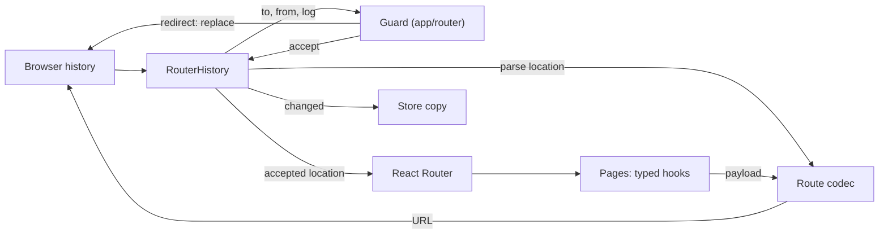

# Web app router

A complete router for a web app, built over React Router's low-level `Router` and a `history`
object, for [§ Routing and overlays](../SKILL.md#routing-and-overlays). Every module below
typechecks against React Router 7 and `history` 5, and the suites at the end pass. It holds with any
state library: the router owns navigation, and the store only keeps a copy for selectors.
`@acme/app-web` and its type root `Web` stand for the app's package and namespace; `EventerBase` is
the event lib's (`code-architecture` § Lib roles).

## The idea

1. **Every route is declared once**, in one list in `config/`: its pattern, the query keys it
   accepts, and the zone it belongs to. All route types are inferred from that list.
2. **A route is a payload**, `{ path, params, query }`. Pages, links, the guard, and the store pass
   payloads; only the route codec turns a payload into a URL and a location into a payload.
3. **The app owns the history.** One `RouterHistory` wraps the browser's history and feeds React
   Router. A location reaches React Router, the store, and every listener only after the guard has
   accepted it, so no page ever renders on a location that is about to be refused.
4. **One guard decides access**, as a pure function of the target and a session snapshot. A refusal
   replaces the location, so Back never returns to it; a refused location stays in the history's log
   as a `GUARD` entry.
5. **The start order is a contract**: the store's copy subscribes, the session starts, the guard
   registers and checks the opening location, and only then do routes render.
6. **The store keeps a copy; the router navigates.** The history's `changed` event updates one copy
   of the route that selectors read. Nothing navigates by writing the store.
7. **Pages read the route through typed hooks** that name their route once, and keep page state
   (tabs, filters, an open dialog) in the query, replaced rather than pushed.
8. **Nothing but `core/router/` imports React Router or `history`**: lint bans both imports
   elsewhere, so the typed layer cannot be bypassed.



## Files

```text
src/
  config/routes.config.ts            the route list, by zone
  core/router/
    types.ts                         Path, ParamsOf, QueryOf, Payload, Entry, Guard, RouteState
    route-codec.ts                   payload ↔ URL, params and query reads, zones
    router-history.ts                RouterHistory: the guarded history React Router renders from
    route-selectors.ts               plain selectors over the store's copy
    router-history-context.ts        RouterHistory for the hooks that need it
    *.error.ts                       RouterRedirectLoopError, RouteMismatchError, …
    hooks/                           useNavigate, usePathParams, useQueryParams, useQueryUpdate, …
    components/                      HistoryRouter, Link, NavLink, Route, Routes, Outlet
  core/session/                      the session the guard reads (the app's own)
  app/router/
    route-guard.ts                   the access rules
    lazy-pages.tsx                   every page behind import()
    layouts/                         layout routes: a frame around an Outlet
    AppRoutes.tsx                    the route table
  index-app.ts                       the composition root: builds, connects, starts, mounts
```

`config/` holds the list because both `core/router/` (types and matching) and `app/router/` (the
table and the guard) read it, and a concept never imports `app/`.

## 1. The route list

```ts
// config/routes.config.ts
/**
 * Every route once: its pattern and the query keys it accepts, grouped into zones by the access
 * they need. The order is the match order, so a specific pattern precedes a general one.
 */

// A key set several routes accept, or a component on several routes reads, is declared once.
const FILTER_QUERY_KEYS = ["filter", "sort", "page"] as const;
const ITEM_DIALOG_QUERY_KEYS = ["details", "select"] as const;

const PUBLIC_ROUTES_LIST = [
  ["/404", []],
  ["/500", []],
  ["/no-access", []],
  ["/sign-in", ["returnTo"]],
  ["/invite/:inviteKey", []],
  ["/shared/:shareToken", []]
] as const;

// Signed in, but the account must be settled first: these pages settle it.
const ACCOUNT_ROUTES_LIST = [
  ["/account/verify", []],
  ["/account/waitlist", []],
  ["/account/blocked", []]
] as const;

const MEMBER_ROUTES_LIST = [
  ["/", ["tab"]],
  ["/search", [...FILTER_QUERY_KEYS, "text"]]
] as const;

// Owned by a team: the guard checks the person against `teamId`.
const TEAM_ROUTES_LIST = [
  ["/team/:teamId/project/:projectId", ["tab", ...ITEM_DIALOG_QUERY_KEYS]],
  ["/team/:teamId/projects", [...FILTER_QUERY_KEYS]],
  ["/team/:teamId", []]
] as const;

const ADMIN_ROUTES_LIST = [
  ["/admin/team/:teamId", ["tab"]],
  ["/admin", ["tab", ...FILTER_QUERY_KEYS]]
] as const;

export default {
  ROUTES_LIST: [
    ...PUBLIC_ROUTES_LIST,
    ...ACCOUNT_ROUTES_LIST,
    ...MEMBER_ROUTES_LIST,
    ...TEAM_ROUTES_LIST,
    ...ADMIN_ROUTES_LIST
  ],
  ZONE_ROUTES_MAP: {
    account: ACCOUNT_ROUTES_LIST,
    admin: ADMIN_ROUTES_LIST,
    member: MEMBER_ROUTES_LIST,
    public: PUBLIC_ROUTES_LIST,
    team: TEAM_ROUTES_LIST
  }
} as const;
```

- **The query keys are the route's contract.** Reading the query returns only declared keys, and a
  link with an undeclared key fails typecheck, so a page cannot quietly depend on a key another
  route forgets. A key set several routes accept, or that a component mounted on several routes
  reads, is one named tuple spread into each, so the routes cannot drift apart.
- **The order is the match order**: the first pattern that matches wins, so
  `/team/:teamId/project/:projectId` precedes `/team/:teamId`.
- **A zone is the access a route needs**, not the page it shows: public, the account pages that
  settle a signed-in account, member pages, pages owned by an id, admin pages. The guard, the route
  table, and the selectors read zones; none keeps its own list of paths.
- **Refusals are routes**: `/404`, `/500`, `/no-access`, and sign-in are public routes like any
  other, so a refused or unknown location still lands on a page with an address.

## 2. Types

```ts
// core/router/types.ts
import type routesConfig from "#web/config/routes.config.ts";

declare module "@acme/app-web" {
  namespace Web.Core.Router {
    type Route = (typeof routesConfig.ROUTES_LIST)[number];
    type Path = Route[0];
    type ZoneName = keyof typeof routesConfig.ZONE_ROUTES_MAP;
    type ZonePath<Z extends ZoneName> = (typeof routesConfig.ZONE_ROUTES_MAP)[Z][number][0];

    /** `/team/:teamId/project/:projectId` gives `{ teamId: string; projectId: string }`. */
    type ParamsOf<P extends string> = P extends `${string}:${infer Name}/${infer Rest}`
      ? { [K in Name | keyof ParamsOf<Rest>]: string }
      : P extends `${string}:${infer Name}`
        ? { [K in Name]: string }
        : Record<never, string>;

    /** Only the keys the route declares; each one optional, as a URL may leave it out. */
    type QueryOf<P extends Path> = {
      [K in Extract<Route, readonly [P, unknown]>[1][number]]?: string;
    };

    /** A route as data: what every caller above the router passes instead of a URL. */
    type Payload<P extends Path = Path> = P extends Path
      ? { path: P } & (keyof ParamsOf<P> extends never ? unknown : { params: ParamsOf<P> }) &
          (keyof QueryOf<P> extends never ? unknown : { query?: QueryOf<P> })
      : never;

    type PathWithParams = { [P in Path]: keyof ParamsOf<P> extends never ? never : P }[Path];
    type PathWithQuery = { [P in Path]: keyof QueryOf<P> extends never ? never : P }[Path];

    /** `GUARD` marks a location the guard refused; the others are the browser's own actions. */
    type EntryAction = "POP" | "PUSH" | "REPLACE" | "GUARD";

    type Entry = {
      readonly action: EntryAction;
      readonly location: import("history").Location;
      readonly payload: Payload;
    };

    type GuardInput = {
      readonly from: Payload | null;
      readonly to: Payload;
      readonly entriesList: readonly Entry[];
    };

    /** `null` accepts `to`; a payload is where to go instead. */
    type Guard = (input: GuardInput) => Payload | null;

    /** What the store keeps of the router: a copy for selectors, never a way to navigate. */
    type RouteState = {
      readonly payload: Payload | null;
      readonly entriesList: readonly Entry[];
    };
  }
}
```

- `Payload` distributes over `Path`, so each route has its own shape: a route with params requires
  them, a route without refuses them, and the query takes only declared keys, each optional.
- `PathWithParams` and `PathWithQuery` keep hooks honest: `usePathParams("/search")` fails because
  `/search` has no params.
- An `Entry` with action `GUARD` is a location the guard refused; the others are the browser's own.

## 3. The route codec

The one place a string becomes a payload and a payload a URL.

```ts
// core/router/route-codec.ts
import type { Location } from "history";
import { generatePath, matchPath } from "react-router-dom";

import routesConfig from "#web/config/routes.config.ts";
import type { Web } from "#web/index.ts";

type Path = Web.Core.Router.Path;
type Payload = Web.Core.Router.Payload;

const NOT_FOUND_PATH = "/404" satisfies Path;

/** Whether `path` is `prefixPath` or a route under it, compared by whole segments. */
function getIsUnder({ path, prefixPath }: { path: Path; prefixPath: Path }): boolean {
  return path === prefixPath || path.startsWith(prefixPath === "/" ? "/" : `${prefixPath}/`);
}

/**
 * Params as the page means them: `generatePath` encodes a param, `matchPath` does not decode it. A
 * malformed escape someone typed stays as typed rather than failing the page.
 */
function decodeParams(paramsMap: Partial<Record<string, string>>): Record<string, string> {
  const decodedMap: Record<string, string> = {};

  for (const [paramName, paramValue] of Object.entries(paramsMap)) {
    if (paramValue === undefined) {
      continue;
    }

    try {
      decodedMap[paramName] = decodeURIComponent(paramValue);
    } catch {
      decodedMap[paramName] = paramValue;
    }
  }

  return decodedMap;
}

function getQueryKeysList(path: Path): readonly string[] {
  return routesConfig.ROUTES_LIST.find(([routePath]) => routePath === path)?.[1] ?? [];
}

function readQueryMap({ path, search }: { path: Path; search: string }): Record<string, string> {
  const searchParams = new URLSearchParams(search);
  const queryMap: Record<string, string> = {};

  for (const queryKey of getQueryKeysList(path)) {
    const queryValue = searchParams.get(queryKey);

    if (queryValue !== null && queryValue !== "") {
      queryMap[queryKey] = queryValue;
    }
  }

  return queryMap;
}

/** A payload's URL: params filled in, query in declared order, empty values left out. */
function formatUrl(payload: Payload): string {
  const pathname =
    "params" in payload ? generatePath<string>(payload.path, payload.params) : payload.path;
  const searchParams = new URLSearchParams();

  if ("query" in payload && payload.query !== undefined) {
    const queryMap: Partial<Record<string, string>> = payload.query;

    for (const queryKey of getQueryKeysList(payload.path)) {
      const queryValue = queryMap[queryKey];

      if (queryValue !== undefined && queryValue !== "") {
        searchParams.set(queryKey, queryValue);
      }
    }
  }

  const searchText = searchParams.toString();

  return searchText === "" ? pathname : `${pathname}?${searchText}`;
}

/** The first route whose pattern matches, in list order; no match is the not-found route. */
function parseLocation({ pathname, search }: Pick<Location, "pathname" | "search">): Payload {
  for (const [path, queryKeysList] of routesConfig.ROUTES_LIST) {
    const match = matchPath(path, pathname);

    if (match === null) {
      continue;
    }

    const hasParams = Object.keys(match.params).length > 0;
    const hasQuery = queryKeysList.length > 0;

    // The one place a string becomes a payload: its shape follows the route it just matched.
    return {
      path,
      ...(hasParams ? { params: decodeParams(match.params) } : {}),
      ...(hasQuery ? { query: readQueryMap({ path, search }) } : {})
    } as Payload;
  }

  return { path: NOT_FOUND_PATH };
}

/**
 * `path`'s params when the location is on `path` or a route under it, so a zone's layout reads its
 * owner id on every page of the zone; null elsewhere.
 */
function readParams<P extends Web.Core.Router.PathWithParams>({
  location,
  path
}: {
  location: Pick<Location, "pathname" | "search">;
  path: P;
}): Web.Core.Router.ParamsOf<P> | null {
  const current = parseLocation(location);

  if (!getIsUnder({ path: current.path, prefixPath: path })) {
    return null;
  }

  const match = matchPath({ path, end: false }, location.pathname);

  return match === null ? null : (decodeParams(match.params) as Web.Core.Router.ParamsOf<P>);
}

/** `path`'s declared query when the location is exactly on `path`; null elsewhere. */
function readQuery<P extends Web.Core.Router.PathWithQuery>({
  location,
  path
}: {
  location: Pick<Location, "pathname" | "search">;
  path: P;
}): Web.Core.Router.QueryOf<P> | null {
  if (parseLocation(location).path !== path) {
    return null;
  }

  // Only the keys the route declares were read, so the map has the route's query shape.
  return readQueryMap({ path, search: location.search }) as Web.Core.Router.QueryOf<P>;
}

/** One param of a payload by name, or null when its route has none of that name. */
function getParam({ payload, paramName }: { payload: Payload; paramName: string }): string | null {
  if (!("params" in payload)) {
    return null;
  }

  const paramsMap: Partial<Record<string, string>> = payload.params;

  return paramsMap[paramName] ?? null;
}

function getZoneName(path: Path): Web.Core.Router.ZoneName {
  for (const [zoneName, zoneRoutesList] of Object.entries(routesConfig.ZONE_ROUTES_MAP)) {
    if (zoneRoutesList.some(([zonePath]) => zonePath === path)) {
      return zoneName as Web.Core.Router.ZoneName;
    }
  }

  return "public";
}

export default {
  formatUrl,
  getIsUnder,
  getParam,
  getZoneName,
  parseLocation,
  readParams,
  readQuery,
  NOT_FOUND_PATH
};
```

- **Parsing decodes what formatting encodes.** `generatePath` percent-encodes a param and
  `matchPath` returns it raw, so the codec decodes each param; a payload survives the round trip
  (the suite checks `p 2`).
- **Params are read on a route or under it.** `readParams({ location, path: "/team/:teamId" })`
  answers on every team route, so a zone's layout reads its owner id without knowing which page is
  open. The prefix compares whole segments.
- **The query is read only on its exact route**, and only its declared keys; empty values are
  absent. A component that lives on several routes reads `useRoutePayload().query` instead.
- **A location nothing matches parses as the not-found route**; the address bar keeps what the
  person typed, and the table's `*` route shows the not-found page.

## 4. RouterHistory

```ts
// core/router/router-history.ts
import type { Blocker, History, Listener, Location, To, Update } from "history";
import { parsePath } from "history";

import EventerBase from "#web/base/eventer-base.ts";
import type { Web } from "#web/index.ts";
import routeCodec from "#web/core/router/route-codec.ts";
import RouterRedirectLoopError from "#web/core/router/router-redirect-loop.error.ts";

type Entry = Web.Core.Router.Entry;
type Payload = Web.Core.Router.Payload;

// A guard that redirects more often than this sends a location around in a circle.
const MAX_REDIRECTS = 20;
// The log answers "where did the person come from", not "everything they did".
const MAX_ENTRIES = 100;

/**
 * The app's one history. It wraps the browser's (or a suite's memory) history, and a location
 * reaches React Router, the store's copy, and every listener only once the guard accepts it.
 */
export default class RouterHistory extends EventerBase<Web.Core.Router.RouterHistory.Listeners> {
  readonly #baseHistory: History;
  readonly #listenersSet = new Set<Listener>();
  #guard: Web.Core.Router.Guard | null = null;
  #stopBaseListening: (() => void) | null = null;
  #accepted: Update;
  #entriesList: Entry[];
  #guardKeyCount = 0;

  constructor({ baseHistory }: Readonly<{ baseHistory: History }>) {
    super();
    this.#baseHistory = baseHistory;
    this.#accepted = { action: baseHistory.action, location: baseHistory.location };
    this.#entriesList = [
      {
        action: baseHistory.action,
        location: baseHistory.location,
        payload: routeCodec.parseLocation(baseHistory.location)
      }
    ];
  }

  /** The location React Router renders: the last one the guard accepted. */
  get location(): Location {
    return this.#accepted.location;
  }

  get action(): Update["action"] {
    return this.#accepted.action;
  }

  /** One object per accepted location, so `useSyncExternalStore` can compare snapshots. */
  getAccepted(): Update {
    return this.#accepted;
  }

  getState(): Web.Core.Router.RouteState {
    return { payload: this.#getLastPayload(), entriesList: this.#entriesList };
  }

  /** Starts listening and guards the location the app opened on; nothing renders before this. */
  registerGuard(guard: Web.Core.Router.Guard): void {
    this.#guard = guard;
    this.#stopBaseListening ??= this.#baseHistory.listen(update => this.#onUpdate(update));
    this.recheckLocation();
    this.emit("changed", this.getState());
  }

  /** Runs the guard again on the current location: after sign-in, sign-out, or a role change. */
  recheckLocation(): void {
    this.#onUpdate({ action: this.#baseHistory.action, location: this.#baseHistory.location });
  }

  // React Router's navigator, delegated to the base history.

  createHref(to: To): string {
    return this.#baseHistory.createHref(to);
  }

  push(to: To, state?: unknown): void {
    this.#baseHistory.push(to, state);
  }

  replace(to: To, state?: unknown): void {
    this.#baseHistory.replace(to, state);
  }

  go(delta: number): void {
    this.#baseHistory.go(delta);
  }

  back(): void {
    this.#baseHistory.back();
  }

  forward(): void {
    this.#baseHistory.forward();
  }

  /** Hears accepted locations only; a refused one never reaches a listener. */
  listen(listener: Listener): () => void {
    this.#listenersSet.add(listener);

    return () => {
      this.#listenersSet.delete(listener);
    };
  }

  /** Stops navigation until the blocker retries it; the base history also asks before unload. */
  block(blocker: Blocker): () => void {
    return this.#baseHistory.block(blocker);
  }

  #onUpdate({ action, location }: Update): void {
    const guard = this.#guard;

    if (guard === null) {
      return;
    }

    const requested = routeCodec.parseLocation(location);
    let target = requested;
    let targetLocation = location;

    for (let redirectCount = 0; ; redirectCount += 1) {
      const redirect = guard({
        from: this.#getLastPayload(),
        to: target,
        entriesList: this.#entriesList
      });

      if (redirect === null) {
        break;
      }

      if (redirectCount === MAX_REDIRECTS) {
        throw new RouterRedirectLoopError(
          `the guard redirected ${MAX_REDIRECTS} times from ${routeCodec.formatUrl(requested)}`
        );
      }

      // The log keeps each refused location, so a page can tell where the person tried to go.
      this.#addEntry({ action: "GUARD", location: targetLocation, payload: target });
      target = redirect;
      targetLocation = this.#buildLocation(routeCodec.formatUrl(redirect));
    }

    if (target !== requested) {
      // Replace, so Back never returns to a refused location; the base history calls back with it.
      this.#baseHistory.replace(routeCodec.formatUrl(target));

      return;
    }

    this.#accept({ update: { action, location }, payload: requested });
  }

  #accept({ update, payload }: { update: Update; payload: Payload }): void {
    if (
      update.location.key !== this.#accepted.location.key ||
      update.action !== this.#accepted.action
    ) {
      this.#accepted = update;
    }

    for (const listener of this.#listenersSet) {
      listener(this.#accepted);
    }

    if (this.#entriesList.at(-1)?.location.key === update.location.key) {
      return;
    }

    this.#addEntry({ action: update.action, location: update.location, payload });
    this.emit("changed", this.getState());
  }

  #addEntry(entry: Entry): void {
    if (this.#entriesList.at(-1)?.location.key === entry.location.key) {
      return;
    }

    this.#entriesList = [...this.#entriesList, entry].slice(-MAX_ENTRIES);
  }

  #getLastPayload(): Payload | null {
    for (let entryIndex = this.#entriesList.length - 1; entryIndex >= 0; entryIndex -= 1) {
      const entry = this.#entriesList[entryIndex];

      if (entry !== undefined && entry.action !== "GUARD") {
        return entry.payload;
      }
    }

    return null;
  }

  #buildLocation(url: string): Location {
    this.#guardKeyCount += 1;

    return {
      pathname: "/",
      search: "",
      hash: "",
      ...parsePath(url),
      state: null,
      key: `guard-${this.#guardKeyCount}`
    };
  }
}

declare module "@acme/app-web" {
  namespace Web.Core.Router.RouterHistory {
    type INSTANCE = RouterHistory;

    type Listeners = {
      /** Each accepted location, with the log: the store's copy follows this event. */
      changed: (state: Web.Core.Router.RouteState) => void;
    };
  }
}
```

- **It is React Router's navigator.** `createHref`, `push`, `replace`, and `go` delegate to the base
  history; `listen` hears accepted locations only, and `location` and `action` are the last accepted
  ones. The base history is passed in: `createBrowserHistory()` at bootstrap,
  `createMemoryHistory()` in a suite.
- **Every update runs the guard chain.** The guard answers for the requested location; a redirect is
  guarded again, up to `MAX_REDIRECTS`, and a longer chain throws `RouterRedirectLoopError`. The
  final target replaces the location, the base history calls back with it, and that call accepts.
- **Nothing listens before the guard.** `registerGuard` starts listening, checks the location the
  app opened on, and publishes the first state; `recheckLocation` runs the chain on the current
  location again.
- **The log is bounded and published.** Each accepted location and each refusal is an entry; the
  `changed` event carries the current payload and the log, which is how the store's copy follows.

## 5. The guard

```ts
// core/session/types.ts
declare module "@acme/app-web" {
  namespace Web.Core.Session {
    /** What the guard reads: one plain snapshot, never the store or a hook. */
    type Snapshot = {
      readonly status: "signed-out" | "unverified" | "waitlisted" | "blocked" | "active";
      readonly isAdmin: boolean;
      readonly teamIdsSet: ReadonlySet<string>;
      /** Where `/` forwards a person who has a home, such as the team they last opened. */
      readonly homeRoute: Web.Core.Router.Payload<"/team/:teamId"> | null;
    };
  }
}

export {};
```

```ts
// app/router/route-guard.ts
import type { Web } from "#web/index.ts";
import routeCodec from "#web/core/router/route-codec.ts";

type Payload = Web.Core.Router.Payload;
type AccountStatus = Exclude<Web.Core.Session.Snapshot["status"], "signed-out" | "active">;

// Each unsettled account status has the one page that settles it.
const ACCOUNT_PATHS_MAP = {
  blocked: "/account/blocked",
  unverified: "/account/verify",
  waitlisted: "/account/waitlist"
} as const satisfies Record<AccountStatus, Web.Core.Router.ZonePath<"account">>;

const NO_ACCESS: Payload = { path: "/no-access" };

/**
 * The app's access rules, in order: public routes pass; a signed-out person signs in and comes
 * back; an unsettled account goes to the page that settles it; `/` forwards to the person's home;
 * a zone owned by an id admits its members and admins. It only decides: work a redirect needs is
 * done by the page it lands on.
 */
function buildRouteGuard({
  readSession
}: Readonly<{ readSession: () => Web.Core.Session.Snapshot }>): Web.Core.Router.Guard {
  return ({ to }) => {
    const zoneName = routeCodec.getZoneName(to.path);

    if (zoneName === "public") {
      return null;
    }

    const session = readSession();

    if (session.status === "signed-out") {
      return { path: "/sign-in", query: { returnTo: routeCodec.formatUrl(to) } };
    }

    if (session.status !== "active") {
      const accountPath = ACCOUNT_PATHS_MAP[session.status];

      return to.path === accountPath ? null : { path: accountPath };
    }

    if (zoneName === "account") {
      return session.homeRoute ?? { path: "/" };
    }

    if (to.path === "/" && session.homeRoute !== null) {
      return session.homeRoute;
    }

    if (zoneName === "admin") {
      return session.isAdmin ? null : NO_ACCESS;
    }

    if (zoneName === "team") {
      const teamId = routeCodec.getParam({ payload: to, paramName: "teamId" });

      return session.isAdmin || (teamId !== null && session.teamIdsSet.has(teamId))
        ? null
        : NO_ACCESS;
    }

    return null;
  };
}

export default { buildRouteGuard };
```

- **The order of the checks is the policy**: public passes; signed out goes to sign-in with
  `returnTo`; an unsettled account goes to the one page that settles it, which it may open; a
  settled account leaves the account pages; `/` forwards to the person's home; admin and owned zones
  check the person. Reordering them changes who sees what.
- **It only decides.** It reads a snapshot through the getter it is built with, never a store module
  or a hook, and answers `null` or a payload. Work a redirect needs is the landing page's: the
  sign-in page reads `returnTo` and starts the provider's login.
- **A route that only forwards is a guard decision.** `/` sending the person to their last team is a
  redirect, not a page effect, so the home page never flashes first.
- **A zone owned by an id checks that id**, read from the target payload; admins pass every owned
  zone.
- **An account page is open only to its own status.** Without that exception, an unverified person
  would be sent to `/account/verify` and refused there, and the chain would throw.

## 6. The composition root

```ts
// index-app.ts
import { createBrowserHistory } from "history";
import { createElement } from "react";
import { createRoot } from "react-dom/client";

import { App } from "#web/app/App.tsx";
import routeGuard from "#web/app/router/route-guard.ts";
import routeStore from "#web/core/route-store/route-store.ts";
import RouterHistory from "#web/core/router/router-history.ts";
import SessionService from "#web/core/session/session-service.ts";

// The composition root: the order is the contract.
const routerHistory = new RouterHistory({ baseHistory: createBrowserHistory() });
const sessionService = new SessionService();

// 1. The store's copy follows the history from the first accepted location.
routerHistory.addEventListener("changed", routeState => routeStore.setRouteState(routeState));

// 2. The session must be known before anything can be guarded.
await sessionService.start();

// 3. The guard checks the location the app opened on; no route has rendered yet.
routerHistory.registerGuard(
  routeGuard.buildRouteGuard({ readSession: () => sessionService.readSnapshot() })
);

// 4. A change of who is signed in, or of what they may open, checks the current page again.
sessionService.addEventListener("changed", () => routerHistory.recheckLocation());

// 5. Only now do routes render; until here the page shows the first-load shell.
const rootElement = document.getElementById("root");

if (rootElement !== null) {
  createRoot(rootElement).render(
    createElement(App, { routerHistory, isAdmin: sessionService.readSnapshot().isAdmin })
  );
}
```

- The order is the contract: the copy subscribes before the first state is published; the guard
  needs the session; routes render only after the guard checked the opening location, and the
  first-load shell ([§ First load](../SKILL.md#first-load)) covers the wait.
- **What the guard reads changes, the current page is checked again**: sign-in, sign-out, a role or
  a membership change. The session publishes those changes; the root connects them to
  `recheckLocation`, so a person who loses access is moved off the page.

## 7. The store's copy

The selectors are plain functions over `RouteState`, so any state library wraps them:

```ts
// core/router/route-selectors.ts
import type { Web } from "#web/index.ts";
import routeCodec from "#web/core/router/route-codec.ts";

type RouteState = Web.Core.Router.RouteState;
type Payload = Web.Core.Router.Payload;

// Plain functions over the store's copy: every state library wraps them in its own selectors.

function getPayload(state: RouteState): Payload | null {
  return state.payload;
}

function getZoneName(state: RouteState): Web.Core.Router.ZoneName | null {
  return state.payload === null ? null : routeCodec.getZoneName(state.payload.path);
}

/** The owner id of the zone the person is in (`teamId` on every team route), or null. */
function getParam({ state, paramName }: { state: RouteState; paramName: string }): string | null {
  return state.payload === null ? null : routeCodec.getParam({ payload: state.payload, paramName });
}

/** The route before the current one, refused locations skipped: where Back would go in the app. */
function getPreviousPayload(state: RouteState): Payload | null {
  const acceptedList = state.entriesList.filter(entry => entry.action !== "GUARD");

  return acceptedList.at(-2)?.payload ?? null;
}

/** The last location the guard refused: where the person tried to go before a redirect. */
function getRefusedPayload(state: RouteState): Payload | null {
  return state.entriesList.findLast(entry => entry.action === "GUARD")?.payload ?? null;
}

export default { getParam, getPayload, getPreviousPayload, getRefusedPayload, getZoneName };
```

A library-free store shows the shape; the repository's own library takes its place:

```ts
// core/route-store/route-store.ts
import type { Web } from "#web/index.ts";
import routeSelectors from "#web/core/router/route-selectors.ts";

// A library-free store, standing in for the repository's own: Redux, Zustand, MobX, or signals.
// Whatever it is, it holds a copy of the route that selectors read, and it never navigates.

type RouteState = Web.Core.Router.RouteState;

let routeState: RouteState = { payload: null, entriesList: [] };
const listenersSet = new Set<() => void>();

function setRouteState(nextRouteState: RouteState): void {
  routeState = nextRouteState;

  for (const listener of listenersSet) {
    listener();
  }
}

function getZoneName(): Web.Core.Router.ZoneName | null {
  return routeSelectors.getZoneName(routeState);
}

function getTeamId(): string | null {
  return routeSelectors.getParam({ state: routeState, paramName: "teamId" });
}

export default { getTeamId, getZoneName, setRouteState };
```

| State library | `setRouteState(routeState)` is                     | Selectors                                                  |
| ------------- | -------------------------------------------------- | ---------------------------------------------------------- |
| Redux Toolkit | `dispatch(routeSlice.actions.changed(routeState))` | `createSelector(selectRoute, routeSelectors.…)`            |
| Zustand       | `useRouteStore.setState({ routeState })`           | `useRouteStore(state => routeSelectors.…(state))`          |
| MobX          | an `action` assigning an `observable.ref`          | `computed` getters calling `routeSelectors.…`              |
| Signals       | `routeStateSignal.value = routeState`              | `computed(() => routeSelectors.…(routeStateSignal.value))` |

- The copy holds what views and models need to read: the zone (which menu to show), the owner id
  (which team's data to load), the previous route (where a "back" button goes), the last refused
  route (where to return after sign-in).
- **It never navigates.** A model that must move the person calls the router (the navigate function
  the composition root hands it, or a hook in its view); writing the copy changes nothing on screen.
- Entries hold `history` locations; under a library that freezes or serializes state (Redux), store
  the payloads and plain location fields, not the objects with their keys and state.

## 8. The React binding

```ts
// core/router/router-history-context.ts
import { createContext } from "react";

import type { Web } from "#web/index.ts";

/** The app's RouterHistory, for the hooks that need more than React Router gives (blocking). */
export default createContext<Web.Core.Router.RouterHistory.INSTANCE | null>(null);
```

```tsx
// core/router/hooks/useAcceptedUpdate.tsx
import type { Update } from "history";
import { useCallback, useSyncExternalStore } from "react";

import type { Web } from "#web/index.ts";

/** The last accepted location and action; renders again only when the guard accepts a new one. */
export function useAcceptedUpdate(routerHistory: Web.Core.Router.RouterHistory.INSTANCE): Update {
  const subscribe = useCallback(
    (onStoreChange: () => void) => routerHistory.listen(onStoreChange),
    [routerHistory]
  );
  const getSnapshot = useCallback(() => routerHistory.getAccepted(), [routerHistory]);

  return useSyncExternalStore(subscribe, getSnapshot);
}
```

```tsx
// core/router/hooks/useRouterHistory.tsx
import { useContext } from "react";

import type { Web } from "#web/index.ts";
import routerHistoryContext from "#web/core/router/router-history-context.ts";
import RouterContextMissingError from "#web/core/router/router-context-missing.error.ts";

export function useRouterHistory(): Web.Core.Router.RouterHistory.INSTANCE {
  const routerHistory = useContext(routerHistoryContext);

  if (routerHistory === null) {
    throw new RouterContextMissingError("a router hook ran outside HistoryRouter");
  }

  return routerHistory;
}
```

```tsx
// core/router/components/HistoryRouter.tsx
import type React from "react";
import { Router } from "react-router-dom";

import type { Web } from "#web/index.ts";
import { useAcceptedUpdate } from "#web/core/router/hooks/useAcceptedUpdate.tsx";
import routerHistoryContext from "#web/core/router/router-history-context.ts";

type Props = {
  routerHistory: Web.Core.Router.RouterHistory.INSTANCE;
  basename?: string;
  children: React.ReactNode;
};

/** React Router's low-level Router, fed by the app's RouterHistory instead of its own. */
export const HistoryRouter: React.FC<Props> = ({ routerHistory, basename, children }) => {
  const { action, location } = useAcceptedUpdate(routerHistory);

  return (
    <routerHistoryContext.Provider value={routerHistory}>
      <Router
        basename={basename}
        navigationType={action}
        location={location}
        navigator={routerHistory}
      >
        {children}
      </Router>
    </routerHistoryContext.Provider>
  );
};

HistoryRouter.displayName = "HistoryRouter";
```

- `useSyncExternalStore` reads the accepted location without tearing; the snapshot is one object per
  accepted location, so React renders again only when the guard accepts a new one.
- The context carries `RouterHistory` for what React Router does not expose, the blocker; React
  Router's own hooks (`useLocation`, `useNavigate`) read the location it was given.

## 9. Hooks

| Need                                    | Hook                                                  |
| --------------------------------------- | ----------------------------------------------------- |
| Go to a route                           | `useNavigate()` → `navigate(payload, { replace? })`   |
| Back and forward                        | `useBack()`, `useForward()`                           |
| Leave the app                           | `useNavigateExternal()`, typed to refuse every `Path` |
| The current route, anywhere             | `useRoutePayload()`, `useLocationUrl()`               |
| Whether the route is one of a set       | `useIsRoute(pathsList)`                               |
| Whether the route is in a zone or below | `useIsWithin(prefixesList)`                           |
| A page's params (and its zone layout's) | `usePathParams(path)`                                 |
| A page's query, raw or parsed           | `useQueryParams(path, parseQuery?)`                   |
| Change part of the page's query         | `useQueryUpdate(path)` → `updateQuery(patch)`         |
| Keep unsaved work                       | `useLeaveBlocker(isEnabled)`                          |

```tsx
// core/router/hooks/useNavigate.tsx
import { useCallback } from "react";
import { useNavigate as useRouterNavigate } from "react-router-dom";

import type { Web } from "#web/index.ts";
import routeCodec from "#web/core/router/route-codec.ts";

type NavigateOptions = { replace?: boolean };
type Navigate = <P extends Web.Core.Router.Path>(
  to: Web.Core.Router.Payload<P>,
  options?: NavigateOptions
) => void;

/** Goes to a declared route; `replace` for a step Back should skip (a redirect, a filter). */
export function useNavigate(): Navigate {
  const navigate = useRouterNavigate();

  return useCallback<Navigate>(
    (to, options) => {
      void navigate(routeCodec.formatUrl(to), { replace: options?.replace ?? false });
    },
    [navigate]
  );
}

export function useBack(): () => void {
  const navigate = useRouterNavigate();

  return useCallback(() => {
    void navigate(-1);
  }, [navigate]);
}

export function useForward(): () => void {
  const navigate = useRouterNavigate();

  return useCallback(() => {
    void navigate(1);
  }, [navigate]);
}
```

```tsx
// core/router/hooks/useNavigateExternal.tsx
import { useCallback } from "react";

import type { Web } from "#web/index.ts";

/** Any URL but a declared route: those go through `useNavigate`, typed. */
type ExternalUrl<U extends string> = U extends Web.Core.Router.Path ? never : U;

type NavigateExternal = <U extends string>(to: {
  url: ExternalUrl<U>;
  query?: Record<string, string>;
  replace?: boolean;
}) => void;

/** Leaves the app: a full page load of another site, a server page, or a sign-in provider. */
export function useNavigateExternal(): NavigateExternal {
  return useCallback<NavigateExternal>(({ url, query, replace }) => {
    const target = new URL(url, window.location.origin);

    for (const [queryKey, queryValue] of Object.entries(query ?? {})) {
      target.searchParams.set(queryKey, queryValue);
    }

    if (replace === true) {
      window.location.replace(target);
    } else {
      window.location.assign(target);
    }
  }, []);
}
```

```tsx
// core/router/hooks/useRoutePayload.tsx
import { useMemo } from "react";
import { useLocation } from "react-router-dom";

import type { Web } from "#web/index.ts";
import routeCodec from "#web/core/router/route-codec.ts";

/** The current route as a payload; for components that live across routes (a header, a menu). */
export function useRoutePayload(): Web.Core.Router.Payload {
  const location = useLocation();

  return useMemo(() => routeCodec.parseLocation(location), [location]);
}

/** The location as the browser shows it, path and query, for a link that stays where it is. */
export function useLocationUrl(): string {
  const { pathname, search } = useLocation();

  return `${pathname}${search}`;
}

/** Whether the current route is one of `pathsList`; pass a module-level list (a dependency). */
export function useIsRoute(pathsList: readonly Web.Core.Router.Path[]): boolean {
  const { path } = useRoutePayload();

  return useMemo(() => pathsList.includes(path), [path, pathsList]);
}

/** Whether the current route is one of `prefixesList` or under one: a zone, a section, a tab. */
export function useIsWithin(prefixesList: readonly Web.Core.Router.Path[]): boolean {
  const { path } = useRoutePayload();

  return useMemo(
    () => prefixesList.some(prefixPath => routeCodec.getIsUnder({ path, prefixPath })),
    [path, prefixesList]
  );
}
```

```tsx
// core/router/hooks/usePathParams.tsx
import { useMemo } from "react";
import { useLocation } from "react-router-dom";

import type { Web } from "#web/index.ts";
import routeCodec from "#web/core/router/route-codec.ts";
import RouteMismatchError from "#web/core/router/route-mismatch.error.ts";

/**
 * `path`'s params, on `path` or any route under it: a page reads its own, a zone's layout reads the
 * owner id on every page of the zone. Anywhere else it throws: the component is mounted wrong.
 */
export function usePathParams<P extends Web.Core.Router.PathWithParams>(
  path: P
): Web.Core.Router.ParamsOf<P> {
  const location = useLocation();
  const paramsMap = useMemo(() => routeCodec.readParams({ location, path }), [location, path]);

  if (paramsMap === null) {
    throw new RouteMismatchError(`${location.pathname} is not ${path} or a route under it`);
  }

  return paramsMap;
}
```

```tsx
// core/router/hooks/useQueryParams.tsx
import { useMemo } from "react";
import { useLocation } from "react-router-dom";

import type { Web } from "#web/index.ts";
import routeCodec from "#web/core/router/route-codec.ts";
import RouteMismatchError from "#web/core/router/route-mismatch.error.ts";

type QueryOf<P extends Web.Core.Router.PathWithQuery> = Web.Core.Router.QueryOf<P>;

/** The page's declared query keys, each a string or absent. */
export function useQueryParams<P extends Web.Core.Router.PathWithQuery>(path: P): QueryOf<P>;
/** The same, through `parseQuery` (numbers, enums, defaults); pass a module-level function. */
export function useQueryParams<P extends Web.Core.Router.PathWithQuery, T>(
  path: P,
  parseQuery: (queryMap: QueryOf<P>) => T
): T;
export function useQueryParams<P extends Web.Core.Router.PathWithQuery, T>(
  path: P,
  parseQuery?: (queryMap: QueryOf<P>) => T
): QueryOf<P> | T {
  const location = useLocation();
  const queryMap = useMemo(() => routeCodec.readQuery({ location, path }), [location, path]);

  if (queryMap === null) {
    throw new RouteMismatchError(`${location.pathname} is not ${path}`);
  }

  return useMemo(
    () => (parseQuery === undefined ? queryMap : parseQuery(queryMap)),
    [parseQuery, queryMap]
  );
}
```

- **A page names its route once** (`const PROJECT_PATH = "…" satisfies Web.Core.Router.Path`) and
  hands it to every hook, so the hook's answer is typed to that route.
- **A page hook off its route throws** `RouteMismatchError`: the component is mounted where it does
  not belong, and an error boundary shows it. A component that lives across routes (a header, a
  menu) reads `useRoutePayload`, `useIsRoute`, or `useIsWithin` instead.
- **What a hook takes as a dependency is stable**: a parse function and a list of paths are
  module-level values, never inline.
- **Leaving the app is a page load**: `useNavigateExternal` assigns `window.location`, and its URL
  type refuses a declared route, which must go through `useNavigate`, typed.

## 10. Page state in the query

```tsx
// core/router/hooks/useQueryUpdate.tsx
import { useCallback } from "react";
import { useLocation } from "react-router-dom";

import type { Web } from "#web/index.ts";
import { useNavigate } from "#web/core/router/hooks/useNavigate.tsx";
import routeCodec from "#web/core/router/route-codec.ts";

type QueryPatch<P extends Web.Core.Router.PathWithQuery> = {
  [K in keyof Web.Core.Router.QueryOf<P>]?: string | null;
};

type UpdateQuery<P extends Web.Core.Router.PathWithQuery> = (
  queryPatch: QueryPatch<P>,
  options?: { push?: boolean }
) => void;

/**
 * Changes some of the page's query and keeps the rest: a filter, a tab, an open dialog. It replaces
 * by default, so Back leaves the page instead of undoing each change. `null` removes a key.
 */
export function useQueryUpdate<P extends Web.Core.Router.PathWithQuery>(path: P): UpdateQuery<P> {
  const location = useLocation();
  const navigate = useNavigate();

  return useCallback<UpdateQuery<P>>(
    (queryPatch, options) => {
      const current = routeCodec.parseLocation(location);

      if (current.path !== path) {
        return;
      }

      const queryMap: Record<string, string> = { ...("query" in current ? current.query : {}) };

      const patchMap: Partial<Record<string, string | null>> = queryPatch;

      for (const [queryKey, queryValue] of Object.entries(patchMap)) {
        if (queryValue === null || queryValue === undefined) {
          delete queryMap[queryKey];
        } else {
          queryMap[queryKey] = queryValue;
        }
      }

      navigate({ ...current, query: queryMap } as Web.Core.Router.Payload, {
        replace: options?.push !== true
      });
    },
    [location, navigate, path]
  );
}
```

- **What the person would share or reload into lives in the query**: the tab, the filters and sort,
  the page number, the open dialog and the selected item (`details`, `select`). A copy of the URL
  opens the same view; local state holds only what nobody would share
  ([§ State](../SKILL.md#state)).
- **A change of page state replaces**, so Back leaves the page instead of stepping through each
  filter; `{ push: true }` is for a step Back should undo, such as opening an item the person reads
  as a page of its own.
- An update keeps the keys it does not name, and `null` removes one.

## 11. Leaving with unsaved work

```tsx
// core/router/hooks/useLeaveBlocker.tsx
import type { Transition } from "history";
import { useCallback, useEffect, useMemo, useRef, useState } from "react";

import { useRouterHistory } from "#web/core/router/hooks/useRouterHistory.tsx";

type LeaveBlocker = {
  /** A navigation is waiting: the page shows its own "leave without saving?" dialog. */
  isBlocked: boolean;
  /** Lets the waiting navigation through, a push or a Back alike. */
  confirmLeave: () => void;
  /** Stays on the page; the next navigation is stopped again. */
  cancelLeave: () => void;
};

/** While `isEnabled` (unsaved work, an upload in flight), stops every navigation away. */
export function useLeaveBlocker(isEnabled: boolean): LeaveBlocker {
  const routerHistory = useRouterHistory();
  const [transition, setTransition] = useState<Transition | null>(null);
  const unblockRef = useRef<(() => void) | null>(null);

  useEffect(() => {
    if (!isEnabled) {
      return;
    }

    unblockRef.current = routerHistory.block(blockedTransition => {
      setTransition(blockedTransition);
    });

    return () => {
      unblockRef.current?.();
      unblockRef.current = null;
    };
  }, [isEnabled, routerHistory]);

  const confirmLeave = useCallback(() => {
    if (transition === null) {
      return;
    }

    unblockRef.current?.();
    unblockRef.current = null;
    setTransition(null);
    transition.retry();
  }, [transition]);

  const cancelLeave = useCallback(() => {
    setTransition(null);
  }, []);

  return useMemo(
    () => ({ isBlocked: transition !== null, confirmLeave, cancelLeave }),
    [cancelLeave, confirmLeave, transition]
  );
}
```

- While enabled, every navigation away stops: a link, Back, a redirect. The page renders its own
  dialog while `isBlocked`; `confirmLeave` lifts the block and retries the stopped transition, push
  or pop alike; `cancelLeave` stays.
- The base history also asks before the tab closes or reloads while a block is on.
- It is built on `RouterHistory.block`, the app's own history, never on React Router internals.

## 12. Components

```tsx
// core/router/components/Link.tsx
import type React from "react";
import type { LinkProps, NavLinkProps } from "react-router-dom";
import { Link as RouterLink, NavLink as RouterNavLink } from "react-router-dom";

import type { Web } from "#web/index.ts";
import { useLocationUrl } from "#web/core/router/hooks/useRoutePayload.tsx";
import routeCodec from "#web/core/router/route-codec.ts";

type Props = Omit<LinkProps, "to"> & {
  /** A declared route; `null` links to where the person already is. */
  to: Web.Core.Router.Payload | null;
};

export const Link: React.FC<Props> = ({ to, ...linkProps }) => {
  const locationUrl = useLocationUrl();

  return <RouterLink to={to === null ? locationUrl : routeCodec.formatUrl(to)} {...linkProps} />;
};

Link.displayName = "Link";

type NavLinkPropsTyped = Omit<NavLinkProps, "to"> & { to: Web.Core.Router.Payload | null };

/** A link that knows whether it is active, for menus and tabs. */
export const NavLink: React.FC<NavLinkPropsTyped> = ({ to, ...navLinkProps }) => {
  const locationUrl = useLocationUrl();

  return (
    <RouterNavLink to={to === null ? locationUrl : routeCodec.formatUrl(to)} {...navLinkProps} />
  );
};

NavLink.displayName = "NavLink";
```

```tsx
// core/router/components/Route.tsx
import type React from "react";
import type { PathRouteProps } from "react-router-dom";
import { Outlet, Route as RouterRoute, Routes } from "react-router-dom";

import type { Web } from "#web/index.ts";

type Props = Omit<PathRouteProps, "path"> & { path?: Web.Core.Router.Path | "*" };

// `Routes` reads its children by component identity, so the typed Route is React Router's own,
// retyped: a path outside the route list fails typecheck. A route without a path is a layout.
export const Route = RouterRoute as React.FC<Props>;

export { Outlet, Routes };
```

- `Link` and `NavLink` take a payload; `to={null}` links to where the person already is.
- `Route` is React Router's own, retyped: `Routes` reads its children by identity, so a wrapper
  component would not work. A path outside the list fails typecheck; a route without a path is a
  layout.

## 13. The route table, layouts, and lazy pages

```tsx
// app/router/lazy-pages.tsx
import { lazy } from "react";

// Every page behind import(), its named export mapped; one chunk per page, named after it.

export const HomePage = lazy(() =>
  import(/* webpackChunkName: "pages/HomePage" */ "#web/app/pages/home/HomePage.tsx").then(
    module => ({ default: module.HomePage })
  )
);

export const TeamPage = lazy(() =>
  import(/* webpackChunkName: "pages/TeamPage" */ "#web/app/pages/team/TeamPage.tsx").then(
    module => ({ default: module.TeamPage })
  )
);

export const ProjectPage = lazy(() =>
  import(/* webpackChunkName: "pages/ProjectPage" */ "#web/app/pages/team/ProjectPage.tsx").then(
    module => ({ default: module.ProjectPage })
  )
);

export const AdminPage = lazy(() =>
  import(/* webpackChunkName: "pages/AdminPage" */ "#web/app/pages/admin/AdminPage.tsx").then(
    module => ({ default: module.AdminPage })
  )
);
```

```tsx
// app/router/layouts/MainLayout.tsx
import type React from "react";
import { Suspense } from "react";

import { Outlet } from "#web/core/router/components/Route.tsx";

/** The frame of the signed-in app; only the content waits while a page's chunk loads. */
export const MainLayout: React.FC = () => (
  <div className="app-frame">
    <nav aria-label="Main" />
    <Suspense fallback={<div role="status">Loading</div>}>
      <Outlet />
    </Suspense>
  </div>
);

MainLayout.displayName = "MainLayout";
```

```tsx
// app/router/AppRoutes.tsx
import type React from "react";

import routesConfig from "#web/config/routes.config.ts";
import { Route, Routes } from "#web/core/router/components/Route.tsx";
import { MainLayout } from "#web/app/router/layouts/MainLayout.tsx";
import { AdminPage, HomePage, ProjectPage, TeamPage } from "#web/app/router/lazy-pages.tsx";
import { NoAccessPage } from "#web/app/pages/status/NoAccessPage.tsx";
import { NotFoundPage } from "#web/app/pages/status/NotFoundPage.tsx";

type Props = { isAdmin: boolean };

/**
 * The route table. The guard has already decided; the table renders what it allows, and a zone the
 * person cannot enter renders its refusal, so a guard mistake shows "no access", never the page.
 */
export const AppRoutes: React.FC<Props> = ({ isAdmin }) => (
  <Routes>
    <Route path="/404" element={<NotFoundPage />} />
    <Route path="/no-access" element={<NoAccessPage />} />
    <Route element={<MainLayout />}>
      <Route path="/" element={<HomePage />} />
      <Route path="/team/:teamId" element={<TeamPage />} />
      <Route path="/team/:teamId/project/:projectId" element={<ProjectPage />} />
      {routesConfig.ZONE_ROUTES_MAP.admin.map(([path]) => (
        <Route key={path} path={path} element={isAdmin ? <AdminPage /> : <NoAccessPage />} />
      ))}
    </Route>
    <Route path="*" element={<NotFoundPage />} />
  </Routes>
);

AppRoutes.displayName = "AppRoutes";
```

- **Each page loads behind `import()`**, its named export mapped, one chunk per page named after it
  (webpack reads the chunk name; Vite names chunks from the module).
- **A layout route keeps its frame.** The layout renders around an `<Outlet />` with the Suspense
  boundary inside it, so moving between its pages keeps the frame and only the content waits for a
  chunk. A page model sits below that boundary ([§ State](../SKILL.md#state)).
- **The table renders what the guard allows, and refuses the rest itself**: a zone the person cannot
  enter maps its routes to the refusal page, so a guard mistake shows "no access", never the page.
  `*` renders the not-found page for a location nothing matched.

## 14. A page

```tsx
// app/pages/team/ProjectPage.tsx
import type React from "react";

import type { Web } from "#web/index.ts";
import { useLeaveBlocker } from "#web/core/router/hooks/useLeaveBlocker.tsx";
import { useNavigate } from "#web/core/router/hooks/useNavigate.tsx";
import { usePathParams } from "#web/core/router/hooks/usePathParams.tsx";
import { useQueryParams } from "#web/core/router/hooks/useQueryParams.tsx";
import { useQueryUpdate } from "#web/core/router/hooks/useQueryUpdate.tsx";
import { Link } from "#web/core/router/components/Link.tsx";

// A page names its route once and hands it to every router hook it uses.
const PROJECT_PATH = "/team/:teamId/project/:projectId" satisfies Web.Core.Router.Path;

const TABS_LIST = ["overview", "files"] as const;

const parseProjectQuery = ({ tab, details }: Web.Core.Router.QueryOf<typeof PROJECT_PATH>) => ({
  tabName: TABS_LIST.find(tabName => tabName === tab) ?? "overview",
  openItemId: details ?? null
});

export const ProjectPage: React.FC = () => {
  const { teamId, projectId } = usePathParams(PROJECT_PATH);
  const { tabName, openItemId } = useQueryParams(PROJECT_PATH, parseProjectQuery);
  const updateQuery = useQueryUpdate(PROJECT_PATH);
  const navigate = useNavigate();
  const { isBlocked, confirmLeave, cancelLeave } = useLeaveBlocker(openItemId !== null);

  return (
    <main>
      <h1>
        {teamId} / {projectId} / {tabName}
      </h1>
      <button type="button" onClick={() => updateQuery({ tab: "files" })}>
        Files
      </button>
      <button type="button" onClick={() => updateQuery({ details: null })}>
        Close details
      </button>
      <button type="button" onClick={() => navigate({ path: "/team/:teamId", params: { teamId } })}>
        Team
      </button>
      <Link to={{ path: "/search", query: { text: projectId } }}>Search</Link>
      {isBlocked && (
        <div role="dialog">
          <button type="button" onClick={confirmLeave}>
            Leave
          </button>
          <button type="button" onClick={cancelLeave}>
            Stay
          </button>
        </div>
      )}
    </main>
  );
};

ProjectPage.displayName = "ProjectPage";
```

## 15. Errors

```ts
// core/router/router-redirect-loop.error.ts
/** The guard kept redirecting: its rules send a location around in a circle. Fix the guard. */
export default class RouterRedirectLoopError extends Error {
  override readonly name = "RouterRedirectLoopError";
}
```

```ts
// core/router/route-mismatch.error.ts
/** A hook asked for a route the current location is not on: the component is mounted elsewhere. */
export default class RouteMismatchError extends Error {
  override readonly name = "RouteMismatchError";
}
```

```ts
// core/router/router-context-missing.error.ts
/** A router hook ran outside `HistoryRouter`. */
export default class RouterContextMissingError extends Error {
  override readonly name = "RouterContextMissingError";
}
```

## 16. Tests

The history and the codec run in a suite over a memory history, with no browser:

```ts
// test/router-history.test.ts
import assert from "node:assert/strict";
import { test } from "node:test";

import { createMemoryHistory } from "history";

import type { Web } from "#web/index.ts";
import routeCodec from "#web/core/router/route-codec.ts";
import RouterHistory from "#web/core/router/router-history.ts";

const buildRouterHistory = (initialUrl: string) =>
  new RouterHistory({ baseHistory: createMemoryHistory({ initialEntries: [initialUrl] }) });

test("a refused location is replaced, logged as GUARD, and never reaches a listener", () => {
  const routerHistory = buildRouterHistory("/");
  const heardList: string[] = [];

  routerHistory.listen(({ location }) => heardList.push(location.pathname));
  routerHistory.registerGuard(({ to }) => (to.path === "/admin" ? { path: "/no-access" } : null));
  routerHistory.push("/admin");

  assert.deepEqual(heardList, ["/", "/no-access"]);
  assert.equal(routerHistory.location.pathname, "/no-access");
  assert.deepEqual(
    routerHistory.getState().entriesList.map(({ action, payload }) => `${action} ${payload.path}`),
    ["POP /", "GUARD /admin", "REPLACE /no-access"]
  );
});

test("the location the app opened on is guarded when the guard registers", () => {
  const routerHistory = buildRouterHistory("/team/t1");

  routerHistory.registerGuard(({ to }) =>
    to.path === "/team/:teamId" ? { path: "/no-access" } : null
  );

  assert.equal(routerHistory.location.pathname, "/no-access");
});

test("a redirect chain is followed to its end; a loop throws", () => {
  const chainHistory = buildRouterHistory("/");

  chainHistory.registerGuard(({ to }) =>
    to.path === "/admin"
      ? { path: "/search" }
      : to.path === "/search"
        ? { path: "/no-access" }
        : null
  );
  chainHistory.push("/admin");
  assert.equal(chainHistory.location.pathname, "/no-access");

  const loopHistory = buildRouterHistory("/");

  loopHistory.registerGuard(({ to }) =>
    to.path === "/" ? null : to.path === "/search" ? { path: "/admin" } : { path: "/search" }
  );
  assert.throws(() => loopHistory.push("/admin"), /redirected 20 times/);
});

test("rechecking after the session changes moves the person off a page they lost", () => {
  const routerHistory = buildRouterHistory("/admin");
  let isAdmin = true;

  routerHistory.registerGuard(({ to }) =>
    to.path === "/admin" && !isAdmin ? { path: "/no-access" } : null
  );
  assert.equal(routerHistory.location.pathname, "/admin");

  isAdmin = false;
  routerHistory.recheckLocation();
  assert.equal(routerHistory.location.pathname, "/no-access");
});

test("a payload formats to a URL and parses back; an unknown location is not found", () => {
  const payload: Web.Core.Router.Payload = {
    path: "/team/:teamId/project/:projectId",
    params: { teamId: "t1", projectId: "p 2" },
    query: { tab: "files", details: "" }
  };
  const url = routeCodec.formatUrl(payload);

  assert.equal(url, "/team/t1/project/p%202?tab=files");
  assert.deepEqual(
    routeCodec.parseLocation({ pathname: "/team/t1/project/p%202", search: "?tab=files&x=1" }),
    {
      path: "/team/:teamId/project/:projectId",
      params: { teamId: "t1", projectId: "p 2" },
      query: { tab: "files" }
    }
  );
  assert.deepEqual(routeCodec.parseLocation({ pathname: "/nowhere", search: "" }), {
    path: "/404"
  });
});

test("a zone's params are read on every route under it, and nowhere else", () => {
  const location = { pathname: "/team/t1/project/p1", search: "" };

  assert.deepEqual(routeCodec.readParams({ location, path: "/team/:teamId" }), { teamId: "t1" });
  assert.equal(
    routeCodec.readParams({ location: { pathname: "/admin", search: "" }, path: "/team/:teamId" }),
    null
  );
});
```

The guard gets a suite of its own over fixed session snapshots: each zone's accept, each refusal,
the account pages' exception, and the landing forward. The types get misuse checks, per
`code-unit-tests-architecture` § Type-level tests; each line must fail typecheck:

```tsx
// app/misuse-check.tsx
// Every line under @ts-expect-error must fail typecheck; tsc reports an unused directive otherwise.
import type React from "react";

import { Link } from "#web/core/router/components/Link.tsx";
import { Route } from "#web/core/router/components/Route.tsx";
import { useNavigate } from "#web/core/router/hooks/useNavigate.tsx";
import { useNavigateExternal } from "#web/core/router/hooks/useNavigateExternal.tsx";
import { usePathParams } from "#web/core/router/hooks/usePathParams.tsx";
import { useQueryParams } from "#web/core/router/hooks/useQueryParams.tsx";
import { useQueryUpdate } from "#web/core/router/hooks/useQueryUpdate.tsx";

export const MisuseCheck: React.FC = () => {
  const navigate = useNavigate();
  const navigateExternal = useNavigateExternal();
  const updateQuery = useQueryUpdate("/search");

  // @ts-expect-error an undeclared route
  navigate({ path: "/nowhere" });
  // @ts-expect-error a missing param
  navigate({ path: "/team/:teamId", params: {} });
  // @ts-expect-error an undeclared query key
  navigate({ path: "/search", query: { tab: "x" } });
  // @ts-expect-error a declared route through the untyped door
  navigateExternal({ url: "/search" });
  navigateExternal({ url: "https://example.com/help" });
  // @ts-expect-error a route without params
  usePathParams("/search");
  // @ts-expect-error a route without query keys
  useQueryParams("/team/:teamId");
  // @ts-expect-error an undeclared query key in an update
  updateQuery({ tab: "x" });
  updateQuery({ page: null, text: "a" });

  return (
    <>
      {/* @ts-expect-error a link without its params */}
      <Link to={{ path: "/team/:teamId/project/:projectId", params: { teamId: "t" } }}>x</Link>
      {/* @ts-expect-error a route outside the list */}
      <Route path="/nowhere" element={null} />
      <Link to={null}>here</Link>
    </>
  );
};
```

## Porting

- **Another state library**: only `setRouteState` and the selector wrappers change (§ 7).
- **Another router library**: a library that infers types from its own route tree (TanStack Router)
  replaces §§ 1–3 with its tree and its types; keep one guard that only decides, run before any
  route loads (its `beforeLoad`), the store's copy, the start order, the query as page state, and
  one blocker.
- **Vite**: drop the chunk-name comments; the rest is unchanged.

## Review checklist

- One route list in `config/`, by zone, with each route's query keys; shared key sets are named
  tuples.
- Only `core/router/` imports React Router or `history`; pages use payloads and the typed hooks.
- One `RouterHistory`, given its base history; React Router renders from it; the guard runs before
  any listener, a refusal replaces, a loop throws.
- One guard in `app/router/`: ordered checks, a snapshot getter, no side effects; account pages open
  to their own status; forwarding routes are redirects.
- The composition root subscribes the copy, starts the session, registers the guard, connects the
  recheck, then renders.
- The store holds a copy for selectors and never navigates.
- Page state that would be shared lives in the query and is replaced; unsaved work goes through
  `useLeaveBlocker`.
- Pages are lazy; layout routes hold the Suspense boundary; zones the person cannot enter render the
  refusal page.
